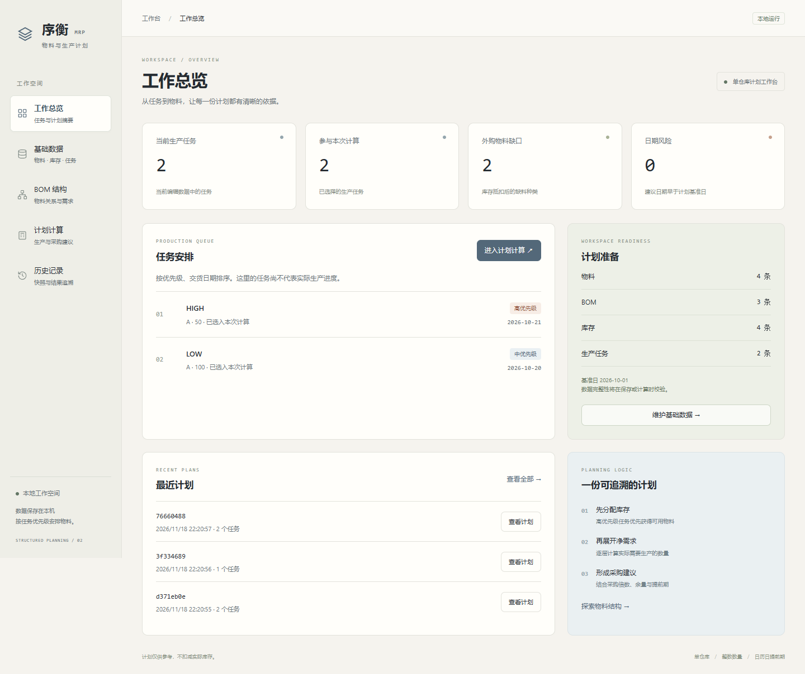

# 物料需求与采购计划系统

软件工程综合实验阶段成果：基于多层物料清单（BOM），计算生产需求、分配共享库存，生成采购建议并识别日期风险。

本仓库保存截至2026-11-18的工作成果，包括应用代码、E1–E5实验材料、原始任务要求、设计图、测试脚本、结果证据和任务计划。最新工作台「序衡 MRP」采用暖白、石墨灰和灰蓝配色，增加可视化解读与数据管理交互。课程最终综合报告与真实小组贡献材料仍需整理。



## 功能

- 维护物料、BOM、库存和生产任务，支持CSV批量导入。
- 按任务优先级、交货日期和任务编号排序分配共享库存。
- 逐层抵扣成品和半成品库存，展开净生产需求，保留需求来源。
- 按物料及需要日期合并采购缺口，处理最小采购量、采购倍数和跨日余量。
- 按日历天倒推生产、采购日期，提示早于计划基准日的风险。
- 保存基础数据版本和独立历史计划，支持五类CSV结果导出。
- 五个工作分区：总览、基础数据、BOM 结构、计划计算、历史记录，支持窄屏布局。
- 基础数据搜索、分类筛选、分页、固定表头与侧边抽屉编辑；保留快速表格编辑模式。
- BOM 树支持根物料切换、节点折叠、库存与净需求详情，遇到循环引用会提示。
- 计算过程展示毛需求、库存抵扣、净需求及采购取整依据，数字可点击追溯 BOM 来源。
- 计划时间轴展示采购、生产与交付日期，标出早于基准日的事件；历史视图使用当时的快照。

系统采用过程式、结构化设计。后端使用Python标准库和SQLite；前端使用原生HTML、CSS与JavaScript。

## 本地运行

安装Python 3.10或更新版本后，在仓库根目录运行：

```powershell
cd material-planning
python web_server.py
```

打开 http://127.0.0.1:8765/ 。应用运行不需要安装额外Python依赖，首次启动会创建本地数据库并提供示例数据。

Windows用户也可双击 `material-planning/启动工作台.cmd`。启动脚本包含原开发环境的Python路径回退；其他电脑建议使用上面的Python命令。

当前工作数据库和缓存不纳入仓库。示例输入、CSV模板、历史测试结果均已保留。

## 成果导航

| 内容 | 入口 |
|---|---|
| 应用说明 | [material-planning/README.md](material-planning/README.md) |
| 需求说明 | [requirements.md](specs/material-requirements-planning/requirements.md) |
| 系统设计 | [design.md](specs/material-requirements-planning/design.md) |
| E1 逻辑模型与数据流图 | [E1](specs/material-requirements-planning/e1/README.md) |
| E2 模块结构设计 | [E2](specs/material-requirements-planning/e2/README.md) |
| E3 详细设计 | [Word报告](specs/material-requirements-planning/e3/E3-detailed-design-en.docx) |
| E4 白盒测试 | [Word报告](specs/material-requirements-planning/e4/E4-white-box-testing-en.docx) |
| E5 黑盒测试 | [Word报告](specs/material-requirements-planning/e5/E5-black-box-testing-en.docx) |
| 新版前端与回归验证 | [2026-11-18验证记录与截图](material-planning/results/refined-ui-2026-11-18/README.md) |
| 界面设计与验收范围 | [界面升级说明](specs/material-requirements-planning/ui-refinement-2026-11-18.md) |
| 全程任务计划 | [任务计划](物料需求与采购计划系统-任务计划-2026-09-24.md) |
| 原始实验要求与综合模板 | [大作业](大作业/) |

## 验证与状态

2026-11-18在独立测试数据库中重新验证浏览器流程：新版界面48项、原工作台30项、保存与历史14项、CSV37项、导航24项，共153/153项断言通过。包含时间轴实际绘制比例、控制台错误、抽屉取消与校验、循环BOM、采购余量、大整数显示、历史隔离和390px布局。断言会有覆盖交集，不代表153条独立需求；详见上方验证记录。

2026-10-26的原105项浏览器记录保留在 [旧版验证目录](material-planning/results/ui-regression-2026-10-26/README.md)。E4/E5完整白盒、HTTP黑盒及性能测试本次未重跑，不将历史结果算作本次验证。

E4、E5的原始记录分别保存在对应实验目录和应用results目录。测试证据包含历史失败、修复前后记录及原始HTTP请求/响应，阅读时请以各报告的结论和执行日期为准。部分浏览器测试与文档生成脚本仍引用原开发电脑的依赖路径，迁移环境时需调整。

目前支持单仓库、整数数量和日历日提前期；计算不会实际扣减库存或自动向供应商下单。时间轴是计划日期展示，不提供设备产能排程。数据搜索针对当前工作区，历史搜索针对已加载记录；数据库保存在本机，GitHub 协作不会同步工作数据库。小组真实分工、评审、个人贡献和最终综合报告应在提交课程作业前继续核对补齐。

仓库中的课程原始文档与模板用于本次实验参考；未对这些材料附加新的开源授权。
