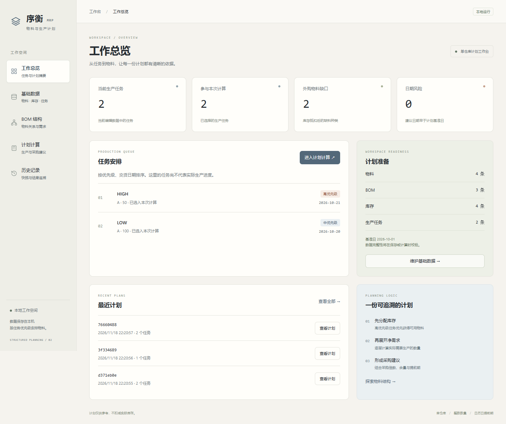

# 序衡 MRP 界面升级与验证（2026-11-18）

本次把深色三分区工作台升级为暖白、石墨灰、灰蓝与鼠尾草绿的五分区管理工作台。业务计算、API和数据库结构保持原实现；新增界面解释直接读取后端真实结果。

## 已完成

| 分区 | 交互与展示 |
| --- | --- |
| 工作总览 | 当前任务与选中数量、优先级队列、计算后的缺料种类与风险、最近计划。未计算或编辑后显示待计算。 |
| 基础数据 | 搜索、类型/优先级筛选、分页、固定表头、状态标签、抽屉编辑与取消、重复编号和数量校验、可选快速编辑。 |
| BOM结构 | 根物料选择、树形展开与折叠、用量与库存、净需求详情、循环提示和展开上限。 |
| 计划计算 | 保留原生产/采购/分配/追溯表和CSV，增加数量依据详情、采购取整说明、可筛选的计划时间轴。 |
| 历史记录 | 已加载记录搜索、快照计算解释与时间轴。当前编辑与历史数据仍独立。 |

## 验证证据

在 Edge 无头浏览器、真实本地 HTTP 服务和独立临时 SQLite 数据库下执行；不操作用户工作数据库。

| 脚本 | 断言通过数 | 原始结果 |
| --- | --- | --- |
| `verify_refined_ui.cjs` | 48/48 | [新版验收](verification.json) |
| `verify_workbench.cjs` | 30/30 | [工作台](regression/workbench-verification.json) |
| `verify_persistence_ui.cjs` | 14/14 | [持久化](regression/persistence-ui-verification.json) |
| `verify_csv_ui.cjs` | 37/37 | [CSV](regression/csv-ui-verification.json) |
| `verify_navigation_ui.cjs` | 24/24 | [导航](regression/navigation-ui-verification.json) |

合计153/153项断言，部分覆盖相同业务路径，不等于153条独立需求。既有测试仅增加进入基础数据与显式快速编辑模式的步骤，保留原业务断言。新增验收同时检查 `pageerror` 和浏览器错误日志。

重点包括：过滤后的编辑行身份、分页、取消不写入、重复编号、自制件采购字段不适用、BOM循环、采购23按10倍数取整为30、后续需求使用余量、早于基准日的高亮、大整数精确显示、历史快照隔离、390px无页面横向溢出。

`before/verification.json` 保留新增功能前的预期失败（旧版首页为基础数据，无总览）。`timeline-before-fix/verification.json` 记录时间轴显示缺陷：服务器现有 CSP 禁止内联 style 属性，导致条形长度被忽略。修复使用脚本设置经过日期计算的数值 CSS 属性，保留原安全策略；新增真实像素比例断言确认5天采购周期在11天轴上的长度，最终控制台无错误。

本次执行 JavaScript 语法检查、Git diff 空白检查，并查看实际桌面与手机截图。未重跑 E4/E5 整套白盒/HTTP黑盒和性能测试；历史报告保持原记录。

## 查看界面



[基础数据](02-data.png) · [BOM结构](03-bom.png) · [计划时间轴](04-planning.png) · [历史记录](05-history.png) · [手机总览](06-mobile.png)

## 复现

运行环境需要 Python 3.10+、Node.js、Playwright和Microsoft Edge。应用本身不需要Node或第三方Python依赖。

```powershell
$env:MRP_PLAYWRIGHT = '你的 Playwright 包绝对路径'
$env:MRP_PYTHON = '你的 python.exe 路径'
$env:MRP_TEST_ARTIFACT_DIR = '新的结果输出目录'
node verify_refined_ui.cjs
```

其他旧脚本仍保留原环境运行路径，跨电脑复现时需调整。汇总与源文件哈希记录在 [summary.json](summary.json)。

时间轴不代表实际进度，也不进行设备产能排程。库存不会实际扣减；工作数据库不会通过GitHub自动同步。
