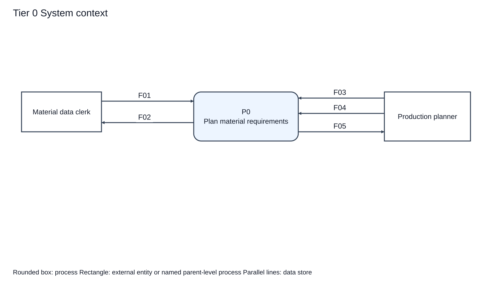
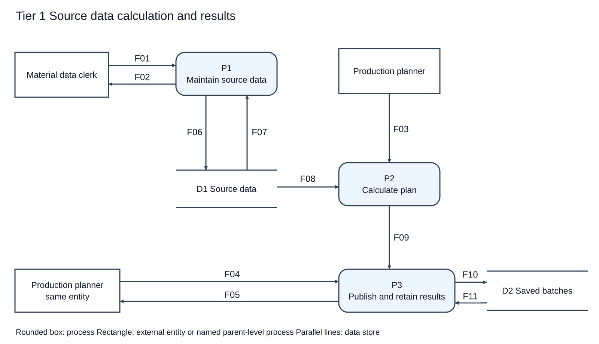
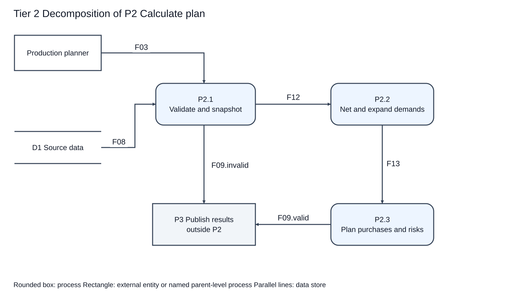
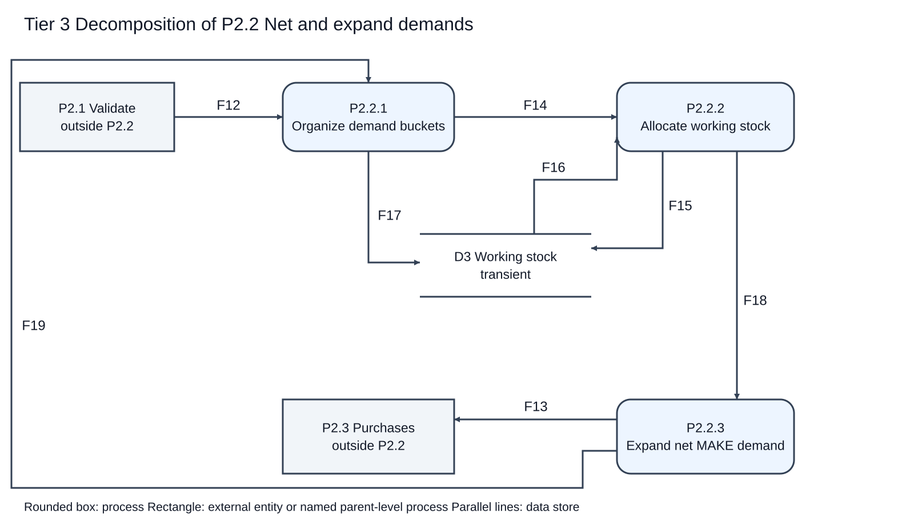

# Material Requirements and Purchasing Plan System

## E1 Developing the Logical Model

Project: Design and Implementation of a Production Requirements and Purchasing Plan System Based on a Multilevel Bill of Materials.

Version 0.2. Prepared 26 September 2026. Group number, member names and student IDs: [TO BE COMPLETED BY THE GROUP]. This is a requirements and logical-model draft for group review. It does not claim that the application has been implemented or that a real group review has occurred.

## 1 Project introduction

A production planner needs to translate finished-product delivery demand into manufacturing and purchasing requirements. A multilevel bill of materials makes manual calculation difficult: existing components reduce lower-level demand, several tasks compete for the same stock, and purchasing rules can create excess quantities. The system will calculate these effects consistently and retain the source of each result.

The intended outcome is a reproducible plan showing net manufacturing quantities, dated purchasing recommendations, inventory allocation and timing risks. The system uses structured analysis, data-flow decomposition and procedural functions. No class hierarchy or object-oriented analysis is required.

## 2 Users and system boundary

The material data clerk maintains materials, BOM relationships, inventory snapshots and task records. The production planner selects tasks, calculates a batch and examines or exports the results. These are logical roles; separate user accounts and permission management are outside the first version.

The first version covers one warehouse, multiple tasks, multilevel MAKE and BUY materials, shared inventory, minimum purchase quantities, purchase multiples, calendar-day lead times, immutable plan batches and CSV exchange. It excludes actual purchase placement, payments, financial accounting, stock posting, transit supply, safety stock, losses, substitute materials, capacity scheduling, supplier comparison and working-day calendars.

A calculation uses a stock snapshot dated at the planning baseline. Its temporary stock balance does not change actual inventory or increase reservations. A date-feasible calculation alone does not prove available production capacity or supplier capability.

## 3 Functional requirements

| ID | Feature | Observable acceptance criterion |
|---|---|---|
| FR01 | Maintain and import source data | Validate required fields, identifiers and values; locate rejected records. |
| FR02 | Select tasks and create a batch | Reject no selection; freeze input and rule snapshots; process priority, due date and ID in that order. |
| FR03 | Validate the reachable BOM | Block unknown references, nonpositive usage, duplicate edges, cycles and incompatible MAKE/BUY structure. |
| FR04 | Explode multilevel net requirements | Explode only net MAKE demand; retain all paths to shared components. |
| FR05 | Allocate shared stock | Allocate existing stock to higher-priority tasks first; keep every balance nonnegative. |
| FR06 | Calculate purchases | Merge dated shortages, use earlier rounding surplus and apply minimums/multiples; no gap means no purchase. |
| FR07 | Derive dates and timing risks | Apply cumulative calendar-day lead times; retain and flag necessary dates before baseline. |
| FR08 | Retain, trace and export results | Save complete batches; show sources and adjustments; CSV matches the selected historical result. |

Eight feature groups are currently defined. The course requires more features than group members and at least one analyzed feature per member. Because group size N is unknown, this numerical condition and individual coverage are not yet verified.

## 4 Business rules

### BR01 Quantities and master data

Quantities are provisionally exact integer units. Task demand and BOM usage must be positive; stock, reserved quantity and lead times are nonnegative. Reserved quantity cannot exceed on-hand stock. BUY minimum defaults to 0 and multiple to 1. Trim IDs, retain case sensitivity and use valid calendar dates. Reject decimal quantities without rounding. Missing reachable stock is a blocking error.

### BR02 BOM validity

Validate the entire graph reachable from selected tasks, including a branch whose current stock would otherwise cover its demand. References must exist and each parent-child pair must be unique. Reject self loops and longer cycles. BUY materials have no children; reachable MAKE materials require a BOM. A blocking error invalidates the whole calculation.

### BR03 Task priority

The user confirmed task priority before delivery date. Sort priority 1, 2, 3, then due date, then ordinal task ID. Thus a later-due high-priority task can receive stock before an earlier-due low-priority task. Input row order must not affect the result. Within one task and material, process earlier demand dates first and merge same-date contributions.

### BR04 Shared stock

Available stock equals on_hand minus reserved. For a demand g and current balance b, allocate min(b,g); the residual is g minus the allocation. All selected tasks share one working balance per material. Start a new run from its own snapshot. Never persist these temporary balances to actual stock.

### BR05 Net manufacturing

Task quantity is provisionally delivery demand, so finished stock may satisfy it. Only the positive residual of a MAKE demand is manufactured and exploded. Child gross demand equals parent net manufacture times BOM usage. Preserve every shared-child contribution; zero net MAKE demand creates no lower-level demand. Manufacturing has no lot-size rounding in this version.

### BR06 Purchasing

Complete existing-stock allocation in task-priority order first. Then aggregate BUY residuals by material and needed date. For each material, process dates earliest first, consume eligible surplus from earlier or same-date planned arrivals, and calculate remaining gap q. If q=0, purchase 0. Otherwise purchase ceil(max(q,minimum)/multiple)*multiple. Retain rounding excess for later dates in this batch only. A later arrival cannot cover an earlier shortage.

### BR07 Dates

Use calendar days. A root is needed on the task due date. MAKE start = needed date minus manufacturing lead time; every direct child of its new manufacture is needed on that start date. BUY order date = arrival needed date minus purchasing lead time. Zero lead time is valid. Preserve separate date buckets and cumulative multilevel lead time.

### BR08 Risks and blocking errors

If a task due date or necessary manufacturing/purchase start is before baseline, retain the computed date and report days before baseline. Equality is allowed. These are risks in an otherwise valid calculation. Invalid data blocks calculation. Do not move dates forward silently or present theoretical surplus as proof of a feasible schedule.

### BR09 History and export

Save all source snapshots, rules, outputs and trace together. Recalculation creates a new batch. Identical inputs and rules give identical business results, apart from batch ID and creation time. Failed persistence must not expose a successful partial batch. Historical queries and export use retained data rather than current source records.

## 5 Additional draft decisions for review

The priority-first rule is confirmed. Integer quantities, treating task quantity as delivery demand, the exact software language and the interface remain provisional. This logical model does not choose a framework.

For deterministic trace within a merged task-material-date bucket, the draft allocates stock to origins in ordinal BOM-path order, then origin ID. When planned excess has several eligible sources, consume earliest arrival first, then ordinal supply bucket ID. These tie-breaks explain trace attribution without changing aggregate net quantities. They require group review alongside the existing business rules.

The draft proposes all-or-nothing validation of each maintenance submission. Failed imports return located errors and commit no part of that submission. Calculation continues to validate the complete selected snapshot, since master data may be maintained in separate submissions.

## 6 Data flow diagrams and process specifications

## Tier 0   System context

| Arrow | Data carried |
|---|---|
| F01 | Maintenance submission |
| F02 | Maintenance outcome |
| F03 | Planning request |
| F04 | Query and export request |
| F05 | Plan response |

## Tier 1   Source data calculation and results

| Arrow | Data carried |
|---|---|
| F01 | Maintenance submission |
| F02 | Maintenance outcome |
| F06 | Accepted source records |
| F07 | Existing source records |
| F08 | Planning source records |
| F03 | Planning request |
| F09 | Calculation outcome |
| F04 | Query and export request |
| F05 | Plan response |
| F10 | Immutable batch record |
| F11 | Historical batch records |

## Tier 2   Decomposition of P2 Calculate plan

| Arrow | Data carried |
|---|---|
| F03 | Planning request |
| F08 | Planning source records |
| F12 | Validated planning context |
| F13 | Net requirements bundle |
| F09.invalid | Calculation outcome (invalid alternative) |
| F09.valid | Calculation outcome (valid alternative) |

## Tier 3   Decomposition of P2.2 Net and expand demands

| Arrow | Data carried |
|---|---|
| F12 | Validated planning context |
| F14 | Allocation candidates |
| F17 | Initial working balances |
| F15 | Working stock updates |
| F16 | Working stock balances |
| F18 | Netted demand records |
| F19 | Child demand records |
| F13 | Net requirements bundle |

## Process specifications

| Process | Name | Transformation | Requirement |
|---|---|---|---|
| P1 | Maintain source data | Check field values, IDs and references; persist accepted source updates; return located errors. | FR01 |
| P2 | Calculate plan | Transform a frozen input snapshot into a valid calculated batch or blocking errors. | FR02-FR07 |
| P3 | Publish and retain results | Save complete valid results atomically; provide history, trace and CSV; report errors. | FR08 |
| P2.1 | Validate and snapshot | Resolve selection, read one consistent revision, validate all reachable data/BOM, fix rules and task order. | FR02, FR03 |
| P2.2 | Net and expand demands | Use batch working stock; net each task's multilevel requirements; keep complete provenance. | FR04, FR05, FR07 |
| P2.3 | Plan purchases and risks | Group BUY residuals by material and date, consume eligible surplus, round quantities and derive dates/risks. | FR06, FR07 |
| P2.2.1 | Organize demand buckets | Initialize D3 once; form roots and merge child requests; retain task order and all source contributions. | FR02, FR04, FR05 |
| P2.2.2 | Allocate working stock | Read current D3, allocate min(balance,gross), update D3, emit residuals and ledger. | FR05 |
| P2.2.3 | Expand net MAKE demand | Generate children only for positive MAKE residuals; retain MAKE rows, BUY residuals and fully satisfied demand trace. | FR04, FR07 |

### Demand organization and termination

P2.2.1 handles one task at a time in the confirmed priority-first order. Within a task, collect every reachable parent contribution before finalizing a shared material. A parent-before-child topological order is a feasible later implementation; it must not depend on input row order. For each material, merge same-date origins and process dates earliest first. P2.2.3 emits child demand data back to P2.2.1, not a control command. Positive MAKE residuals create child demand; BUY or zero residuals do not. Every parent-child expansion follows the validated acyclic graph, and the finite selected task list bounds the computation. F13 denotes the complete accumulated bundle after all selected demand is resolved, not a partial completed plan after each loop iteration.

F12 context is retained inside F14 and F18, so P2.2.3 has the BOM, lead times and identifiers necessary to derive F19 and F13. D3 is temporary calculation state. Initializing F17 again during a task or during child expansion would violate the stock rule.

## Parent child balancing

| Parent | Boundary inputs | Boundary outputs | Child correspondence |
|---|---|---|---|
| P0 -> tier 1 | F01, F03, F04 | F02, F05 | Same entities and directions. D1 and D2 are internal. |
| P2 -> tier 2 | F03, F08 | F09 | P2.1 receives both inputs. F09.invalid plus F09.valid partitions F09; no new outside flow. |
| P2.2 -> tier 3 | F12 | F13 | P2.2.1 receives F12; P2.2.3 emits F13. D3 and F14-F19 are internal. |

A repeated Production planner box in tier 1 represents the same external entity. Boxes explicitly named outside P2 or outside P2.2 are existing parent-level processes, not new users. Context diagram P0 hides internal stores. All 19 base flow IDs have dictionary entries.

## 7 Nonfunctional requirements

| ID | Requirement | Verification criterion |
|---|---|---|
| NFR01 | Correctness | Match the independent expected cases in the requirements examples. |
| NFR02 | Reproducibility | Input row permutation does not change quantities, dates or ownership. |
| NFR03 | Traceability | Every plan quantity links to tasks, demand paths, allocations and rounding. |
| NFR04 | Usability | Errors identify the problematic record and reason; terms remain consistent. |
| NFR05 | Maintainability | Use separate procedural responsibilities for validation, netting, stock, purchases, dates and output. |
| NFR06 | Proposed performance target | Measure a fixed 200-material, 500-edge, 100-task dataset of depth at most 10; target core computation within 10 seconds on a recorded machine. Not yet measured. |
| NFR07 | Integrity | Failed calculations do not alter actual stock; successful saved batches are complete. |

## 8 Independent worked example

All dates in this example are simulated planning data. Baseline is 2026-10-01. Task T001 requires delivery of 100 A on 2026-10-20 with priority 2. A and B are MAKE; C and D are BUY. Lead times are A 2, B 3, C 4 and D 5 calendar days. BOM edges are A to B with usage 2, A to C with usage 3, and B to D with usage 4. On-hand quantities are A 0, B 20, C 50 and D 100; all reserved quantities are 0. BUY minimums are 0 and multiples are 1.

| Material | Gross | Stock allocated | Net make or buy | Needed | Start or order |
|---|---|---|---|---|---|
| A | 100 | 0 | MAKE 100 | 2026-10-20 | 2026-10-18 |
| B | 200 | 20 | MAKE 180 | 2026-10-18 | 2026-10-15 |
| C | 300 | 50 | BUY 250 | 2026-10-18 | 2026-10-14 |
| D | 720 | 100 | BUY 620 | 2026-10-15 | 2026-10-10 |

D gross demand is 180 times 4, because the 20 B already in stock need no new D. If D has minimum 100 and multiple 100, its purchase becomes 700 and planned excess becomes 80. Actual inventory remains unchanged in both cases.

For priority contention, restore the base inputs and use HIGH with A 50, priority 1, due 2026-10-21, and LOW with A 100, priority 2, due 2026-10-20. HIGH receives the existing B 20, C 50 and D 100 first. Its B manufacture is 80, C shortage 100 and D shortage 220. LOW then has B manufacture 200, C shortage 300 and D shortage 800. Combined totals are B manufacture 280, C purchase 400 and D purchase 1020. Later sorting of purchase dates must not reassign existing stock.

For planned surplus, a BUY material with zero stock, minimum 10 and multiple 10 has shortages 23 on October 10 and 7 on October 11. Purchase 30 for October 10; its excess 7 covers October 11, with no further purchase. The same excess cannot cover a shortage on October 9.

## 9 Requirement and verification mapping

| Requirement | Main process | Independent cases |
|---|---|---|
| FR01 | P1 and P2.1 | CASE09 invalid fields, references and import |
| FR02 | P2.1 and P2.2.1 | CASE04 priority; CASE11 deterministic ties |
| FR03 | P2.1 | CASE09 cycles, duplicate edges and structure |
| FR04 | P2.2.1 and P2.2.3 | CASE01 multilevel; CASE07 finished stock and shared paths |
| FR05 | P2.2.2 | CASE04 competing tasks; CASE06 stock boundaries |
| FR06 | P2.3 | CASE03 lot sizes; CASE05 surplus chronology |
| FR07 | P2.2.3 and P2.3 | CASE02 dates; CASE08 boundaries and calendar crossings |
| FR08 | P3 | CASE10 history, trace, reproducibility, export and failed save |

These cases specify expected behavior; they are not application execution evidence. White-box coverage and black-box system testing belong to E4 and E5 after implementation.

## 10 Group task allocation

Complete the table with actual members before submission. Every member must analyze at least one feature. Add rows when needed and verify feature count greater than N.

| Member name and student ID | Assigned feature IDs | Concrete deliverable | Reviewer | Actual completion |
|---|---|---|---|---|
| [TO COMPLETE] | [TO ASSIGN] | [TO COMPLETE] | [TO COMPLETE] | [TO COMPLETE] |
| [TO COMPLETE] | [TO ASSIGN] | [TO COMPLETE] | [TO COMPLETE] | [TO COMPLETE] |
| [TO COMPLETE] | [TO ASSIGN] | [TO COMPLETE] | [TO COMPLETE] | [TO COMPLETE] |

The number of placeholder rows does not represent the group size.

## 11 Group review record

No group review is claimed by this draft. Record the actual meeting date, time, location or channel, attendees, reviewed document version and decisions when the review takes place.

| Review item | Questions for the group | Decision and evidence |
|---|---|---|
| Completeness | Do all required features and selected-task inputs have outputs and error paths? | [TO COMPLETE] |
| Consistency | Do priority, net explosion, dates and procurement match all diagrams and examples? | [TO COMPLETE] |
| Unambiguity | Are integer units, delivery-demand semantics and trace tie-breaks acceptable? | [TO COMPLETE] |
| DFD balance | Do parent and child boundary flows correspond, including F09 alternatives? | [TO COMPLETE] |
| Dictionary | Does every flow and store have a complete definition and correct references? | [TO COMPLETE] |
| Course constraints | Are feature/member counts, English format and submission details satisfied? | [TO COMPLETE] |

Record each actual issue, responsible member, agreed change and closure evidence. Do not fill this section with a fabricated discussion.

## 12 Individual contributions

Each member should provide their actual analyzed features, diagram or dictionary entries, corrections from review and evidence of their work. Use one entry per member: name and ID [TO COMPLETE]; assigned work [TO COMPLETE]; completed work [TO COMPLETE]; review contribution [TO COMPLETE]; evidence [TO COMPLETE].

## 13 Submission readiness

The draft includes project background, eight features, tier 0 through tier 3 DFDs, process specifications, a complete flow dictionary and independent examples. The remaining submission prerequisites are actual group information, reviewed assumptions, real task/contribution records and an all-member review.

Confirm the teacher's current schedule and naming rules. The provided E1 sheet states 25 November 2026, while E2 states 15 October 2026 and repeats an experiment-1 filename. This inconsistency has not been resolved. No FTP upload or final submission has been performed.

## 14 Source documents

The logical model derives from the supplied E1 instructions, the selected project, the user's confirmed priority rule, and requirements.md and examples.md dated 24 September 2026. E2 through E5 and the comprehensive template inform later deliverables but do not imply that implementation, tests or later experiments are complete.

The comprehensive template is a reference example, not evidence of this project's technology stack, personnel or results.

## Appendix A Data dictionary

## Conventions

ID is a nonempty trimmed, case-sensitive string. ID sorting is ordinal and independent of locale. Text is Unicode text. Int is an exact integer; reject decimal quantities rather than rounding. Date is a valid YYYY-MM-DD calendar date. Timestamp is ISO 8601 with a timezone. List[T] is a finite sequence of T. Fields are required unless explicitly nullable. Empty lists are allowed unless otherwise stated. All quantities use the material's fixed unit. No stock row may be assumed to exist with a zero quantity.

## Data flows

| ID | Name | Composition | Source and destination | Validation and meaning |
|---|---|---|---|---|
| F01 | Maintenance submission | MaintenanceSubmission | Data clerk -> P1 | A submitted dataset and its input location; never silently round invalid quantities. |
| F02 | Maintenance outcome | MaintenanceOutcome | P1 -> Data clerk | Accepted record counts or located errors. Proposed import policy: validate the entire submission before committing it. |
| F03 | Planning request | PlanningRequest | Planner -> P2 / P2.1 | Selected task IDs, baseline date and rule version; reject an empty selection. |
| F04 | Query and export request | QueryRequest | Planner -> P3 | A saved batch, optional filters, and VIEW or CSV output mode. |
| F05 | Plan response | PlanResponse | P3 -> Planner | Saved results, history views, export data, or located errors. Never label a failed save as successful. |
| F06 | Accepted source records | SourceSet | P1 -> D1 | Validated source updates. Only maintenance changes source data. |
| F07 | Existing source records | SourceSet | D1 -> P1 | Current records for uniqueness, reference and update checks. |
| F08 | Planning source records | SourceSet | D1 -> P2 / P2.1 | One consistent read of selected tasks and their reachable materials, BOM and stock. |
| F09 | Calculation outcome | CalculationOutcome | P2 / P2.1 / P2.3 -> P3 | Tagged union: INVALID with errors, or VALID with a complete calculated batch. F09.invalid and F09.valid denote its alternatives. |
| F10 | Immutable batch record | BatchRecord | P3 -> D2 | Successful results plus complete input and rule snapshots, written atomically. No actual inventory update. |
| F11 | Historical batch records | List[BatchRecord] | D2 -> P3 | Saved snapshots and matching results used for history, trace and CSV. |
| F12 | Validated planning context | Context | P2.1 -> P2.2 / P2.2.1 | Valid selected data, deterministic task order, initial availability and rule snapshot. |
| F13 | Net requirements bundle | NetBundle | P2.2 / P2.2.3 -> P2.3 | Complete context, net manufacturing requirements, dated BUY shortages, demand provenance and allocation ledger. |
| F14 | Allocation candidates | CandidateEnvelope | P2.2.1 -> P2.2.2 | Context plus ordered, merged task-material-date demand buckets with every contributing source. |
| F15 | Working stock updates | List[Balance] | P2.2.2 -> D3 | Replacement batch balances after allocation; nonnegative and isolated from actual stock. |
| F16 | Working stock balances | List[Balance] | D3 -> P2.2.2 | Current batch balances before allocation, indexed by material. |
| F17 | Initial working balances | List[Balance] | P2.2.1 -> D3 | Available stock initialized once per batch from on_hand minus reserved. |
| F18 | Netted demand records | NettedEnvelope | P2.2.2 -> P2.2.3 | Context, demands with allocation and residual quantities, and their allocation records. |
| F19 | Child demand records | List[Demand] | P2.2.3 -> P2.2.1 | New child requests from positive MAKE residuals; child date equals parent planned start. |

F09.invalid contains the INVALID alternative and F09.valid the VALID alternative of F09. These are partitions of the same parent flow, not additional external interfaces. F12 context is carried inside F14, F18 and F13; their consumers therefore receive the BOM, policies and baseline they need.

## Data stores

| ID | Name | Composition | Access | Lifetime and integrity |
|---|---|---|---|---|
| D1 | Source data | SourceSet | P1 writes; P1 and P2.1 read | Material, BOM, task and inventory data. No planning process writes to this store. |
| D2 | Saved plan batches | List[BatchRecord] | P3 writes and reads | All-or-nothing saved input snapshots and output history. |
| D3 | Working stock | List[Balance] | P2.2.1 initializes; P2.2.2 reads and updates | Transient, private to one calculation; introduced inside P2.2, not a new parent boundary. |

## Record definitions

### Material

| Field | Type | Meaning and constraint |
|---|---|---|
| material_id | ID | Unique material identifier. |
| name | Text | Nonempty display name. |
| supply_type | MAKE or BUY | BUY must be a BOM leaf; reachable MAKE requires a valid BOM. |
| unit | Text | One fixed unit per material; no conversion. |
| lead_time_days | Int >= 0 | Calendar days; zero allowed. |
| min_purchase_qty | Int >= 0 or null | BUY default 0; null for MAKE. |
| purchase_multiple | Int > 0 or null | BUY default 1; null for MAKE. |

### BomEdge

| Field | Type | Meaning and constraint |
|---|---|---|
| parent_id, child_id | ID | References to Material; pair is unique; cannot be equal. |
| qty_per | Int > 0 | Child units needed per newly manufactured parent unit. |

The reachable graph must be acyclic. Reusing a child on multiple paths is valid.

### Stock

| Field | Type | Meaning and constraint |
|---|---|---|
| material_id | ID | Unique within snapshot; references Material. |
| snapshot_date | Date | Must equal the planning baseline. |
| on_hand, reserved | Int >= 0 | reserved <= on_hand; missing reachable stock blocks calculation. |

### Task

| Field | Type | Meaning and constraint |
|---|---|---|
| task_id | ID | Unique task identifier. |
| product_id | ID | References Material. |
| required_qty | Int > 0 | Delivery demand; existing finished stock may satisfy it. |
| due_date | Date | Required delivery date. |
| priority | 1, 2 or 3 | 1 is highest. |
| selected | Boolean | Selection in the planning request determines batch participation. |

### RuleSnapshot

| Field | Type | Meaning and constraint |
|---|---|---|
| version | ID | Immutable identifier for the exact rule set. |
| quantity_mode | INTEGER | Provisional integer quantities, awaiting user confirmation. |
| task_order | Text | priority ASC, due_date ASC, task_id ordinal ASC. |
| calendar_mode | CALENDAR_DAYS | No holiday or weekend adjustment. |
| scope_policy | Text | Single warehouse; no transit supply, safety stock, loss, substitutes or capacity constraints. |
| purchase_policy | Text | Date aggregation, earlier surplus first, then minimum and multiple. |
| attribution_policy | Text | Preserve source quantities and links; deterministic allocation detail as stated in Section 5. |

### SourceSet

| Field | Type | Meaning and constraint |
|---|---|---|
| source_revision | ID | Identifies one consistent dataset revision. |
| materials | List[Material] | Referenced master data. |
| bom | List[BomEdge] | Reachable edges for calculation; submitted/current edges for maintenance. |
| stocks | List[Stock] | Relevant stock snapshot rows. |
| tasks | List[Task] | Relevant tasks. |

### MaintenanceSubmission

| Field | Type | Meaning and constraint |
|---|---|---|
| request_id | ID | Correlates request and response. |
| dataset_kind | MATERIAL / BOM / STOCK / TASK | Submitted dataset. |
| records | List[raw records] | Untrusted field text before conversion to the corresponding record schema. |
| source_name | Text | Form name or import filename. |
| row_locations | List[Text] | Source row/field identifiers retained for error feedback. |

Import/update operations are logical requirements here. Physical file columns and update interfaces are deferred to E2.

### Issue

| Field | Type | Meaning and constraint |
|---|---|---|
| code | ID | Stable error or warning category. |
| severity | BLOCKING or RISK | Input errors block a batch; date risks remain visible in valid results. |
| message | Text | Readable cause. |
| source_location | Text | Dataset, row, field, task or BOM edge. |
| task_id, material_id | ID or null | Relevant identifiers when known. |
| computed_date | Date or null | Required for a date risk; retain the original date. |
| days_before_baseline | Int >= 0 or null | Required for a date risk; strictly positive when flagged. |

### MaintenanceOutcome

| Field | Type | Meaning and constraint |
|---|---|---|
| request_id | ID | Matches submission. |
| status | ACCEPTED or REJECTED | Proposed all-or-nothing submission policy. |
| accepted_count, rejected_count | Int >= 0 | Rejected submission has accepted_count 0. |
| issues | List[Issue] | Located validation issues. |

### PlanningRequest

| Field | Type | Meaning and constraint |
|---|---|---|
| request_id | ID | Correlates computation and response. |
| selected_task_ids | Nonempty List[ID] | Unique, existing IDs; no unselected task consumes stock. |
| baseline_date | Date | Reference for inventory snapshot and date risks. |
| rule_version | ID | Resolves to the retained RuleSnapshot. |

### QueryRequest

| Field | Type | Meaning and constraint |
|---|---|---|
| request_id | ID | Correlates response. |
| batch_id | ID or null | Required for batch detail and export; null for listing history. |
| mode | LIST / VIEW / CSV | Requested representation. |
| task_id, material_id | ID or null | Optional filters; never recompute history from current master data. |

### Context

| Field | Type | Meaning and constraint |
|---|---|---|
| request | PlanningRequest | Original request. |
| sources | SourceSet | Validated immutable calculation snapshot. |
| rules | RuleSnapshot | Exact rules used. |
| ordered_task_ids | List[ID] | Sorted priority first, then due date, then ordinal task ID. |
| initial_balances | List[Balance] | on_hand minus reserved for each reachable material. |

### Balance

| Field | Type | Meaning and constraint |
|---|---|---|
| request_id | ID | Identifies transient calculation scope. |
| material_id | ID | Balance key within that scope. |
| available_qty | Int >= 0 | Current remaining stock, or starting amount in F17. |

### Origin

| Field | Type | Meaning and constraint |
|---|---|---|
| origin_id | ID | Stable identifier within one calculation. |
| task_id | ID | Root task. |
| parent_demand_id | ID or null | Null for root demand; links a child back to its parent. |
| bom_path | List[ID] | Ordered material path from root to this material. |
| contribution_qty | Int > 0 | This path's contribution to the merged demand. |

### Demand

| Field | Type | Meaning and constraint |
|---|---|---|
| demand_id | ID | Unique task-material-date bucket identifier. |
| task_id, material_id | ID | Associated task and material. |
| needed_date | Date | Root due date or immediate parent's start date. |
| gross_qty | Int > 0 | Sum of contributing origin quantities. |
| origins | Nonempty List[Origin] | Retain every path after merging. |

Merge only within the same task, material and date at this stage. Multiple dates remain separate.

### CandidateEnvelope

| Field | Type | Meaning and constraint |
|---|---|---|
| context | Context | Carried through the calculation; does not bypass validation. |
| candidates | List[Demand] | Deterministic demand order; collect all parent contributions before finalizing a material. |

### Allocation

| Field | Type | Meaning and constraint |
|---|---|---|
| allocation_id, demand_id | ID | Allocation record and linked demand. |
| task_id, material_id | ID | Allocation ownership. |
| needed_date | Date | Demand date. |
| before_qty, allocated_qty, after_qty | Int >= 0 | allocated=min(before,gross); after=before-allocated. |
| source_allocations | List[OriginAllocation] | Attribution within merged demand. |

### OriginAllocation

| Field | Type | Meaning and constraint |
|---|---|---|
| origin_id | ID | Contributing path. |
| allocated_qty, residual_qty | Int >= 0 | Their sum equals the origin contribution. |

Proposed trace tie-break: within one task-material-date bucket, sort origins by ordinal BOM path then origin ID before allocating stock. This changes attribution, not the bucket total.

### NettedDemand

| Field | Type | Meaning and constraint |
|---|---|---|
| demand | Demand | Original merged demand. |
| allocated_qty, net_qty | Int >= 0 | gross_qty = allocated_qty + net_qty. |
| source_allocations | List[OriginAllocation] | Preserves attributable residuals for child expansion. |

### NettedEnvelope

| Field | Type | Meaning and constraint |
|---|---|---|
| context | Context | Retained validated data and rules. |
| records | List[NettedDemand] | Demand outcomes. |
| allocations | List[Allocation] | Matching stock ledger records. |

### MakeLine

| Field | Type | Meaning and constraint |
|---|---|---|
| line_id, demand_id | ID | Output and demand linkage. |
| task_id, material_id | ID | Root task and manufactured material. |
| gross_qty, allocated_qty | Int >= 0 | Demand and stock usage. |
| make_qty | Int > 0 | Net manufacture only; zero creates no production line. |
| needed_date, start_date | Date | start_date = needed_date - lead_time_days. |
| origin_ids | List[ID] | Source trace. |

### BuyShortage

| Field | Type | Meaning and constraint |
|---|---|---|
| shortage_id, demand_id | ID | Shortage and demand linkage. |
| task_id, material_id | ID | Source task and BUY material. |
| needed_date | Date | Required availability date. |
| shortage_qty | Int > 0 | Residual after existing stock allocation. |
| origin_ids | List[ID] | Source trace; zero residual creates no shortage row. |

### NetBundle

| Field | Type | Meaning and constraint |
|---|---|---|
| context | Context | Includes baseline, all material policies and original task due dates. |
| demands | List[NettedDemand] | All processed buckets, including zero-net outcomes. |
| allocations | List[Allocation] | Complete allocation ledger. |
| make_lines | List[MakeLine] | Only positive net manufacturing requirements. |
| buy_shortages | List[BuyShortage] | Dated positive BUY residuals. |
| final_balances | List[Balance] | Remaining actual-stock working balances, never written to D1. |

### PurchaseBucket

| Field | Type | Meaning and constraint |
|---|---|---|
| bucket_id, material_id | ID | Unique material-date aggregate. |
| needed_date | Date | Required arrival date. |
| shortage_ids | List[ID] | All source shortages merged for that day. |
| gross_shortage, surplus_used, remaining_gap | Int >= 0 | remaining_gap = gross_shortage - surplus_used. |
| purchase_qty | Int >= 0 | 0 if gap=0; otherwise ceil(max(gap,min)/multiple)*multiple. |
| order_date | Date or null | needed_date - lead time only if purchase_qty > 0. |
| surplus_after | Int >= 0 | Balance after consuming prior surplus and adding current rounding excess. |
| adjustment_reason | Text | No gap, exact requirement, minimum quantity, multiple rounding, or combination. |

Keep a zero-purchase bucket for traceability; display only positive quantities as purchase recommendations.

### SurplusUse

| Field | Type | Meaning and constraint |
|---|---|---|
| supply_bucket_id, demand_bucket_id | ID | Source purchase bucket and consuming dated bucket. |
| qty | Int > 0 | Theoretical rounding surplus transferred. |
| source_arrival_date, use_date | Date | source_arrival_date <= use_date. |

Never treat planned surplus as actual stock or carry it into another batch. Earliest arrival first; same-date ties use ordinal bucket ID.

### CalculatedBatch

| Field | Type | Meaning and constraint |
|---|---|---|
| net_bundle | NetBundle | Full inputs, net demand and allocation trace. |
| purchase_buckets | List[PurchaseBucket] | Date-ordered procurement calculation. |
| surplus_uses | List[SurplusUse] | Trace of planned excess consumption. |
| risks | List[Issue] | RISK entries; task due or necessary start/order date before baseline. |
| summary | Summary | Counts, not sums of unrelated material units. |

### Summary

| Field | Type | Meaning and constraint |
|---|---|---|
| task_count, make_line_count, purchase_line_count, risk_count | Int >= 0 | Purchase line count includes positive purchase quantities only. |

### CalculationOutcome

| Field | Type | Meaning and constraint |
|---|---|---|
| request_id | ID | Correlates F03. |
| status | VALID or INVALID | Discriminator. |
| result | CalculatedBatch or null | Required only for VALID. |
| errors | List[Issue] | Nonempty BLOCKING list for INVALID; result must be null. |

### BatchRecord

| Field | Type | Meaning and constraint |
|---|---|---|
| batch_id | ID | Unique immutable historical identifier. |
| created_at | Timestamp | ISO 8601 time with timezone. |
| result | CalculatedBatch | Entire calculated result, snapshots and rule version retained together. |
| save_status | SAVED | Exposed only after complete successful persistence. |

New calculation creates a new batch. Failed persistence creates no successful historical record.

### PlanResponse

| Field | Type | Meaning and constraint |
|---|---|---|
| request_id | ID | Calculation or query correlation. |
| status | SAVED / VIEW / EXPORTED / REJECTED / SAVE_FAILED / NOT_FOUND | Discriminator; no success response on a failed save. |
| records | List[BatchRecord] | Saved result or requested history; empty on failure. |
| issues | List[Issue] | Located errors or risks. |
| csv | Text or null | UTF-8 CSV representation of selected saved records for EXPORTED. |
| export_columns | List[Text] | Named identifiers, quantities, dates and links for exported detail tables. |

CSV must match the selected immutable batch. Separate tables may be exported for production, purchasing, allocation and provenance.

## Cross record invariants

- Each demand gross quantity equals the sum of its origins and equals allocated plus net quantity.
- Every allocation leaves a nonnegative balance. Per material, initial balance minus all allocations equals final balance.
- Only positive MAKE net quantities generate child requests; child contribution equals attributable parent net times BOM usage.
- Purchase buckets merge across tasks only after priority allocation of existing stock has finished.
- Surplus transfer dates never run backwards; each source bucket's rounding excess cannot be consumed more than once.
- Batch snapshots, rules, details, trace links and summary are saved together or no successful batch is exposed.
- Every reference in a saved result resolves within its retained snapshot and trace. Quantities from different material units are never combined as a meaningful purchase total.
