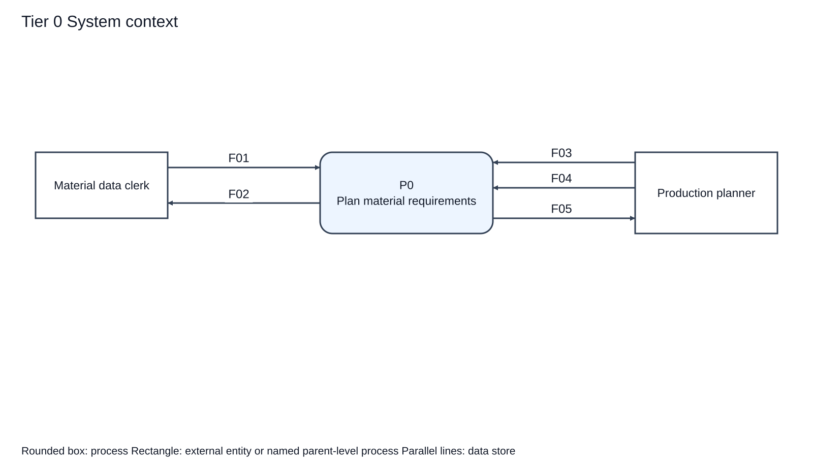
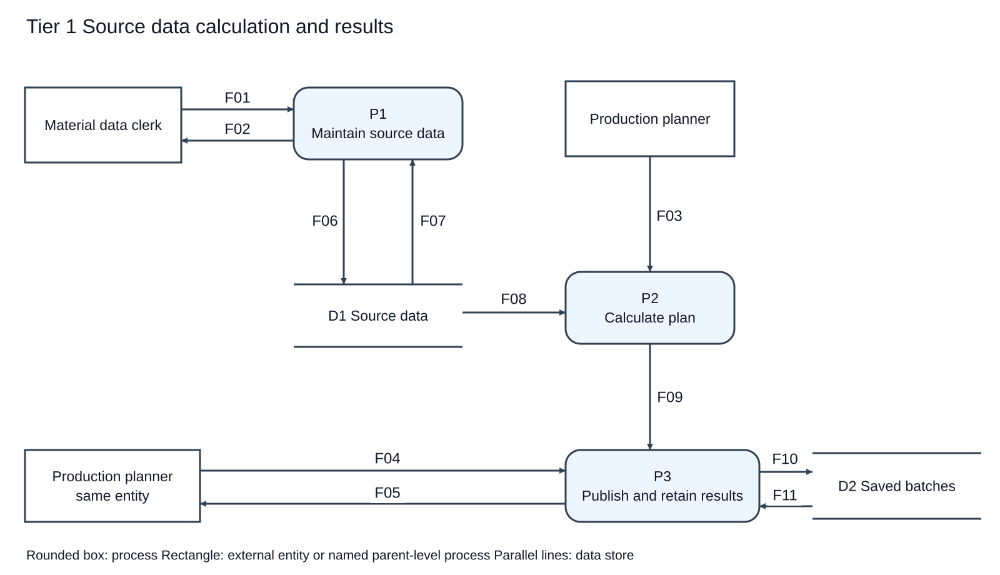
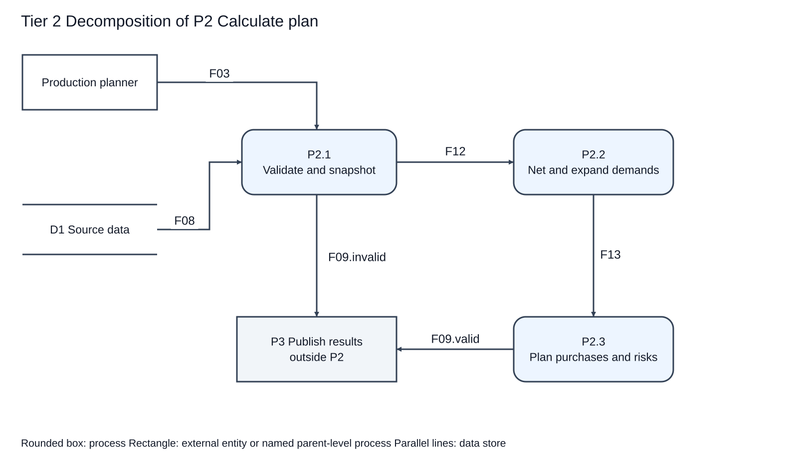
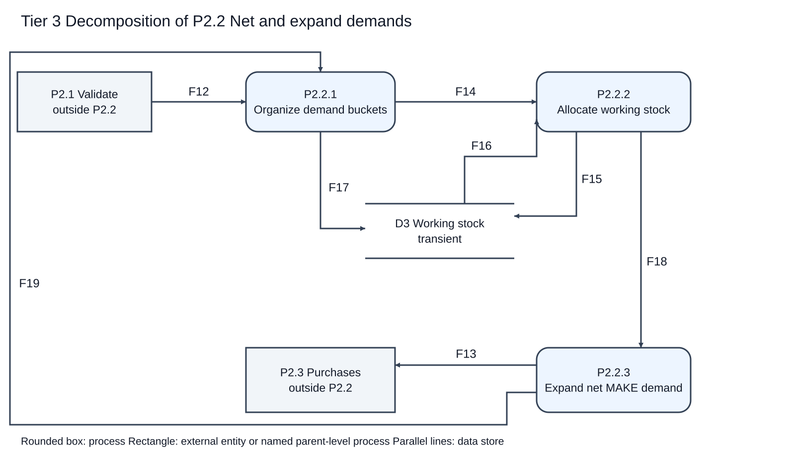

# E1 Data Flow Model

Version 0.2, 26 September 2026. Tier 0 is the context diagram; tier 1 decomposes P0; tier 2 decomposes P2; tier 3 decomposes P2.2. Other processes remain at this E1 level and can be refined in E2. A DFD models data transformation, not execution-control arrows or class relationships.

## Tier 0   System context

| Arrow | Data carried |
|---|---|
| F01 | Maintenance submission |
| F02 | Maintenance outcome |
| F03 | Planning request |
| F04 | Query and export request |
| F05 | Plan response |

## Tier 1   Source data calculation and results

| Arrow | Data carried |
|---|---|
| F01 | Maintenance submission |
| F02 | Maintenance outcome |
| F06 | Accepted source records |
| F07 | Existing source records |
| F08 | Planning source records |
| F03 | Planning request |
| F09 | Calculation outcome |
| F04 | Query and export request |
| F05 | Plan response |
| F10 | Immutable batch record |
| F11 | Historical batch records |

## Tier 2   Decomposition of P2 Calculate plan

| Arrow | Data carried |
|---|---|
| F03 | Planning request |
| F08 | Planning source records |
| F12 | Validated planning context |
| F13 | Net requirements bundle |
| F09.invalid | Calculation outcome (invalid alternative) |
| F09.valid | Calculation outcome (valid alternative) |

## Tier 3   Decomposition of P2.2 Net and expand demands

| Arrow | Data carried |
|---|---|
| F12 | Validated planning context |
| F14 | Allocation candidates |
| F17 | Initial working balances |
| F15 | Working stock updates |
| F16 | Working stock balances |
| F18 | Netted demand records |
| F19 | Child demand records |
| F13 | Net requirements bundle |

## Process specifications

| Process | Name | Transformation | Requirement |
|---|---|---|---|
| P1 | Maintain source data | Check field values, IDs and references; persist accepted source updates; return located errors. | FR01 |
| P2 | Calculate plan | Transform a frozen input snapshot into a valid calculated batch or blocking errors. | FR02-FR07 |
| P3 | Publish and retain results | Save complete valid results atomically; provide history, trace and CSV; report errors. | FR08 |
| P2.1 | Validate and snapshot | Resolve selection, read one consistent revision, validate all reachable data/BOM, fix rules and task order. | FR02, FR03 |
| P2.2 | Net and expand demands | Use batch working stock; net each task's multilevel requirements; keep complete provenance. | FR04, FR05, FR07 |
| P2.3 | Plan purchases and risks | Group BUY residuals by material and date, consume eligible surplus, round quantities and derive dates/risks. | FR06, FR07 |
| P2.2.1 | Organize demand buckets | Initialize D3 once; form roots and merge child requests; retain task order and all source contributions. | FR02, FR04, FR05 |
| P2.2.2 | Allocate working stock | Read current D3, allocate min(balance,gross), update D3, emit residuals and ledger. | FR05 |
| P2.2.3 | Expand net MAKE demand | Generate children only for positive MAKE residuals; retain MAKE rows, BUY residuals and fully satisfied demand trace. | FR04, FR07 |

### Demand organization and termination

P2.2.1 handles one task at a time in the confirmed priority-first order. Within a task, collect every reachable parent contribution before finalizing a shared material. A parent-before-child topological order is a feasible later implementation; it must not depend on input row order. For each material, merge same-date origins and process dates earliest first. P2.2.3 emits child demand data back to P2.2.1, not a control command. Positive MAKE residuals create child demand; BUY or zero residuals do not. Every parent-child expansion follows the validated acyclic graph, and the finite selected task list bounds the computation. F13 denotes the complete accumulated bundle after all selected demand is resolved, not a partial completed plan after each loop iteration.

F12 context is retained inside F14 and F18, so P2.2.3 has the BOM, lead times and identifiers necessary to derive F19 and F13. D3 is temporary calculation state. Initializing F17 again during a task or during child expansion would violate the stock rule.

## Parent child balancing

| Parent | Boundary inputs | Boundary outputs | Child correspondence |
|---|---|---|---|
| P0 -> tier 1 | F01, F03, F04 | F02, F05 | Same entities and directions. D1 and D2 are internal. |
| P2 -> tier 2 | F03, F08 | F09 | P2.1 receives both inputs. F09.invalid plus F09.valid partitions F09; no new outside flow. |
| P2.2 -> tier 3 | F12 | F13 | P2.2.1 receives F12; P2.2.3 emits F13. D3 and F14-F19 are internal. |

A repeated Production planner box in tier 1 represents the same external entity. Boxes explicitly named outside P2 or outside P2.2 are existing parent-level processes, not new users. Context diagram P0 hides internal stores. All 19 base flow IDs have dictionary entries.
