# Module Design of the Material Requirements and Purchasing Plan System

## E2 Developing Module Structure Diagrams

Version 0.1, 26 September 2026. Group number, member names and student IDs: [TO COMPLETE]. This draft continues E1 version 0.2 using structured analysis and procedural decomposition.

The design divides the project into six business subsystems. It supplies a refined DFD and a corresponding module structure chart for every subsystem, plus an overall call chart and a P2.3 decomposition bridge. Each final DFD process has a named procedure and an explicit data contract. The system has not yet been implemented.

## 1 Scope and course requirements

The supplied E2 document asks for refined DFDs, module structure diagrams, member tasks, actual all-member review records and individual contributions, all in English. Subsystem and subsystem-chart counts must each be at least group size N. Six subsystems and six corresponding charts satisfy those two counts only if N is at most 6. N is still unknown; no unconditional compliance claim is made. If N is larger, split genuine responsibilities and regenerate both DFDs and module charts, rather than counting the overview as another subsystem.

The E2 sheet states 15 October 2026 and repeats an experiment-1 filename. Confirm the teacher's naming and schedule before final submission. This draft is not an FTP submission and does not contain invented group meetings.

## 2 Preserved requirements and decisions

Task priority remains first: priority, due date, then ordinal task ID. All tasks share one batch stock balance. Only net MAKE demand creates child requirements. Procurement runs after stock allocation and groups shortages by material/date, consumes earlier planned surplus and applies minimum/multiple rules. Dates use calendar days; history and calculation do not modify actual inventory.

Integer quantities, interpreting task quantity as delivery demand, ordinal origin attribution and all-or-nothing source imports remain the E1 draft assumptions. The language, database product and UI are still provisional. Plain records and function adapters are sufficient; no classes, inheritance or object-oriented modeling are introduced.

## 3 Subsystems and module structure

The system has six business subsystems and one application coordinator. Seven structure charts are supplied: one overview and six subsystem charts. Each rectangular module denotes a callable procedure. Solid downward arrows mean calls; dashed arrows call a shared procedure owned elsewhere. REPEAT marks calls repeated over tasks/materials/dates; CONDITIONAL marks error or selected-mode branches. These are hierarchical module charts, not data-flow diagrams.

I/Mxx and O/Mxx beside a call identify its data couples: the Inputs and Returns fields of module Mxx in interfaces.md. The returned Result tag, query mode and supply type are control information described in the coupling tables below. The interface table provides the full data names so abbreviated edge labels are unambiguous. The dotted ownership link to M52 is explicitly not a call.

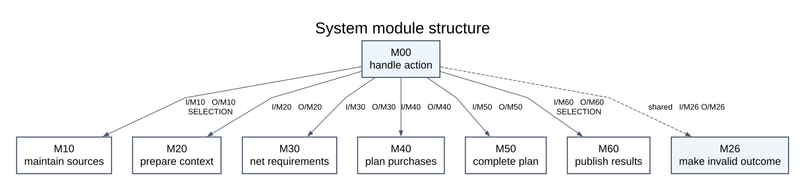

| Subsystem | Responsibility | Entry procedure | Requirements | E1 process |
|---|---|---|---|---|
| S1 | Source maintenance | maintain_sources | FR01 | P1 |
| S2 | Snapshot and BOM validation | prepare_context | FR02, FR03 | P2.1 |
| S3 | Demand and shared inventory | net_requirements | FR04, FR05 | P2.2 |
| S4 | Purchasing and planned surplus | plan_purchases | FR06 | Purchasing part of P2.3 |
| S5 | Calendar and timing risk | complete_plan | FR07 | Risk part of P2.3; shared calendar helper |
| S6 | History trace and export | publish_results | FR08 | P3 |

## S1 Source maintenance

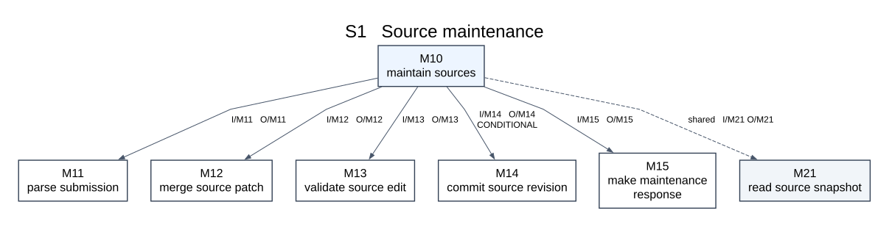

| Call | Control condition | Input data couple | Return data couple |
|---|---|---|---|
| M10 -> M11 | call | MaintenanceSubmission | Result[TypedImport] |
| M10 -> M12 | call | SourceSet, TypedImport | SourceSet |
| M10 -> M13 | call | SourceSet candidate, TypedImport | List[Issue] |
| M10 -> M14 | conditional | repository, expected_revision, SourceSet candidate | Result[revision_id] |
| M10 -> M15 | call | request_id, accepted_count, List[Issue], commit_result | MaintenanceOutcome |
| M10 -> M21 | shared | repository, baseline_date or null | Result[SourceSet] |

## S2 Snapshot and BOM validation

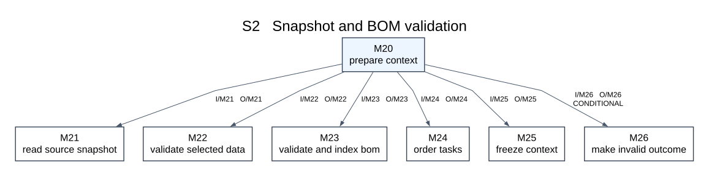

| Call | Control condition | Input data couple | Return data couple |
|---|---|---|---|
| M20 -> M21 | call | repository, baseline_date or null | Result[SourceSet] |
| M20 -> M22 | call | PlanningRequest, SourceSet, RuleSnapshot | List[Issue] |
| M20 -> M23 | call | SourceSet, selected_task_ids | Result[GraphIndex] |
| M20 -> M24 | call | List[Task], selected_task_ids | List[Task] |
| M20 -> M25 | call | request, sources, rules, ordered_tasks, GraphIndex | PreparedContext |
| M20 -> M26 | conditional | request_id, nonempty List[Issue] | CalculationOutcome |

## S3 Demand and shared inventory

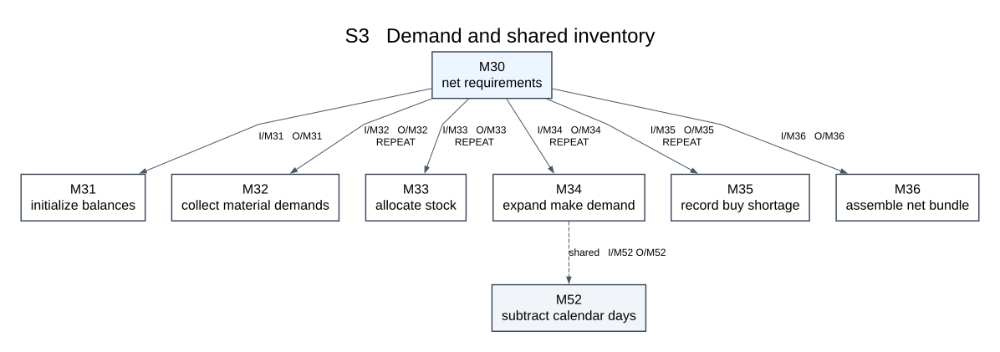

| Call | Control condition | Input data couple | Return data couple |
|---|---|---|---|
| M30 -> M31 | call | request_id, List[Stock] | BalanceMap |
| M30 -> M32 | repeat | task_id, material_id, DemandMap | List[Demand] |
| M30 -> M33 | repeat | Demand, Balance | AllocationResult |
| M30 -> M34 | repeat | NettedDemand, Material, child_edges | Result[MakeExpansion] |
| M30 -> M35 | repeat | NettedDemand, Material | BuyShortage or null |
| M30 -> M36 | call | Context, netted_demands, allocations, make_lines, shortages, final_balances | Result[NetBundle] |
| M34 -> M52 | shared | Date needed_date, Int >= 0 lead_days | Result[Date] |

## S4 Purchasing and planned surplus

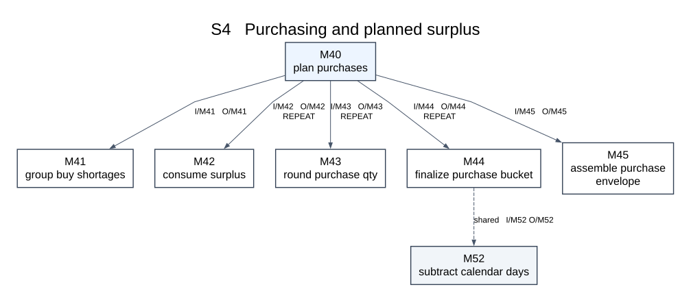

| Call | Control condition | Input data couple | Return data couple |
|---|---|---|---|
| M40 -> M41 | call | List[BuyShortage] | List[ShortageGroup] |
| M40 -> M42 | repeat | ShortageGroup, List[SurplusLot] | SurplusAllocation |
| M40 -> M43 | repeat | remaining_gap, minimum_qty, purchase_multiple | Int >= 0 |
| M40 -> M44 | repeat | ShortageGroup, SurplusAllocation, purchase_qty, Material | Result[PurchaseStep] |
| M40 -> M45 | call | NetBundle, purchase_buckets, surplus_uses, surplus_lots | Result[PurchasingEnvelope] |
| M44 -> M52 | shared | Date needed_date, Int >= 0 lead_days | Result[Date] |

## S5 Calendar and timing risk

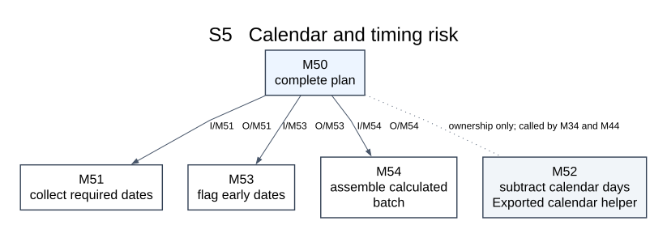

| Call | Control condition | Input data couple | Return data couple |
|---|---|---|---|
| M50 -> M51 | call | PurchasingEnvelope | List[DatedEvent] |
| M50 -> M53 | call | List[DatedEvent], baseline_date | List[Issue] |
| M50 -> M54 | call | PurchasingEnvelope, List[Issue] risks | CalculatedBatch |

## S6 History trace and export

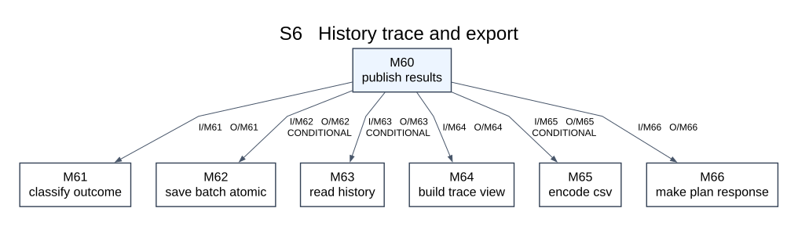

| Call | Control condition | Input data couple | Return data couple |
|---|---|---|---|
| M60 -> M61 | call | CalculationOutcome | Result[CalculatedBatch] |
| M60 -> M62 | conditional | CalculatedBatch, repository, batch_id, created_at | Result[BatchRecord] |
| M60 -> M63 | conditional | QueryRequest, repository | Result[List[BatchRecord]] |
| M60 -> M64 | call | List[BatchRecord], filters | Result[ReportView] |
| M60 -> M65 | conditional | ReportView, table_kind | CsvDocument |
| M60 -> M66 | call | request_id, outcome_status, saved_records, view, csv, issues | PlanResponse |

## Transformation from E1

The overall calculation is a transformation sequence: validate and freeze inputs, net multilevel demand against shared stock, calculate dated purchasing, assess risks, then retain and present the result. M00 controls this sequence; modules do not call each other's top-level controllers. Task-priority stock allocation and date-ordered procurement therefore have distinct owners.

M30 owns D3 working stock; M40 owns D4 planned surplus. Neither writes D1. M14 exclusively commits master-data revisions; M62 exclusively commits D2 batches. M21 and M63 read their respective stores. Calendar subtraction M52 is shared by M34 and M44 so lead-time behavior is consistent. M50 calls risk procedures, not M52 redundantly.

## Cohesion and coupling review

S1 is cohesive around accepted data changes; S2 around valid immutable calculation input; S3 around net demand and stock; S4 around procurement quantities and excess; S5 around dates and complete risk results; S6 around retained output. Narrow leaf interfaces such as M33 and M43 take only the data needed. Aggregate Context/NetBundle carriers belong at coordinator boundaries, rather than mutable global state. Storage and presentation dependencies do not enter the pure arithmetic functions.

Cross-subsystem calls are M10 to read-only M21, M34/M44 to pure M52, and M00 to the M26 failure-outcome formatter. There is no controller call cycle. Sharing a date helper does not create an object hierarchy or make the entire risk subsystem a dependency of quantity calculation.

## 4 Refined logical models

All six selected subsystems have a refined DFD. The additional bridge explains the decomposition of E1 P2.3 into S4 and S5. Rounded processes transform data; gray rectangles denote external entities or parent-level boundaries; gold store boxes marked D1-D4 denote stores. Arrows carry records, not calls. Each final primitive process maps to one procedure. E1 F01-F19 retain their established definitions.

## S1   Refined source maintenance

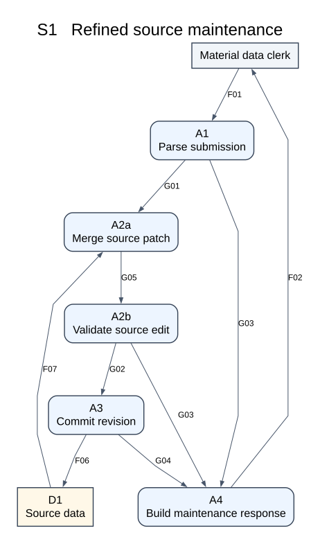

| Primitive process | Mapped procedure |
|---|---|
| A1 Parse submission | M11 parse_submission |
| A2a Merge source patch | M12 merge_source_patch |
| A2b Validate source edit | M13 validate_source_edit |
| A3 Commit revision | M14 commit_source_revision |
| A4 Build maintenance response | M15 make_maintenance_response |

| Flow | Meaning | Record type |
|---|---|---|
| F01 | Maintenance submission | MaintenanceSubmission |
| F07 | Existing source records | SourceSet |
| G01 | Typed submission | TypedImport |
| G03 | Located maintenance errors | List[Issue] |
| G02 | Validated source candidate | SourceSet |
| F06 | Accepted source records | SourceSet |
| G04 | Maintenance commit result | CommitResult |
| F02 | Maintenance outcome | MaintenanceOutcome |
| G05 | Merged source candidate | EditWork |

## S2   Refined snapshot and BOM validation

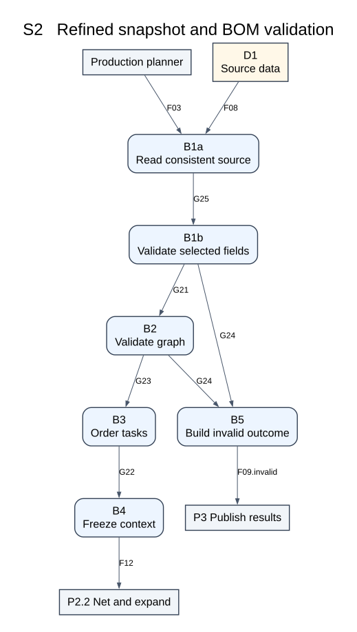

| Primitive process | Mapped procedure |
|---|---|
| B1a Read consistent source | M21 read_source_snapshot |
| B1b Validate selected fields | M22 validate_selected_data |
| B2 Validate graph | M23 validate_and_index_bom |
| B3 Order tasks | M24 order_tasks |
| B4 Freeze context | M25 freeze_context |
| B5 Build invalid outcome | M26 make_invalid_outcome |

| Flow | Meaning | Record type |
|---|---|---|
| F03 | Planning request | PlanningRequest |
| F08 | Planning source records | SourceSet |
| G21 | Selected snapshot envelope | ValidationEnvelope |
| G24 | Planning validation errors | List[Issue] |
| G23 | Validated graph envelope | ValidationEnvelope |
| G22 | Ordered task envelope | ValidationEnvelope |
| F12 | Validated planning context | Context |
| F09.invalid | Calculation outcome | CalculationOutcome |
| G25 | Consistent request snapshot | ValidationEnvelope |

## S3   Refined multilevel demand and stock

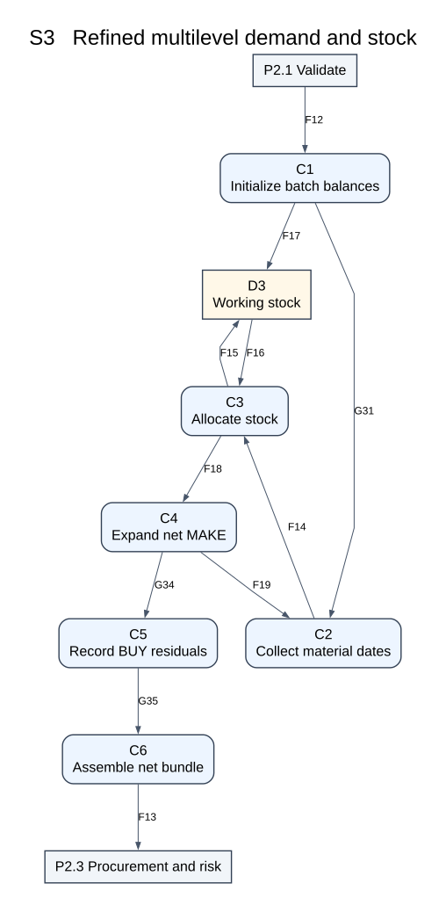

| Primitive process | Mapped procedure |
|---|---|
| C1 Initialize batch balances | M31 initialize_balances |
| C2 Collect material dates | M32 collect_material_demands |
| C3 Allocate stock | M33 allocate_stock |
| C4 Expand net MAKE | M34 expand_make_demand |
| C5 Record BUY residuals | M35 record_buy_shortage |
| C6 Assemble net bundle | M36 assemble_net_bundle |

| Flow | Meaning | Record type |
|---|---|---|
| F12 | Validated planning context | Context |
| F17 | Initial working balances | List[Balance] |
| G31 | Initialized netting state | NettingState |
| F14 | Allocation candidates | CandidateEnvelope |
| F16 | Working stock balances | List[Balance] |
| F15 | Working stock updates | List[Balance] |
| F18 | Netted demand records | NettedEnvelope |
| F19 | Child demand records | List[Demand] |
| G34 | Manufacturing expansion | ExpansionResult |
| G35 | Completed netting state | NettingState |
| F13 | Net requirements bundle | NetBundle |

## S4   Refined purchasing and surplus

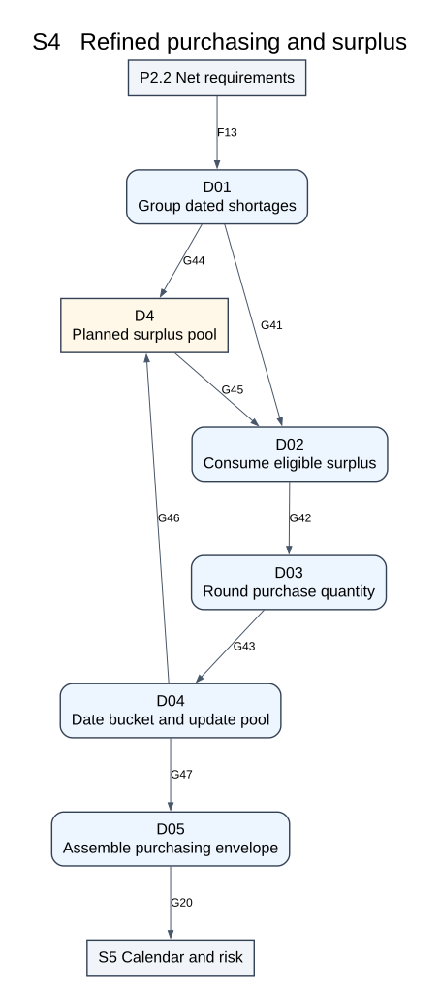

| Primitive process | Mapped procedure |
|---|---|
| D01 Group dated shortages | M41 group_buy_shortages |
| D02 Consume eligible surplus | M42 consume_surplus |
| D03 Round purchase quantity | M43 round_purchase_qty |
| D04 Date bucket and update pool | M44 finalize_purchase_bucket |
| D05 Assemble purchasing envelope | M45 assemble_purchase_envelope |

| Flow | Meaning | Record type |
|---|---|---|
| F13 | Net requirements bundle | NetBundle |
| G44 | Empty planned surplus pool | List[SurplusLot] |
| G41 | Date grouped shortage envelope | PurchaseWork |
| G45 | Available planned surplus lots | List[SurplusLot] |
| G42 | Surplus adjusted shortage | PurchaseWork |
| G43 | Rounded purchasing quantity | PurchaseWork |
| G46 | Updated planned surplus lots | List[SurplusLot] |
| G47 | Accumulated procurement records | PurchaseWork |
| G20 | Purchasing envelope | PurchasingEnvelope |

## S5   Refined timing risk and completed result

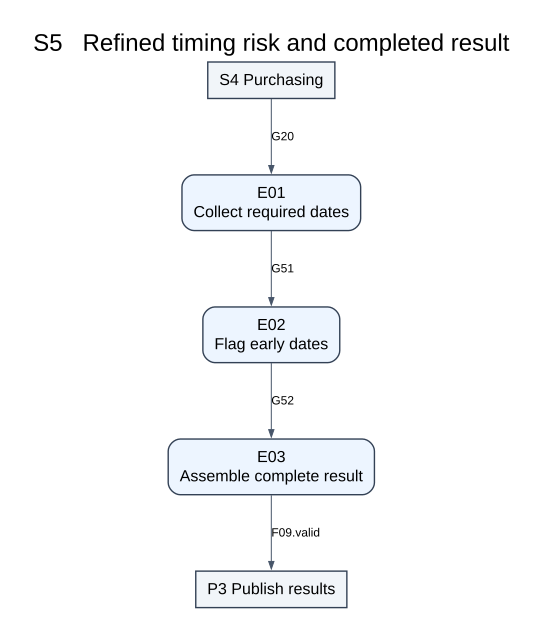

| Primitive process | Mapped procedure |
|---|---|
| E01 Collect required dates | M51 collect_required_dates |
| E02 Flag early dates | M53 flag_early_dates |
| E03 Assemble complete result | M54 assemble_calculated_batch |

| Flow | Meaning | Record type |
|---|---|---|
| G20 | Purchasing envelope | PurchasingEnvelope |
| G51 | Required dates and retained calculation | RiskWork |
| G52 | Assessed dates and retained calculation | RiskWork |
| F09.valid | Calculation outcome | CalculationOutcome |

## S6   Refined history trace and export

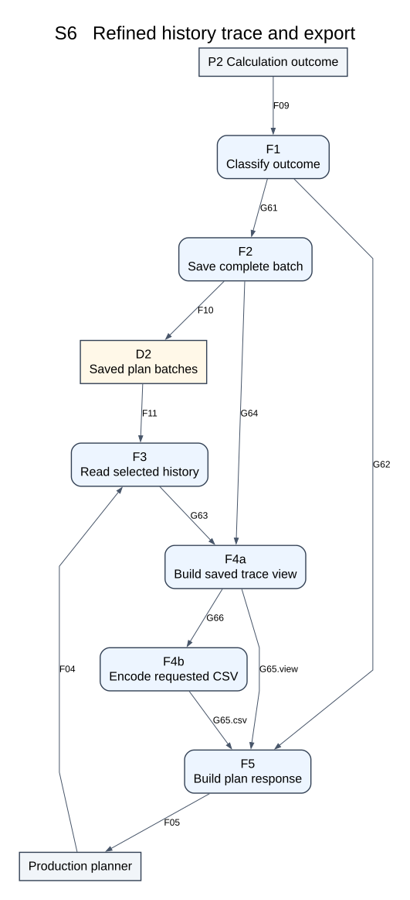

| Primitive process | Mapped procedure |
|---|---|
| F1 Classify outcome | M61 classify_outcome |
| F2 Save complete batch | M62 save_batch_atomic |
| F3 Read selected history | M63 read_history |
| F4a Build saved trace view | M64 build_trace_view |
| F4b Encode requested CSV | M65 encode_csv |
| F5 Build plan response | M66 make_plan_response |

| Flow | Meaning | Record type |
|---|---|---|
| F09 | Calculation outcome | CalculationOutcome |
| F04 | Query and export request | QueryRequest |
| G61 | Accepted calculated result | CalculatedBatch |
| G62 | Rejected outcome issues | List[Issue] |
| F10 | Immutable batch record | BatchRecord |
| F11 | Historical batch records | List[BatchRecord] |
| G64 | Committed batch record | BatchRecord |
| G63 | Loaded batch records | List[BatchRecord] |
| G65.csv | View and CSV data | PresentationWork |
| F05 | Plan response | PlanResponse |
| G66 | Prepared report view | PresentationWork |
| G65.view | View and CSV data | PresentationWork |

## P2.3   Purchasing and risk decomposition

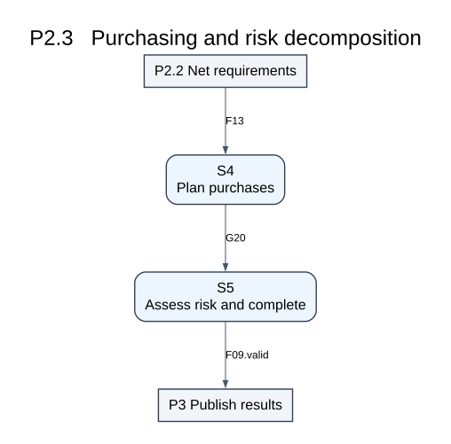

| Primitive process | Mapped procedure |
|---|---|
| S4 Plan purchases | M40 plan_purchases |
| S5 Assess risk and complete | M50 complete_plan |

| Flow | Meaning | Record type |
|---|---|---|
| F13 | Net requirements bundle | NetBundle |
| G20 | Purchasing envelope | PurchasingEnvelope |
| F09.valid | Calculation outcome | CalculationOutcome |

## Iteration and retained data

In S3, C1 initializes stock once. M30 processes a complete task before the next task and waits for all parents before finalizing a shared material. C2 groups same-date requests; C3 nets them; C4 creates children from positive MAKE residuals only. C5 retains BUY residuals and forwards accumulated state; C6 emits F13 only after the entire run. Zero-net records remain in trace. G34 explicitly retains the original netted record so BUY requirements are not lost on the MAKE path.

In S4, D01 initializes an empty D4 pool once per run. Each material/date consumes prior eligible surplus, rounds the remaining gap, and updates D4. D05 emits G20 only after every dated group is processed. D4 is not physical stock. It is internal to the refinement of P2.3 and never adds an external parent input.

S6 has an explicit optional conversion branch: F4a sends VIEW/LIST data directly to F5 through G65.view; CSV goes through F4b/M65 and G65.csv. Both flows are alternatives of the same PresentationWork record. The call chart records this selection. Commit and read failures are propagated to F05 by M60/M66; successful G64 exists only after a full commit.

Unchanged context carried along a DFD flow is retained by its coordinator; a leaf function consumes only its documented slice and returns the transformed data. This pass-through convention explains the difference between a complete logical flow envelope and a narrow procedure signature. For example C1 returns BalanceMap while M30 carries forward the received Context in G31. F12 remains the E1 Context; the graph index in PreparedContext is derived from that same BOM, not a new external input.

The reusable calendar function M52 implements the date transformation inside C4/D04. It is shown in module charts and does not require an additional business data-flow boundary.

## Added internal flow dictionary

| ID | Data | Type |
|---|---|---|
| G01 | Typed submission | TypedImport |
| G02 | Validated source candidate | SourceSet |
| G03 | Located maintenance errors | List[Issue] |
| G04 | Maintenance commit result | CommitResult |
| G21 | Selected snapshot envelope | ValidationEnvelope |
| G22 | Ordered task envelope | ValidationEnvelope |
| G23 | Validated graph envelope | ValidationEnvelope |
| G24 | Planning validation errors | List[Issue] |
| G31 | Initialized netting state | NettingState |
| G34 | Manufacturing expansion | ExpansionResult |
| G35 | Completed netting state | NettingState |
| G41 | Date grouped shortage envelope | PurchaseWork |
| G42 | Surplus adjusted shortage | PurchaseWork |
| G43 | Rounded purchasing quantity | PurchaseWork |
| G44 | Empty planned surplus pool | List[SurplusLot] |
| G45 | Available planned surplus lots | List[SurplusLot] |
| G46 | Updated planned surplus lots | List[SurplusLot] |
| G47 | Accumulated procurement records | PurchaseWork |
| G20 | Purchasing envelope | PurchasingEnvelope |
| G51 | Required dates and retained calculation | RiskWork |
| G52 | Assessed dates and retained calculation | RiskWork |
| G61 | Accepted calculated result | CalculatedBatch |
| G62 | Rejected outcome issues | List[Issue] |
| G63 | Loaded batch records | List[BatchRecord] |
| G64 | Committed batch record | BatchRecord |
| G65 | View and CSV data | PresentationWork |
| G05 | Merged source candidate | EditWork |
| G25 | Consistent request snapshot | ValidationEnvelope |
| G66 | Prepared report view | PresentationWork |

Envelope fields are defined in interfaces.md. F09.valid and F09.invalid are alternatives of F09. Parent/child balance compares their union, never treats them as unrelated flows.

## 5 Procedure contracts

Version 0.1, 26 September 2026. Signatures are language-neutral and describe plain records, sequences and functions. They do not mandate classes, Python or a UI framework.

## Error and state conventions

All calculation data is passed explicitly. Pure functions do not read the database or mutate caller-owned input. Coordinators install returned values into private state. Result[T] carries either a value or located issues. INVALID input, DATE_RANGE, SOURCE_CONFLICT, STORAGE_READ_FAILED, STORAGE_WRITE_FAILED and NOT_FOUND cannot produce a saved successful batch. Unexpected technical failures abort the coordinator and are converted through the existing outer response interface; DFDs show business data paths rather than every infrastructure exception.

RuleSnapshot is the documented supported configuration supplied by the application entry point. Request rule_version must match it; downstream functions receive it through Context rather than reading a mutable global.

## S1 Source maintenance

### M10 maintain_sources

| Contract | Definition |
|---|---|
| Inputs | MaintenanceSubmission, repository |
| Returns | MaintenanceOutcome |
| State and I/O | Coordinator |
| Behavior | Read current revision; parse, merge and validate one submission; commit only a fully accepted candidate. |

### M11 parse_submission

| Contract | Definition |
|---|---|
| Inputs | MaintenanceSubmission |
| Returns | Result[TypedImport] |
| State and I/O | Pure |
| Behavior | Parse required fields without rounding, preserve row locations, reject duplicate input keys and unknown columns where policy requires. |

### M12 merge_source_patch

| Contract | Definition |
|---|---|
| Inputs | SourceSet, TypedImport |
| Returns | SourceSet |
| State and I/O | Pure |
| Behavior | Apply explicit upserts to a copy. Stock upserts identify both snapshot date and material. No implicit deletion or mutation of the original. |

### M13 validate_source_edit

| Contract | Definition |
|---|---|
| Inputs | SourceSet candidate, TypedImport |
| Returns | List[Issue] |
| State and I/O | Pure |
| Behavior | Check uniqueness, referenced IDs, integer/date domains and stock bounds. Detect incompatible BUY edges and cycles in changed BOM; full selected MAKE completeness is checked in S2. |

### M14 commit_source_revision

| Contract | Definition |
|---|---|
| Inputs | repository, expected_revision, SourceSet candidate |
| Returns | Result[revision_id] |
| State and I/O | Writes D1 atomically |
| Behavior | In one transaction create an immutable revision, compare the current revision, move the head, and commit; conflicts and failures roll back. |

### M15 make_maintenance_response

| Contract | Definition |
|---|---|
| Inputs | request_id, accepted_count, List[Issue], commit_result |
| Returns | MaintenanceOutcome |
| State and I/O | Pure |
| Behavior | REJECTED has zero accepted records. On commit failure do not report accepted data. |

## S2 Snapshot and BOM validation

### M20 prepare_context

| Contract | Definition |
|---|---|
| Inputs | PlanningRequest, repository, RuleSnapshot |
| Returns | PreparationResult |
| State and I/O | Coordinator |
| Behavior | Obtain one consistent snapshot, validate selected data and BOM, order tasks and freeze a read-only context. Return READY with prepared input, or call M26 and return INVALID with that outcome. |

### M21 read_source_snapshot

| Contract | Definition |
|---|---|
| Inputs | repository, baseline_date or null |
| Returns | Result[SourceSet] |
| State and I/O | Reads D1 |
| Behavior | Read source head and all required revision rows in one read transaction. Null date is used for maintenance reads; planning selects the baseline stock snapshot. |

### M22 validate_selected_data

| Contract | Definition |
|---|---|
| Inputs | PlanningRequest, SourceSet, RuleSnapshot |
| Returns | List[Issue] |
| State and I/O | Pure |
| Behavior | Reject no selection, duplicate or unknown task IDs, unsupported rules, invalid fields and missing reachable stock. Snapshot date must equal baseline. |

### M23 validate_and_index_bom

| Contract | Definition |
|---|---|
| Inputs | SourceSet, selected_task_ids |
| Returns | Result[GraphIndex] |
| State and I/O | Pure |
| Behavior | Validate all selected reachable edges including stock-covered branches; return adjacency and deterministic parent-before-child order or located graph errors. |

### M24 order_tasks

| Contract | Definition |
|---|---|
| Inputs | List[Task], selected_task_ids |
| Returns | List[Task] |
| State and I/O | Pure |
| Behavior | Sort by priority ascending, due date ascending, then ordinal task ID. Preserve no import-row tie-break. |

### M25 freeze_context

| Contract | Definition |
|---|---|
| Inputs | request, sources, rules, ordered_tasks, GraphIndex |
| Returns | PreparedContext |
| State and I/O | Pure |
| Behavior | Copy validated inputs and initial availability into E1 Context; attach only a derived graph index outside the retained E1 Context. |

### M26 make_invalid_outcome

| Contract | Definition |
|---|---|
| Inputs | request_id, nonempty List[Issue] |
| Returns | CalculationOutcome |
| State and I/O | Pure |
| Behavior | Return INVALID with null result and blocking issues. Do not manufacture an empty successful batch. |

## S3 Demand and shared inventory

### M30 net_requirements

| Contract | Definition |
|---|---|
| Inputs | PreparedContext |
| Returns | Result[NetBundle] |
| State and I/O | Coordinator; private memory only |
| Behavior | Own the batch balance map. Complete each task before the next; visit materials in parent-before-child order, then dates ascending. |

### M31 initialize_balances

| Contract | Definition |
|---|---|
| Inputs | request_id, List[Stock] |
| Returns | BalanceMap |
| State and I/O | Pure |
| Behavior | Create available quantities as on_hand minus reserved exactly once per run. |

### M32 collect_material_demands

| Contract | Definition |
|---|---|
| Inputs | task_id, material_id, DemandMap |
| Returns | List[Demand] |
| State and I/O | Pure |
| Behavior | For this task/material collect all contributions, group by date, preserve origins and return dates ascending. The caller must first finish all parents. |

### M33 allocate_stock

| Contract | Definition |
|---|---|
| Inputs | Demand, Balance |
| Returns | AllocationResult |
| State and I/O | Pure |
| Behavior | Allocate min(balance,gross). Split origin attribution by ordinal BOM path then origin ID. Return residual, ledger and new balance; do not mutate caller inputs. |

### M34 expand_make_demand

| Contract | Definition |
|---|---|
| Inputs | NettedDemand, Material, child_edges |
| Returns | Result[MakeExpansion] |
| State and I/O | Pure |
| Behavior | For positive MAKE net quantity derive start date, one MAKE row and children from attributed net origins. Zero net yields no MAKE row or children. Calls M52. |

### M35 record_buy_shortage

| Contract | Definition |
|---|---|
| Inputs | NettedDemand, Material |
| Returns | BuyShortage or null |
| State and I/O | Pure |
| Behavior | Return a positive BUY residual with date/source links; otherwise return null. |

### M36 assemble_net_bundle

| Contract | Definition |
|---|---|
| Inputs | Context, netted_demands, allocations, make_lines, shortages, final_balances |
| Returns | Result[NetBundle] |
| State and I/O | Pure |
| Behavior | Check gross=allocated+net, origin totals, stock conservation and reference integrity before returning the completed bundle. |

## S4 Purchasing and planned surplus

### M40 plan_purchases

| Contract | Definition |
|---|---|
| Inputs | NetBundle |
| Returns | Result[PurchasingEnvelope] |
| State and I/O | Coordinator; private memory only |
| Behavior | Use only BUY residuals after existing-stock allocation completes; iterate material IDs and needed dates with one separate surplus pool per material. |

### M41 group_buy_shortages

| Contract | Definition |
|---|---|
| Inputs | List[BuyShortage] |
| Returns | List[ShortageGroup] |
| State and I/O | Pure |
| Behavior | Group by material and needed date across tasks; preserve shortage IDs. Sort material ID ordinal, then date. |

### M42 consume_surplus

| Contract | Definition |
|---|---|
| Inputs | ShortageGroup, List[SurplusLot] |
| Returns | SurplusAllocation |
| State and I/O | Pure |
| Behavior | Consume only lots available by the needed date, earliest arrival then supply bucket ID. Return remaining gap, updated lots and source-use links. |

### M43 round_purchase_qty

| Contract | Definition |
|---|---|
| Inputs | remaining_gap, minimum_qty, purchase_multiple |
| Returns | Int >= 0 |
| State and I/O | Pure |
| Behavior | Zero gap returns zero even with a positive minimum. Otherwise use exact integer ceiling of max(gap,minimum) to the multiple. |

### M44 finalize_purchase_bucket

| Contract | Definition |
|---|---|
| Inputs | ShortageGroup, SurplusAllocation, purchase_qty, Material |
| Returns | Result[PurchaseStep] |
| State and I/O | Pure |
| Behavior | Build the dated bucket and update the returned pool with new rounding excess; no order date for zero purchase. Calls M52 only for positive purchases. |

### M45 assemble_purchase_envelope

| Contract | Definition |
|---|---|
| Inputs | NetBundle, purchase_buckets, surplus_uses, surplus_lots |
| Returns | Result[PurchasingEnvelope] |
| State and I/O | Pure |
| Behavior | Check quantity/date conservation and produce the complete purchasing result, retaining zero-purchase buckets for trace. |

## S5 Calendar and timing risk

### M50 complete_plan

| Contract | Definition |
|---|---|
| Inputs | PurchasingEnvelope |
| Returns | Result[CalculationOutcome] |
| State and I/O | Coordinator |
| Behavior | Collect required events, assess dates against baseline, assemble totals and return VALID with the calculated result. |

### M51 collect_required_dates

| Contract | Definition |
|---|---|
| Inputs | PurchasingEnvelope |
| Returns | List[DatedEvent] |
| State and I/O | Pure |
| Behavior | Include every selected task due date and positive manufacturing/purchase start; retain event/task/material links. Ignore nonexistent zero-quantity orders. |

### M52 subtract_calendar_days

| Contract | Definition |
|---|---|
| Inputs | Date needed_date, Int >= 0 lead_days |
| Returns | Result[Date] |
| State and I/O | Pure |
| Behavior | Subtract calendar days including weekends and leap days. Zero is valid; return DATE_RANGE if the result cannot be represented. |

### M53 flag_early_dates

| Contract | Definition |
|---|---|
| Inputs | List[DatedEvent], baseline_date |
| Returns | List[Issue] |
| State and I/O | Pure |
| Behavior | Only dates strictly before baseline are RISK; retain original date and positive difference in calendar days. |

### M54 assemble_calculated_batch

| Contract | Definition |
|---|---|
| Inputs | PurchasingEnvelope, List[Issue] risks |
| Returns | CalculatedBatch |
| State and I/O | Pure |
| Behavior | Attach net bundle, procurement, surplus uses, risks and count summary. Do not add quantities across unrelated units. |

## S6 History trace and export

### M60 publish_results

| Contract | Definition |
|---|---|
| Inputs | PublishCommand, repository, clock, id_factory |
| Returns | PlanResponse |
| State and I/O | Coordinator |
| Behavior | For VALID outcome save first, then expose saved data; INVALID becomes rejection. For queries load saved history, build views and optionally CSV. |

### M61 classify_outcome

| Contract | Definition |
|---|---|
| Inputs | CalculationOutcome |
| Returns | Result[CalculatedBatch] |
| State and I/O | Pure |
| Behavior | Pass a valid complete result or return its blocking issues; enforce the tagged union. |

### M62 save_batch_atomic

| Contract | Definition |
|---|---|
| Inputs | CalculatedBatch, repository, batch_id, created_at |
| Returns | Result[BatchRecord] |
| State and I/O | Writes D2 atomically |
| Behavior | Insert one canonical result document including all snapshots in a transaction. Return SAVED only after commit. |

### M63 read_history

| Contract | Definition |
|---|---|
| Inputs | QueryRequest, repository |
| Returns | Result[List[BatchRecord]] |
| State and I/O | Reads D2 |
| Behavior | Read exact saved documents; return NOT_FOUND for missing detail/export batches; listing may return an empty list. |

### M64 build_trace_view

| Contract | Definition |
|---|---|
| Inputs | List[BatchRecord], filters |
| Returns | Result[ReportView] |
| State and I/O | Pure |
| Behavior | Filter display rows while retaining their linked source, demand, allocation and supply records. Never consult current source data. |

### M65 encode_csv

| Contract | Definition |
|---|---|
| Inputs | ReportView, table_kind |
| Returns | CsvDocument |
| State and I/O | Pure |
| Behavior | UTF-8 CSV with a header, proper quoting and ISO dates. Export MAKE, PURCHASE, ALLOCATION, TRACE or RISK; preserve batch identifiers. |

### M66 make_plan_response

| Contract | Definition |
|---|---|
| Inputs | request_id, outcome_status, saved_records, view, csv, issues |
| Returns | PlanResponse |
| State and I/O | Pure |
| Behavior | Map failures and successes consistently. A failed save returns SAVE_FAILED with no successful saved records. |

## Entry coordinator

| Function | Inputs | Returns | Behavior |
|---|---|---|---|
| handle_action | Action, payload, repository, supported_rules, clock, id_factory | ApplicationResponse | Dispatch maintenance, calculation, history or export. During calculation call S2 then S3 then S4 then S5 then S6; stop at the first error and convert its issues through M26 before publishing rejection. |

## Additional record and envelope definitions

| Type | Fields | Constraint |
|---|---|---|
| Result[T] | tag OK or ERROR; value T only for OK; nonempty issues only for ERROR | No exceptions used as ordinary valid return data; I/O/date failures are handled by the coordinator. |
| Action / PublishCommand | MAINTAIN, CALCULATE, LIST, VIEW or CSV plus matching payload; publish accepts OUTCOME or QUERY | No arbitrary function names accepted. |
| TypedImport | dataset_kind, typed_rows, row_locations, request_id | All rows remain attributable to their original input. |
| EditWork | candidate SourceSet, TypedImport, request_id, issues | A2a merges; A2b validates. Includes original field locations. |
| CommitResult | request_id, revision_id or null, accepted_count, issues | Failed commit has no accepted records. |
| PreparationResult | tag READY or INVALID; prepared: PreparedContext only for READY; outcome: CalculationOutcome only for INVALID | M00 sends INVALID directly to M60, and calls M26 itself only for a later calculation failure. |
| MakeExpansion | optional MAKE line and child demands | The narrow M34 return; M30 retains the unmodified netted demand and prior accumulated state in the logical G34 carrier. |
| PreparedContext | context: E1 Context; graph: GraphIndex | Graph is derived and immutable; it is not a class. |
| GraphIndex | adjacency by material; reachable IDs; deterministic topological order; roots by task | Each parent precedes each child; disconnected selected roots included. |
| ValidationEnvelope | request, sources, supported rules, graph if available, ordered tasks if available, issues | Carries progressively validated data through B1a to B4. |
| BalanceMap / DemandMap | material ID -> Balance; task/material/date -> origins | Private to one M30 call; only M30 installs updated balances. |
| AllocationResult | netted demand, Allocation ledger row, new Balance | Ledger and origin totals reconcile. |
| ExpansionResult | current NettedEnvelope, optional MAKE line, child demands, accumulated NettingState | Retains the original netted BUY record so C5 can classify it. This is the G34 carrier, not only newly generated children. |
| NettingState | Context, GraphIndex, current task/material position, pending demand map, balances, accumulated netted demands/allocations/MAKE lines/BUY shortages | G31 and G35 are logical carriers; production interfaces pass only the relevant slices. Completion is emitted only after all tasks/materials finish. |
| ShortageGroup | material_id, needed_date, gross_shortage, shortage_ids | Across-task aggregation follows completed priority-based stock allocation. |
| SurplusLot | supply_bucket_id, material_id, arrival_date, remaining_qty | Nonnegative temporary planned excess, not on-hand stock. |
| SurplusAllocation | group, used_qty, remaining_gap, updated_lots, SurplusUse records | No future supply can cover an earlier demand. |
| PurchaseStep | PurchaseBucket, updated_lots, SurplusUse records | A zero-gap bucket remains in trace but creates no purchase recommendation. |
| PurchaseWork | NetBundle, ordered shortage groups, current group, surplus allocation, quantity if computed, accumulated purchase records | G41-G43/G47 retain policies, context and already accumulated output. |
| PurchasingEnvelope | NetBundle, purchase_buckets, surplus_uses, final_surplus_lots | G20 retains all input snapshots and original task due dates. |
| DatedEvent | event_id, TASK_DUE or MAKE_START or BUY_ORDER, date, task_id/material_id when relevant, source_line_id | Only actual required events are included; one aggregated purchase need not be duplicated per task. |
| RiskWork | PurchasingEnvelope, required events, assessed risks if available | G51/G52 keep enough data to assemble the final batch. |
| ReportView | batch IDs, filtered display tables, required trace closure, immutable snapshots | Filters affect display rows, not historical calculation. |
| CsvDocument | table_kind, filename, UTF-8 content, ordered column names | CSV uses saved values and includes stable identifiers. |
| PresentationWork | saved records, query/filter context, ReportView, optional CsvDocument, response status, issues | G66 bypasses CSV encoding for VIEW/LIST; G65 carries the selected representation. |

## Query refinement

CSV requests add an explicit table_kind selector to E1 QueryRequest: MAKE, PURCHASE, ALLOCATION, TRACE or RISK. VIEW and LIST require no selector and bypass M65. PlanResponse.csv holds one requested CSV table; its export_columns describe that table. This is a presentation refinement, not a new business calculation. A later multi-file export can call the same procedure repeatedly.

## 6 Data ownership and storage

This is a proposed relational storage layout. Python and SQLite remain an implementation option, not a confirmed course constraint. Table descriptions define responsibilities and keys; no database has been created by this design.

## Source data and revisions

Master-data edits use copy-on-write revisions to make consistent snapshots straightforward for a small course project. A source transaction creates a new revision, copies unchanged rows, applies validated upserts, checks the expected old head, and switches the head only at commit. A conflict returns SOURCE_CONFLICT for explicit reload; no silent lost update. Old revisions are retained while referenced by history. This trades additional storage for simpler traceability; optimize only after measurement.

| Table | Key | Fields and constraints | Owner |
|---|---|---|---|
| source_revision | revision_id | created_at; optional parent_revision_id. Immutable after creation. | M14 |
| source_head | singleton_id = 1 | current_revision_id references source_revision; compare-and-swap within commit. | M14 |
| material | (revision_id, material_id) | name, supply_type, unit, lead_time_days, min_purchase_qty, purchase_multiple; E1 domains. | M14 |
| bom_edge | (revision_id, parent_id, child_id) | qty_per > 0; both references use the same revision; graph cycles checked by procedures. | M14 |
| inventory_snapshot | (revision_id, snapshot_date, material_id) | on_hand >= reserved >= 0; material reference in the same revision. | M14 |
| production_task | (revision_id, task_id) | product_id, required_qty > 0, due_date, priority in 1/2/3. Run selection is not a stock reservation. | M14 |
| plan_batch | batch_id | created_at, source_revision_id, rule_version, baseline_date, status=SAVED, result_document. | M62 |

## Canonical saved result

result_document is a canonical UTF-8 serialized CalculatedBatch document containing its complete source and rule snapshots, every netted demand, origin, allocation, manufacturing line, BUY shortage, purchase bucket, surplus link, risk and summary. E1 BatchRecord metadata wraps it. Preserve exact integers and date text; do not convert quantities to floating point during serialization. Collection ordering is deterministic.

One saved batch is one atomic record; do not split successful metadata from partially saved details. A write transaction either commits the whole document or rolls back. Future normalized result indexes must remain derived views of this canonical record. The current design reads and filters that saved document, which is sufficient as a proposed design for the stated coursework dataset; performance has not been measured.

A batch stores its own calculation snapshot even if the referenced master-data revision is later unavailable. Therefore historical export and source explanation do not depend on current master data.

## Data lifetime

D1 corresponds to source revisions and the current head. D2 corresponds to immutable plan batches. D3 BalanceMap and D4 surplus lots exist only inside one calculation and are discarded afterward. Saving a batch never writes inventory_snapshot or creates a real purchase order.

M21 reads the source head and matching rows in the same read transaction. The later planning calculation uses the frozen copy, so a subsequent maintenance edit does not change that run. M63 reads D2, not the current source head.

## Representation and error policy

IDs remain case-sensitive; perform ordinal ordering in the application rather than relying on database locale collation. Dates must be validated as calendar dates in addition to database field constraints. Use parameterized persistence operations and explicit transactions. The repository parameter denotes a set of function adapters or an opaque connection passed to procedures; no repository class or inheritance is required.

The internal arbitrary-precision integer model must survive the selected storage representation. If an implementation uses a bounded SQL integer, it must validate and report overflow, or store exact decimal text with exact parsing. Do not truncate a correct computed quantity. DATE_RANGE likewise aborts calculation without moving dates or saving partial results.

## 7 End to end design walkthrough

For CASE01, M20 freezes A demand 100 and the validated graph. M30 initializes A/B/C/D balances 0/20/50/100. A nets to 100 and creates B 200 and C 300. B nets to 180 and creates D 720. C nets to BUY 250; D nets to BUY 620. M40 groups those dated BUY residuals; with minimum 0 and multiple 1 the purchases remain 250 and 620. Calls to M52 give A start October 18, B start October 15, C order October 14 and D order October 10. M50 finds no date risk against October 1. Only then does M60/M62 save the complete calculated batch.

For CASE04, M24 places the later-due priority-1 HIGH task before the earlier-due priority-2 LOW task. M30 retains the same balance map between tasks, so HIGH takes B 20, C 50 and D 100. M40 may list LOW purchase dates earlier without undoing that stock ownership. For CASE05, M42/M44 carry a planned excess of 7 from an October 10 purchase of 30 to the October 11 gap of 7, so M43 returns zero for the latter date. D3 remains separate from this D4 surplus.

For a shared component with two parent paths, M23 supplies a parent-before-child order. M30 finishes both parents before M32 processes the child; M32 retains both origins. A naive depth-first immediate allocation would not guarantee the required earliest-date behavior, so it is not the selected control design.

These are design walkthroughs against independent expected values, not software test results.

## 8 Traceability to later detailed design and testing

| Requirement | Main procedures | Existing acceptance cases |
|---|---|---|
| FR01 | M10-M15 | CASE09 |
| FR02 | M20, M22, M24, M25 | CASE04, CASE11 |
| FR03 | M22, M23 | CASE09 |
| FR04 | M30, M32, M34, M35, M36 | CASE01, CASE07 |
| FR05 | M31, M33 | CASE04, CASE06, CASE11 |
| FR06 | M40-M45 | CASE03, CASE05 |
| FR07 | M34, M44, M50-M54 | CASE02, CASE08 |
| FR08 | M60-M66 | CASE10 |

E3 will specify algorithms and pseudocode, using the required detailed-design diagram types. Suitable functions include M23, M32, M33, M34, M42, M43, M52 and M62. The required number depends on actual N. E4 must later exercise the required five coverage criteria for selected modules; E5 must apply equivalence classes and boundary values. No design check is counted as those runtime tests.

## 9 Member task allocation

| Actual member and ID | Assigned subsystem | Refined DFD and module chart | Interface/data work | Review evidence |
|---|---|---|---|---|
| [TO COMPLETE] | S1 | [TO ASSIGN] | [TO ASSIGN] | [TO COMPLETE] |
| [TO COMPLETE] | S2 | [TO ASSIGN] | [TO ASSIGN] | [TO COMPLETE] |
| [TO COMPLETE] | S3 | [TO ASSIGN] | [TO ASSIGN] | [TO COMPLETE] |
| [TO COMPLETE] | S4 | [TO ASSIGN] | [TO ASSIGN] | [TO COMPLETE] |
| [TO COMPLETE] | S5 | [TO ASSIGN] | [TO ASSIGN] | [TO COMPLETE] |
| [TO COMPLETE] | S6 | [TO ASSIGN] | [TO ASSIGN] | [TO COMPLETE] |

Rows represent six responsibility areas, not six asserted group members. One member may own multiple areas; every actual member needs attributable work.

## 10 Actual review meeting record

Meeting date/time [TO COMPLETE]; location/channel [TO COMPLETE]; attendees [TO COMPLETE]; reviewed version [TO COMPLETE]. No meeting has been claimed by this draft.

| Review question | Actual finding | Owner and correction evidence |
|---|---|---|
| Are subsystem and chart counts at least N? | [TO COMPLETE] | [TO COMPLETE] |
| Does every primitive DFD process map to a callable function? | [TO COMPLETE] | [TO COMPLETE] |
| Do data couples, flows and interface types agree? | [TO COMPLETE] | [TO COMPLETE] |
| Can stock or planned surplus be consumed twice? | [TO COMPLETE] | [TO COMPLETE] |
| Are task-priority order and purchase-date order kept separate? | [TO COMPLETE] | [TO COMPLETE] |
| Are error handling, snapshot history and atomic save unambiguous? | [TO COMPLETE] | [TO COMPLETE] |

## 11 Individual contribution record

For each actual member, record name and student ID [TO COMPLETE], assigned subsystem [TO COMPLETE], diagrams/procedures analyzed [TO COMPLETE], design decisions and sources studied [TO COMPLETE], review corrections [TO COMPLETE], and concrete evidence [TO COMPLETE]. Do not replace actual work with generic contribution claims.

## 12 Verification and remaining work

252 structural checks passed for this document model. Application behavior, performance, E4 coverage and E5 system tests have not been executed. Before submission complete the actual member information, assumptions review, all-member meeting and teacher clarification. The current deliverable is a reviewable E2 design draft.
