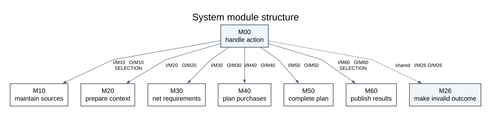
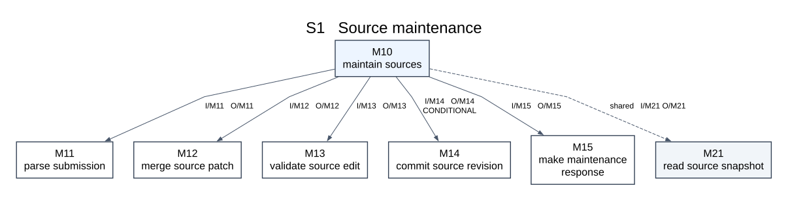
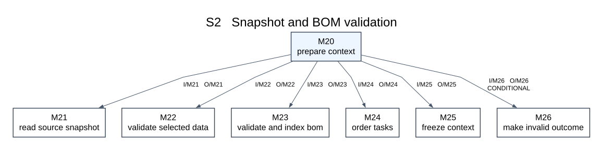
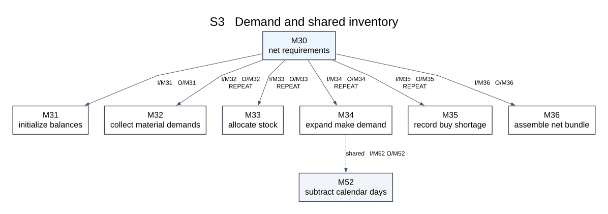
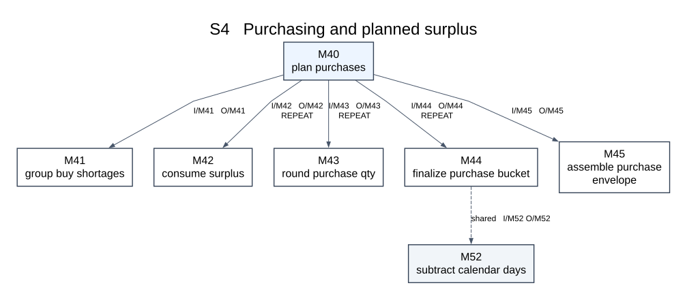
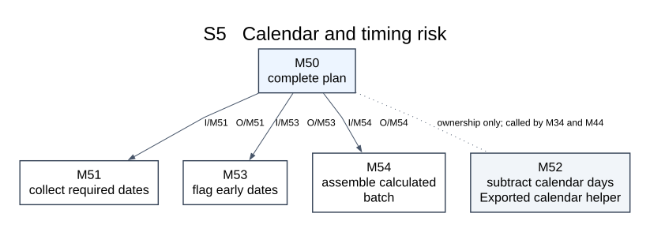
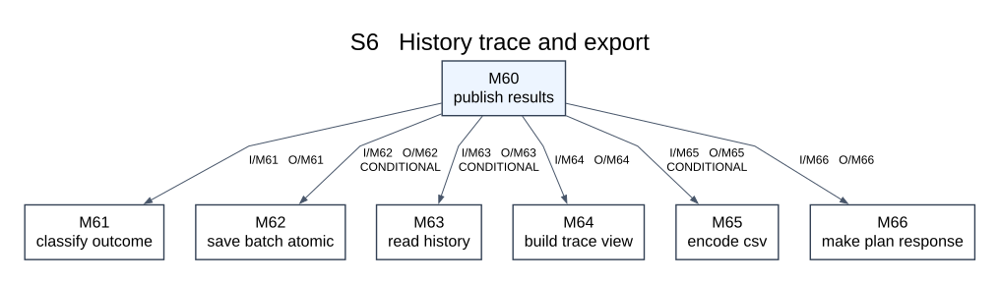

# E2 Module Structure Design

The system has six business subsystems and one application coordinator. Seven structure charts are supplied: one overview and six subsystem charts. Each rectangular module denotes a callable procedure. Solid downward arrows mean calls; dashed arrows call a shared procedure owned elsewhere. REPEAT marks calls repeated over tasks/materials/dates; CONDITIONAL marks error or selected-mode branches. These are hierarchical module charts, not data-flow diagrams.

I/Mxx and O/Mxx beside a call identify its data couples: the Inputs and Returns fields of module Mxx in interfaces.md. The returned Result tag, query mode and supply type are control information described in the coupling tables below. The interface table provides the full data names so abbreviated edge labels are unambiguous. The dotted ownership link to M52 is explicitly not a call.

| Subsystem | Responsibility | Entry procedure | Requirements | E1 process |
|---|---|---|---|---|
| S1 | Source maintenance | maintain_sources | FR01 | P1 |
| S2 | Snapshot and BOM validation | prepare_context | FR02, FR03 | P2.1 |
| S3 | Demand and shared inventory | net_requirements | FR04, FR05 | P2.2 |
| S4 | Purchasing and planned surplus | plan_purchases | FR06 | Purchasing part of P2.3 |
| S5 | Calendar and timing risk | complete_plan | FR07 | Risk part of P2.3; shared calendar helper |
| S6 | History trace and export | publish_results | FR08 | P3 |

## S1 Source maintenance

| Call | Control condition | Input data couple | Return data couple |
|---|---|---|---|
| M10 -> M11 | call | MaintenanceSubmission | Result[TypedImport] |
| M10 -> M12 | call | SourceSet, TypedImport | SourceSet |
| M10 -> M13 | call | SourceSet candidate, TypedImport | List[Issue] |
| M10 -> M14 | conditional | repository, expected_revision, SourceSet candidate | Result[revision_id] |
| M10 -> M15 | call | request_id, accepted_count, List[Issue], commit_result | MaintenanceOutcome |
| M10 -> M21 | shared | repository, baseline_date or null | Result[SourceSet] |

## S2 Snapshot and BOM validation

| Call | Control condition | Input data couple | Return data couple |
|---|---|---|---|
| M20 -> M21 | call | repository, baseline_date or null | Result[SourceSet] |
| M20 -> M22 | call | PlanningRequest, SourceSet, RuleSnapshot | List[Issue] |
| M20 -> M23 | call | SourceSet, selected_task_ids | Result[GraphIndex] |
| M20 -> M24 | call | List[Task], selected_task_ids | List[Task] |
| M20 -> M25 | call | request, sources, rules, ordered_tasks, GraphIndex | PreparedContext |
| M20 -> M26 | conditional | request_id, nonempty List[Issue] | CalculationOutcome |

## S3 Demand and shared inventory

| Call | Control condition | Input data couple | Return data couple |
|---|---|---|---|
| M30 -> M31 | call | request_id, List[Stock] | BalanceMap |
| M30 -> M32 | repeat | task_id, material_id, DemandMap | List[Demand] |
| M30 -> M33 | repeat | Demand, Balance | AllocationResult |
| M30 -> M34 | repeat | NettedDemand, Material, child_edges | Result[MakeExpansion] |
| M30 -> M35 | repeat | NettedDemand, Material | BuyShortage or null |
| M30 -> M36 | call | Context, netted_demands, allocations, make_lines, shortages, final_balances | Result[NetBundle] |
| M34 -> M52 | shared | Date needed_date, Int >= 0 lead_days | Result[Date] |

## S4 Purchasing and planned surplus

| Call | Control condition | Input data couple | Return data couple |
|---|---|---|---|
| M40 -> M41 | call | List[BuyShortage] | List[ShortageGroup] |
| M40 -> M42 | repeat | ShortageGroup, List[SurplusLot] | SurplusAllocation |
| M40 -> M43 | repeat | remaining_gap, minimum_qty, purchase_multiple | Int >= 0 |
| M40 -> M44 | repeat | ShortageGroup, SurplusAllocation, purchase_qty, Material | Result[PurchaseStep] |
| M40 -> M45 | call | NetBundle, purchase_buckets, surplus_uses, surplus_lots | Result[PurchasingEnvelope] |
| M44 -> M52 | shared | Date needed_date, Int >= 0 lead_days | Result[Date] |

## S5 Calendar and timing risk

| Call | Control condition | Input data couple | Return data couple |
|---|---|---|---|
| M50 -> M51 | call | PurchasingEnvelope | List[DatedEvent] |
| M50 -> M53 | call | List[DatedEvent], baseline_date | List[Issue] |
| M50 -> M54 | call | PurchasingEnvelope, List[Issue] risks | CalculatedBatch |

## S6 History trace and export

| Call | Control condition | Input data couple | Return data couple |
|---|---|---|---|
| M60 -> M61 | call | CalculationOutcome | Result[CalculatedBatch] |
| M60 -> M62 | conditional | CalculatedBatch, repository, batch_id, created_at | Result[BatchRecord] |
| M60 -> M63 | conditional | QueryRequest, repository | Result[List[BatchRecord]] |
| M60 -> M64 | call | List[BatchRecord], filters | Result[ReportView] |
| M60 -> M65 | conditional | ReportView, table_kind | CsvDocument |
| M60 -> M66 | call | request_id, outcome_status, saved_records, view, csv, issues | PlanResponse |

## Transformation from E1

The overall calculation is a transformation sequence: validate and freeze inputs, net multilevel demand against shared stock, calculate dated purchasing, assess risks, then retain and present the result. M00 controls this sequence; modules do not call each other's top-level controllers. Task-priority stock allocation and date-ordered procurement therefore have distinct owners.

M30 owns D3 working stock; M40 owns D4 planned surplus. Neither writes D1. M14 exclusively commits master-data revisions; M62 exclusively commits D2 batches. M21 and M63 read their respective stores. Calendar subtraction M52 is shared by M34 and M44 so lead-time behavior is consistent. M50 calls risk procedures, not M52 redundantly.

## Cohesion and coupling review

S1 is cohesive around accepted data changes; S2 around valid immutable calculation input; S3 around net demand and stock; S4 around procurement quantities and excess; S5 around dates and complete risk results; S6 around retained output. Narrow leaf interfaces such as M33 and M43 take only the data needed. Aggregate Context/NetBundle carriers belong at coordinator boundaries, rather than mutable global state. Storage and presentation dependencies do not enter the pure arithmetic functions.

Cross-subsystem calls are M10 to read-only M21, M34/M44 to pure M52, and M00 to the M26 failure-outcome formatter. There is no controller call cycle. Sharing a date helper does not create an object hierarchy or make the entire risk subsystem a dependency of quantity calculation.
