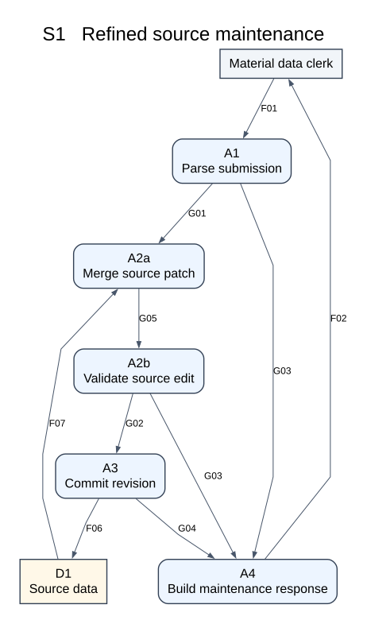
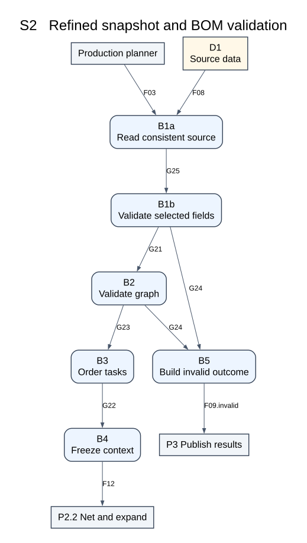
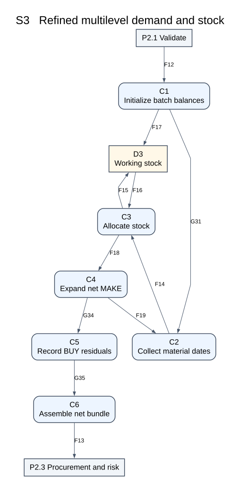
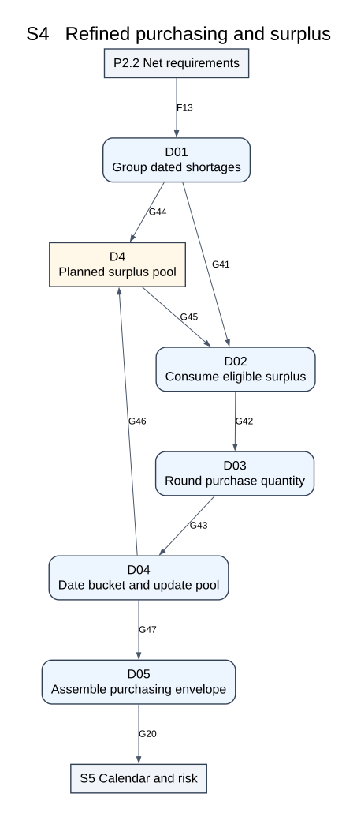
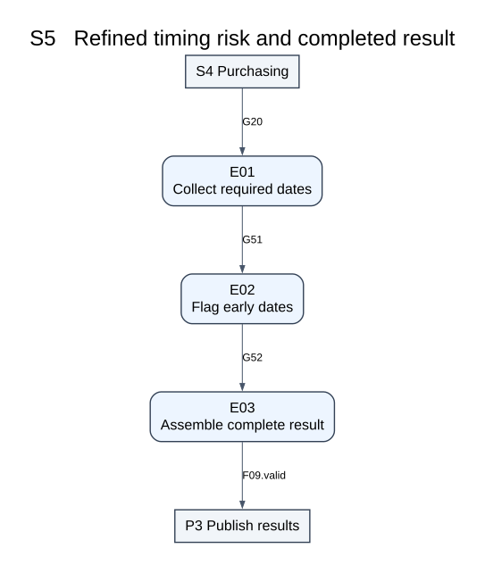
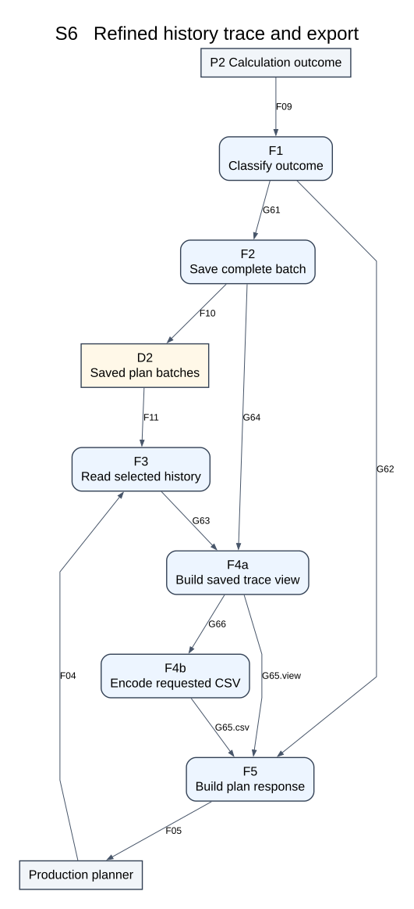
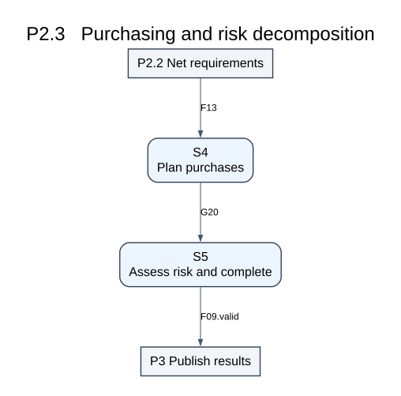

# E2 Refined Data Flow Diagrams

All six selected subsystems have a refined DFD. The additional bridge explains the decomposition of E1 P2.3 into S4 and S5. Rounded processes transform data; gray rectangles denote external entities or parent-level boundaries; gold store boxes marked D1-D4 denote stores. Arrows carry records, not calls. Each final primitive process maps to one procedure. E1 F01-F19 retain their established definitions.

## S1   Refined source maintenance

| Primitive process | Mapped procedure |
|---|---|
| A1 Parse submission | M11 parse_submission |
| A2a Merge source patch | M12 merge_source_patch |
| A2b Validate source edit | M13 validate_source_edit |
| A3 Commit revision | M14 commit_source_revision |
| A4 Build maintenance response | M15 make_maintenance_response |

| Flow | Meaning | Record type |
|---|---|---|
| F01 | Maintenance submission | MaintenanceSubmission |
| F07 | Existing source records | SourceSet |
| G01 | Typed submission | TypedImport |
| G03 | Located maintenance errors | List[Issue] |
| G02 | Validated source candidate | SourceSet |
| F06 | Accepted source records | SourceSet |
| G04 | Maintenance commit result | CommitResult |
| F02 | Maintenance outcome | MaintenanceOutcome |
| G05 | Merged source candidate | EditWork |

## S2   Refined snapshot and BOM validation

| Primitive process | Mapped procedure |
|---|---|
| B1a Read consistent source | M21 read_source_snapshot |
| B1b Validate selected fields | M22 validate_selected_data |
| B2 Validate graph | M23 validate_and_index_bom |
| B3 Order tasks | M24 order_tasks |
| B4 Freeze context | M25 freeze_context |
| B5 Build invalid outcome | M26 make_invalid_outcome |

| Flow | Meaning | Record type |
|---|---|---|
| F03 | Planning request | PlanningRequest |
| F08 | Planning source records | SourceSet |
| G21 | Selected snapshot envelope | ValidationEnvelope |
| G24 | Planning validation errors | List[Issue] |
| G23 | Validated graph envelope | ValidationEnvelope |
| G22 | Ordered task envelope | ValidationEnvelope |
| F12 | Validated planning context | Context |
| F09.invalid | Calculation outcome | CalculationOutcome |
| G25 | Consistent request snapshot | ValidationEnvelope |

## S3   Refined multilevel demand and stock

| Primitive process | Mapped procedure |
|---|---|
| C1 Initialize batch balances | M31 initialize_balances |
| C2 Collect material dates | M32 collect_material_demands |
| C3 Allocate stock | M33 allocate_stock |
| C4 Expand net MAKE | M34 expand_make_demand |
| C5 Record BUY residuals | M35 record_buy_shortage |
| C6 Assemble net bundle | M36 assemble_net_bundle |

| Flow | Meaning | Record type |
|---|---|---|
| F12 | Validated planning context | Context |
| F17 | Initial working balances | List[Balance] |
| G31 | Initialized netting state | NettingState |
| F14 | Allocation candidates | CandidateEnvelope |
| F16 | Working stock balances | List[Balance] |
| F15 | Working stock updates | List[Balance] |
| F18 | Netted demand records | NettedEnvelope |
| F19 | Child demand records | List[Demand] |
| G34 | Manufacturing expansion | ExpansionResult |
| G35 | Completed netting state | NettingState |
| F13 | Net requirements bundle | NetBundle |

## S4   Refined purchasing and surplus

| Primitive process | Mapped procedure |
|---|---|
| D01 Group dated shortages | M41 group_buy_shortages |
| D02 Consume eligible surplus | M42 consume_surplus |
| D03 Round purchase quantity | M43 round_purchase_qty |
| D04 Date bucket and update pool | M44 finalize_purchase_bucket |
| D05 Assemble purchasing envelope | M45 assemble_purchase_envelope |

| Flow | Meaning | Record type |
|---|---|---|
| F13 | Net requirements bundle | NetBundle |
| G44 | Empty planned surplus pool | List[SurplusLot] |
| G41 | Date grouped shortage envelope | PurchaseWork |
| G45 | Available planned surplus lots | List[SurplusLot] |
| G42 | Surplus adjusted shortage | PurchaseWork |
| G43 | Rounded purchasing quantity | PurchaseWork |
| G46 | Updated planned surplus lots | List[SurplusLot] |
| G47 | Accumulated procurement records | PurchaseWork |
| G20 | Purchasing envelope | PurchasingEnvelope |

## S5   Refined timing risk and completed result

| Primitive process | Mapped procedure |
|---|---|
| E01 Collect required dates | M51 collect_required_dates |
| E02 Flag early dates | M53 flag_early_dates |
| E03 Assemble complete result | M54 assemble_calculated_batch |

| Flow | Meaning | Record type |
|---|---|---|
| G20 | Purchasing envelope | PurchasingEnvelope |
| G51 | Required dates and retained calculation | RiskWork |
| G52 | Assessed dates and retained calculation | RiskWork |
| F09.valid | Calculation outcome | CalculationOutcome |

## S6   Refined history trace and export

| Primitive process | Mapped procedure |
|---|---|
| F1 Classify outcome | M61 classify_outcome |
| F2 Save complete batch | M62 save_batch_atomic |
| F3 Read selected history | M63 read_history |
| F4a Build saved trace view | M64 build_trace_view |
| F4b Encode requested CSV | M65 encode_csv |
| F5 Build plan response | M66 make_plan_response |

| Flow | Meaning | Record type |
|---|---|---|
| F09 | Calculation outcome | CalculationOutcome |
| F04 | Query and export request | QueryRequest |
| G61 | Accepted calculated result | CalculatedBatch |
| G62 | Rejected outcome issues | List[Issue] |
| F10 | Immutable batch record | BatchRecord |
| F11 | Historical batch records | List[BatchRecord] |
| G64 | Committed batch record | BatchRecord |
| G63 | Loaded batch records | List[BatchRecord] |
| G65.csv | View and CSV data | PresentationWork |
| F05 | Plan response | PlanResponse |
| G66 | Prepared report view | PresentationWork |
| G65.view | View and CSV data | PresentationWork |

## P2.3   Purchasing and risk decomposition

| Primitive process | Mapped procedure |
|---|---|
| S4 Plan purchases | M40 plan_purchases |
| S5 Assess risk and complete | M50 complete_plan |

| Flow | Meaning | Record type |
|---|---|---|
| F13 | Net requirements bundle | NetBundle |
| G20 | Purchasing envelope | PurchasingEnvelope |
| F09.valid | Calculation outcome | CalculationOutcome |

## Iteration and retained data

In S3, C1 initializes stock once. M30 processes a complete task before the next task and waits for all parents before finalizing a shared material. C2 groups same-date requests; C3 nets them; C4 creates children from positive MAKE residuals only. C5 retains BUY residuals and forwards accumulated state; C6 emits F13 only after the entire run. Zero-net records remain in trace. G34 explicitly retains the original netted record so BUY requirements are not lost on the MAKE path.

In S4, D01 initializes an empty D4 pool once per run. Each material/date consumes prior eligible surplus, rounds the remaining gap, and updates D4. D05 emits G20 only after every dated group is processed. D4 is not physical stock. It is internal to the refinement of P2.3 and never adds an external parent input.

S6 has an explicit optional conversion branch: F4a sends VIEW/LIST data directly to F5 through G65.view; CSV goes through F4b/M65 and G65.csv. Both flows are alternatives of the same PresentationWork record. The call chart records this selection. Commit and read failures are propagated to F05 by M60/M66; successful G64 exists only after a full commit.

Unchanged context carried along a DFD flow is retained by its coordinator; a leaf function consumes only its documented slice and returns the transformed data. This pass-through convention explains the difference between a complete logical flow envelope and a narrow procedure signature. For example C1 returns BalanceMap while M30 carries forward the received Context in G31. F12 remains the E1 Context; the graph index in PreparedContext is derived from that same BOM, not a new external input.

The reusable calendar function M52 implements the date transformation inside C4/D04. It is shown in module charts and does not require an additional business data-flow boundary.

## Added internal flow dictionary

| ID | Data | Type |
|---|---|---|
| G01 | Typed submission | TypedImport |
| G02 | Validated source candidate | SourceSet |
| G03 | Located maintenance errors | List[Issue] |
| G04 | Maintenance commit result | CommitResult |
| G21 | Selected snapshot envelope | ValidationEnvelope |
| G22 | Ordered task envelope | ValidationEnvelope |
| G23 | Validated graph envelope | ValidationEnvelope |
| G24 | Planning validation errors | List[Issue] |
| G31 | Initialized netting state | NettingState |
| G34 | Manufacturing expansion | ExpansionResult |
| G35 | Completed netting state | NettingState |
| G41 | Date grouped shortage envelope | PurchaseWork |
| G42 | Surplus adjusted shortage | PurchaseWork |
| G43 | Rounded purchasing quantity | PurchaseWork |
| G44 | Empty planned surplus pool | List[SurplusLot] |
| G45 | Available planned surplus lots | List[SurplusLot] |
| G46 | Updated planned surplus lots | List[SurplusLot] |
| G47 | Accumulated procurement records | PurchaseWork |
| G20 | Purchasing envelope | PurchasingEnvelope |
| G51 | Required dates and retained calculation | RiskWork |
| G52 | Assessed dates and retained calculation | RiskWork |
| G61 | Accepted calculated result | CalculatedBatch |
| G62 | Rejected outcome issues | List[Issue] |
| G63 | Loaded batch records | List[BatchRecord] |
| G64 | Committed batch record | BatchRecord |
| G65 | View and CSV data | PresentationWork |
| G05 | Merged source candidate | EditWork |
| G25 | Consistent request snapshot | ValidationEnvelope |
| G66 | Prepared report view | PresentationWork |

Envelope fields are defined in interfaces.md. F09.valid and F09.invalid are alternatives of F09. Parent/child balance compares their union, never treats them as unrelated flows.
