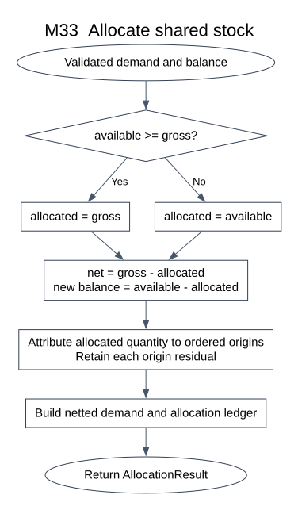
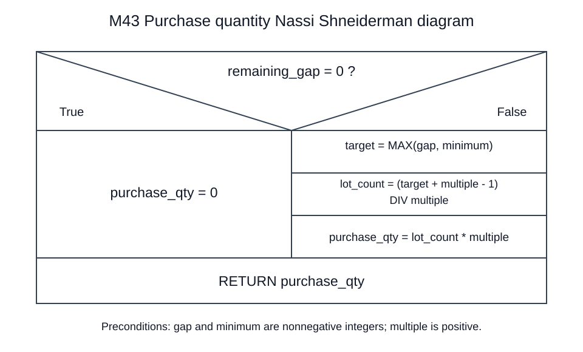

# E3 Detailed Design Starter

Version 0.1 short draft, 26 September 2026. Project: Material Requirements and Purchasing Plan System.

## Scope of this short draft

This deliberately partial E3 draft covers six selected procedures from E2 with concise pseudocode, one flowchart and one Nassi-Shneiderman diagram. It preserves structured/procedural design and the confirmed priority-first inventory rule. It is not a complete submission, executable application, group review or test report.

The course's count requirement depends on N and its module/subsystem wording still needs confirmation. Six selected procedures do not establish compliance while N and that interpretation remain unknown. The remaining interface detail, exceptional paths, additional detailed-design diagrams and actual group records will be added later.

## M23 Validate and index the BOM

Input: SourceSet and validated selected task IDs. Output: Result[GraphIndex]. Inspect every reachable branch, including stock-covered materials.

~~~text
reachable, edges = collect_reachable_graph_with_visited_set(selected_roots)
IF an unknown material, duplicate edge or nonpositive usage exists:
    RETURN ERROR(located issues)
IF any BUY has children OR any reachable MAKE has no children:
    RETURN ERROR(type/structure issues)
indegree = count_incoming_edges(reachable, edges)
ready = zero-indegree materials ordered by ordinal material ID
order = empty list
WHILE ready is not empty:
    parent = remove_smallest(ready)
    append parent to order
    FOR each child edge in ordinal child-ID order:
        decrement indegree[child]
        IF indegree[child] = 0: add child to ready
IF length(order) != size(reachable):
    RETURN ERROR(BOM_CYCLE, remaining graph records)
RETURN OK(GraphIndex(adjacency, reachable, order, roots))
~~~

Later: specify graph collection, exact error locations and extraction of a concrete cycle. A visited set prevents traversal from looping; it must not discard distinct valid BOM edges.

## M30 Net multilevel requirements

Input: PreparedContext from E2. Output: Result[NetBundle]. All field and graph validation has passed. M30 alone owns the temporary balance map.

~~~text
context, graph = prepared.context, prepared.graph
balances = M31.initialize_balances(context.request.request_id, context.sources.stocks)    // once per batch
outputs = empty accumulated demand, allocation, MAKE and BUY records
FOR task_id IN context.ordered_task_ids:    // priority, due date, ordinal ID
    task = lookup task_id in context.sources.tasks
    pending = one root demand(task.product_id, task.required_qty, task.due_date)
    FOR material IN graph.parent_before_child_order:
        buckets = M32.collect_material_demands(task_id, material, pending)
        FOR demand IN buckets ordered by needed_date:
            allocation = M33.allocate_stock(demand, balances[material])
            balances[material] = allocation.new_balance
            retain allocation.netted_demand and allocation.ledger
            IF material.supply_type = MAKE:
                expansion = M34.expand_make_demand(
                    allocation.netted_demand, material, graph.children[material])
                IF expansion is ERROR: RETURN that ERROR
                retain expansion.make_line if present
                merge expansion.children into pending, preserving origins
            ELSE:
                retain M35.record_buy_shortage(allocation.netted_demand, material)
                    if the returned shortage is not null
RETURN M36.assemble_net_bundle(context, outputs.netted_demands,
    outputs.allocations, outputs.make_lines, outputs.buy_shortages, balances)
~~~

All parents finish before a shared child is processed. Same-task, same-material, same-date requests merge before stock allocation. Purchasing surplus is calculated later in M40, not inside this stock loop.

## M33 Allocate shared stock

Input: Demand and Balance with matching material IDs. Preconditions: gross equals origin contributions; quantities are valid and nonnegative. Output: AllocationResult. Inputs are not mutated.

~~~text
allocated = MIN(balance.available_qty, demand.gross_qty)
new_balance = balance.available_qty - allocated
net = demand.gross_qty - allocated
left_to_attribute = allocated
source_allocations = empty list
FOR origin IN demand.origins ordered by ordinal BOM path then origin ID:
    taken = MIN(left_to_attribute, origin.contribution_qty)
    append (origin.id, taken, origin.contribution_qty - taken)
    left_to_attribute = left_to_attribute - taken
ASSERT left_to_attribute = 0
RETURN AllocationResult(
    netted demand(gross, allocated, net, source_allocations),
    ledger(before=balance.available_qty, allocated, after=new_balance),
    copied balance with available_qty=new_balance)
~~~

Invariant: gross = allocated + net; before = allocated + after; after >= 0. Flowchart 1 uses an equivalent conditional form of MIN and summarizes the origin-attribution loop as one process.

## M34 Expand net manufacturing demand

Input: NettedDemand for a MAKE material, its Material record and validated child edges. Output: Result[MakeExpansion]. BUY materials follow M35 instead.

~~~text
IF netted.net_qty = 0:
    RETURN OK(no MAKE line, empty child list)
start = M52.subtract_calendar_days(netted.demand.needed_date, material.lead_time_days)
IF start is ERROR: RETURN that ERROR
make_line = record netted.net_qty with needed_date and start.value
children = empty list
FOR source IN netted.source_allocations:
    IF source.residual_qty = 0: CONTINUE
    FOR edge IN child_edges ordered by ordinal child ID:
        quantity = source.residual_qty * edge.qty_per
        append child contribution(
            task=netted.demand.task_id, material=edge.child_id,
            needed_date=start.value, quantity=quantity,
            parent_demand_id=netted.demand.demand_id,
            BOM_path=lookup(source.origin_id, netted.demand.origins).bom_path extended with edge.child_id)
RETURN OK(MakeExpansion(make_line, children))
~~~

Only residual parent manufacture consumes new child materials. Child contribution IDs must be stable; their exact encoding and merging procedure will be specified in the expanded design.

## M43 Round a purchase quantity

Input: nonnegative integer remaining_gap and minimum_qty; positive integer purchase_multiple. Output: nonnegative integer purchase quantity. M42 has already consumed eligible earlier surplus.

~~~text
IF remaining_gap = 0:
    purchase_qty = 0
ELSE:
    target = MAX(remaining_gap, minimum_qty)
    lot_count = (target + purchase_multiple - 1) DIV purchase_multiple
    purchase_qty = lot_count * purchase_multiple
RETURN purchase_qty
~~~

DIV is exact integer division. No floating-point rounding is used. N-S diagram 2 shows the same selection and sequence. Invalid parameter handling belongs to input validation and will be documented explicitly later.

## M53 Flag early required dates

Input: required events from M51 and baseline_date. Output: List[Issue]. M51 excludes nonexistent zero-quantity manufacturing or purchasing starts.

~~~text
risks = empty list
FOR event IN required_events:
    IF event.date < baseline_date:
        append Issue(
            severity=RISK, source_location=event.event_id,
            computed_date=event.date,
            days_before_baseline=calendar_days_between(event.date, baseline_date),
            task_id=event.task_id, material_id=event.material_id)
RETURN risks
~~~

Equality with baseline is allowed. Dates are preserved, not moved forward. Task due dates are checked even when finished stock satisfies the whole task.

## Diagram 1 Flowchart for M33

The origin-attribution block follows the loop written in the M33 pseudocode. This first diagram focuses on allocation quantity and balance conservation; expanded error and loop paths remain future work.

## Diagram 2 Nassi Shneiderman diagram for M43

The left branch handles zero gap. The right branch applies the minimum and then rounds to a purchase multiple. Both branches return a purchase quantity.

## Small design walkthroughs

| Procedure | Input | Expected result |
|---|---|---|
| M33 | Gross 200; available 20 | Allocated 20; net 180; balance 0 |
| M33 | Gross 10; available 10 | Allocated 10; net 0; balance 0 |
| M34 | B net 180; each B needs 4 D | D gross demand 720 |
| M43 | Gap 620; minimum 100; multiple 100 | Purchase 700 |
| M43 | Gap 0; minimum 100; multiple 10 | Purchase 0 |
| M53 | Event 2026-10-09; baseline 2026-10-10 | Risk 1 calendar day before baseline |

These are independent expected values, not program test results. In the full CASE01, D demand 720 minus stock 100 yields purchase 620 before lot-size adjustment.

## What to add next

1. M32 demand merging, M42 chronological surplus use and M62 atomic-save pseudocode.
2. Complete preconditions, postconditions, error results, stable ID construction and trace fields.
3. More flowcharts and N-S or PAD diagrams for the chosen detailed-design objects; verify the required count with actual N.
4. A consistent mapping from each decision/loop to later E4 and E5 cases.
5. Actual member tasks, all-member meeting record and individual contributions.

No application code, database or test execution is included in this short draft.
