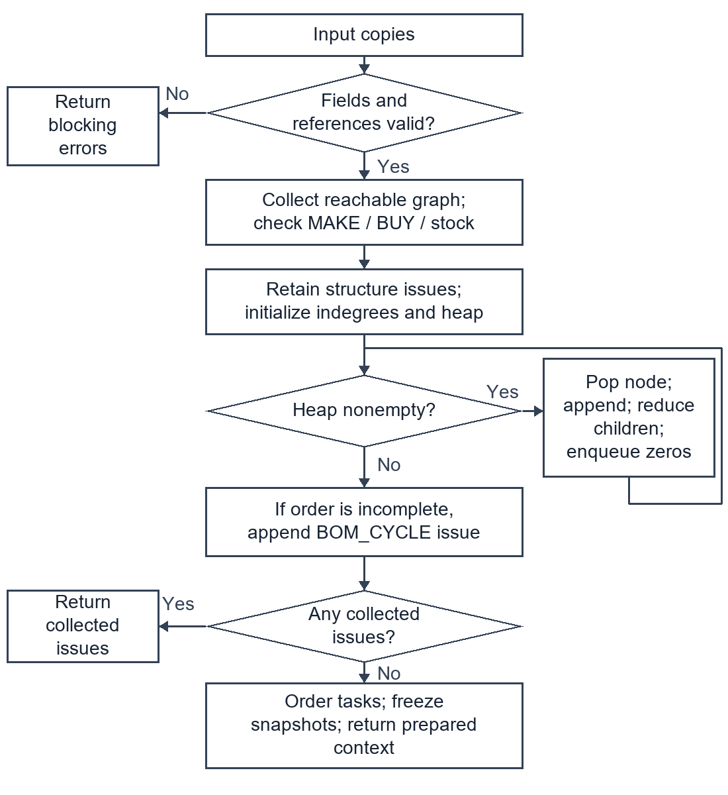
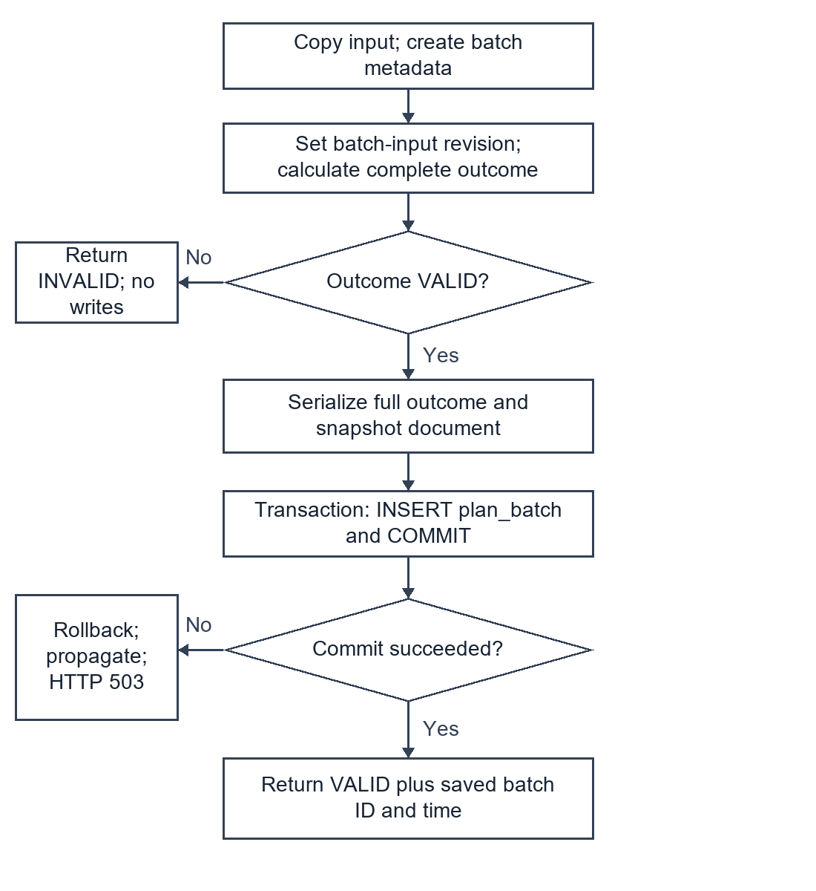
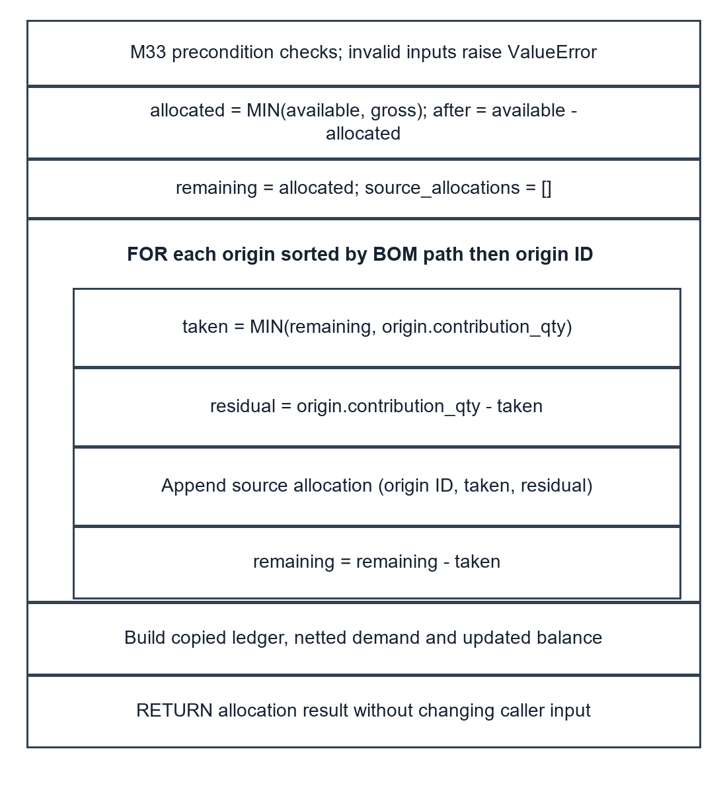
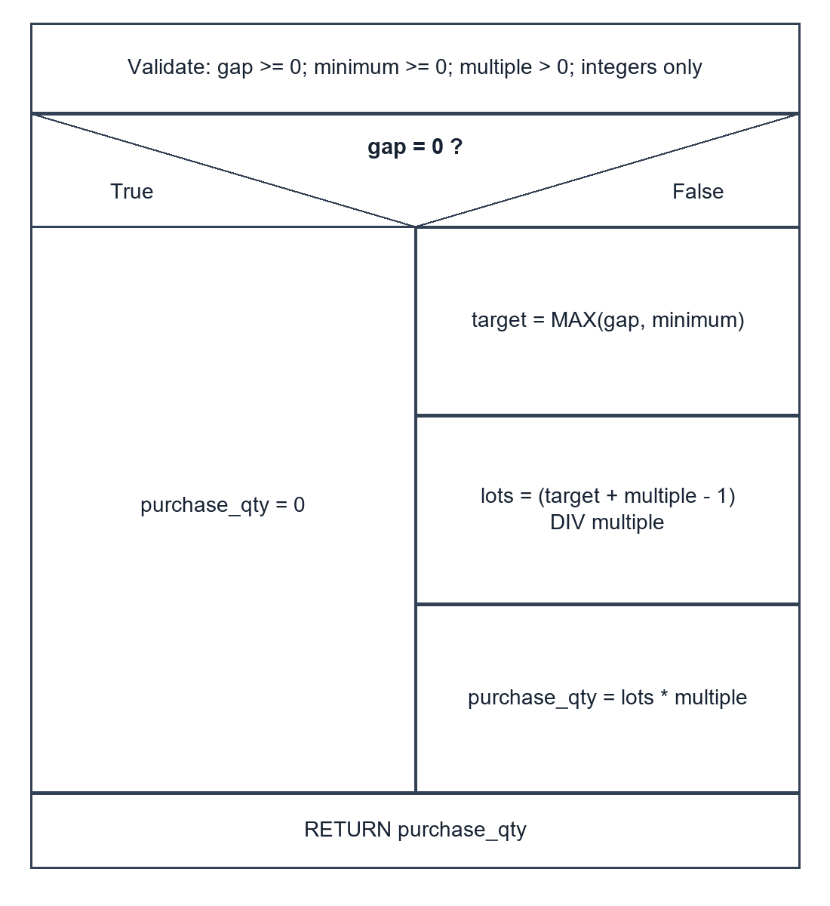

# Detailed Design of the Material Requirements and Purchasing Plan System

Experiment 3 | Technical draft v0.2 | 15 October 2026

This report refines the existing six-subsystem structured design into 14 selected procedures. It specifies input and output contracts, pseudocode, failure paths and implementation mappings, with two flowcharts, two Nassi-Shneiderman diagrams and two decision tables. The current implementation uses functions and records rather than a custom object-oriented model.

The group size is two, confirmed on 15 October 2026. E3 literally requires at least twice the number of group members in subsystems: six subsystems exceed the minimum of four. If the wording is intended to count refined modules instead, the 14 selected modules also exceed four. Member identities, actual division of work and the all-member review remain unrecorded; this is not yet a complete submission package.

Table 1.1 Scope inherited from E2

| Subsystem | Selected E3 modules |
| --- | --- |
| S1 Source maintenance | M11, M14 |
| S2 Snapshot and BOM validation | M23 |
| S3 Net requirements | M30, M33 |
| S4 Purchasing | M40, M42, M43 |
| S5 Dates and completion | M50, M52, M53 |
| S6 Publication and history | M62, M63, M65 |

Sections 2 and 3 define records and procedures. Section 4 provides the two required model types. Sections 5 and 6 describe decisions and validation links. Section 7 reserves genuine submission records. All report content is in English as required by the supplied E3 brief; no FTP upload is performed.


## 2 Shared records and implementation boundaries

Table 2.1 Record contracts

| Record | Fields and ownership |
| --- | --- |
| SourceSet | source_revision; materials, bom, stocks and tasks. Normalized copies retain immutable input provenance. |
| PlanningRequest | request_id, selected_task_ids, baseline_date, rule_version. Selection IDs are canonicalized; execution order is separately priority-based. |
| PreparedContext | Context snapshots, material/task indexes, graph adjacency/reachability/topological order and initial balances. |
| Demand and origin | task, material, needed date, gross quantity; origins retain parent_demand_id, bom_path and contribution_qty. |
| Allocation and shortage | Before/allocated/after balances; per-origin allocated/residual quantities; BUY shortage links to its demand. |
| Purchase bucket and surplus | Material/date, shortage IDs, gross gap, surplus used, residual gap, rounded quantity, order date and remaining lot quantities. |
| Outcome and saved document | VALID or INVALID, result/errors; saved_batch has immutable batch ID and UTC creation time. RISK does not imply INVALID. |

Stable calculation IDs are compact JSON arrays, not delimiter-concatenated strings. Examples are ["demand",task,material,date], ["origin",task,path] and ["purchase_bucket",material,date]. Root origins use ["root",task]. MAKE, shortage and allocation IDs retain their task/demand references. Batch IDs and source revision IDs are independently generated UUID hex values.

Implementation refinements from E2 are explicit: several logical leaf modules are inline steps; CSV imports replace whole selected tables; three SQLite tables store complete version documents instead of seven physical relational tables. The supported rule constant is checked, not dynamically selected by clients. History reads a stored result without recalculation.

Single warehouse, integer quantities and calendar days remain the current scope. The confirmed rule is task priority first, then due date, then ordinal ID. Neither calculation nor saving posts inventory. Current UI/CSV inputs are bounded to JavaScript safe integers; computed larger quantities retain exact decimal representation.


## 3.1 M11 Parse and preview a CSV submission

E2 owner: S1. Implementation: csv_io.py:38-76 parse_table; csv_io.py:79-111 preview_import.

Input: current payload and one or more named CSV texts. Output: READY with a normalized candidate and row counts, or INVALID with located errors.

Precondition: a supported table name and UTF-8 text. The HTTP boundary caps the full JSON body at 2 MB. Each CSV is capped at 500,000 UTF-8 bytes and 5,000 records.

```text
COPY the current payload to candidate
FOR each supplied table:
  CHECK exact header set, unique headers and row column counts
  PARSE integers; reject fractions, scientific notation or overflow
  DEFAULT blank minimum to 0 and blank purchase multiple to 1
  RECORD physical CSV ending-line numbers, including quoted newlines
  REPLACE that whole candidate table with the parsed rows
IF parsing errors exist: RETURN INVALID without applying candidate
REMEMBER old selected IDs that still occur in the new task table
SET candidate selection to all candidate tasks
CALL validate_and_prepare(candidate.sources, candidate.request)
IF invalid: remap row errors to CSV locations; RETURN INVALID
RESTORE surviving selected IDs in normalized candidate
RETURN READY(candidate, per-table counts)
```

Postcondition: no database or original input changes. The UI applies a valid preview explicitly; saving is a separate action. New task IDs are not selected automatically.

Failure paths: CSV_TYPE, CSV_HEADER, CSV_COLUMNS, CSV_INTEGER, CSV_SYNTAX, CSV_SIZE and business validation errors. Empty task data fails full validation. A changed editor/file invalidates the UI preview.

E2 refinement: M11 parsing and M12/M13 candidate preparation share this adapter. Current CSV semantics replace complete selected tables; they are not E2 upsert patches.


## 3.2 M14 Commit a source version

E2 owner: S1. Implementation: storage.py:60-90 save_workspace.

Input: database path, payload and expected_revision. Output: SAVED with normalized payload and new revision, INVALID, or CONFLICT.

Precondition: initialized schema. Validate copies before acquiring the write transaction. At least one valid task must exist; an empty saved selection is permitted.

```text
COPY payload; remember whether its selection was empty
IF selection was empty: temporarily select all supplied tasks
VALIDATE and normalize the payload
VALIDATE again with every task selected, including unselected BOMs
IF either validation fails: RETURN INVALID
IF original selection was empty: restore the empty selection
CREATE revision ID and timestamp; put revision ID into sources
BEGIN IMMEDIATE transaction
READ the current source_head revision (or null)
IF current differs from expected_revision:
  RETURN CONFLICT without inserting a revision
INSERT immutable source_revision with current as parent
INSERT or UPDATE source_head to the new revision
COMMIT transaction
RETURN SAVED only after successful commit
```

Invariant: a stale writer cannot move the head. A failed insert/head update/commit rolls back the whole transaction. This operation does not change actual stock or create a plan batch.

Database or filesystem failures propagate to the HTTP adapter, which returns 503 SAVE_FAILED. CONFLICT maps to HTTP 409; the browser retains its unsaved edits.

The actual connection context manages commit/rollback. BEGIN IMMEDIATE precedes the head comparison, so no writer can alter the head between comparison and update.


## 3.3 M23 Validate data and index the reachable BOM

E2 owner: S2. Implementation: planner.py:27-198 validate_and_prepare.

Input: sources and request records. Output: prepared context and an empty error list, or no context and blocking issues. This function also implements M22, M24 and M25.

Precondition: none for the public input shape. IDs are stripped and case-sensitive; quantities must be integers, not booleans. Request rule_version must match the supported constant.

```text
COPY sources and request; validate records and nonempty selection
CHECK unique IDs, integer domains, valid dates and supply types
CHECK stock date = baseline and reserved <= on_hand
IF schema/field errors exist: RETURN no context and errors
BUILD adjacency; reject unknown references and duplicate edges
CHECK selected task IDs; sort each child list by ordinal ID
IF reference errors exist: RETURN no context and errors
COLLECT all reachable nodes from selected roots using a visited set
CHECK reachable stocks, MAKE children and BUY leaf restrictions
COMPUTE reachable indegrees; heap = zero-indegree nodes
WHILE heap is nonempty:
  REMOVE smallest node; append to topological order
  DECREMENT each child's indegree; enqueue newly zero children
IF order size differs from reachable size: add BOM_CYCLE issue
IF errors exist: RETURN no context and errors
SORT tasks by priority, due date, ordinal task ID
CANONICALIZE source rows; initialize on_hand - reserved balances
RETURN prepared snapshots, indexes, tasks, balances and graph
```

Postcondition: every reachable parent precedes its child. Validation includes branches covered by current stock; inventory cannot hide an illegal BOM. Only selected tasks enter calculation.

Cycle reporting lists nodes blocked by topological sorting; this can include descendants of a cycle and is not a reconstructed cycle path. Row locations in JSON are zero-based.

Global field/reference checks cover all supplied rows. MAKE completeness, BUY children, missing stock and cycle checks apply to the selected reachable graph; save/import select all tasks for their extra validation.


## 3.4 M30 Calculate net multilevel requirements

E2 owner: S3. Implementation: planner.py:208-256 net_requirements.

Input: validated prepared context. Output: NetBundle with demands, allocations, MAKE lines, BUY shortages and final balances, or date-range errors.

Precondition: valid acyclic reachable graph, sorted tasks and matching stock snapshots. Balances are private to one batch and shared across its tasks.

```text
COPY initial balances once; initialize output collections
FOR each task in priority, due date, ordinal ID order:
  SEED pending[root][due_date] with the root contribution
  FOR material in parent-before-child topological order:
    FOR needed_date in sorted pending[material] dates:
      SORT origins by BOM path then origin ID; SUM gross demand
      CALL M33; install new balance; retain demand and ledger
      IF net quantity = 0: CONTINUE to next date bucket
      KEEP residual origins with residual_qty > 0
      IF BUY: append shortage and CONTINUE
      CALL M52 for the MAKE start date
      IF date error: RETURN no bundle and located errors
      APPEND a MAKE line for the net quantity
      FOR child edge in child-ID order:
        FOR residual origin in fixed source order:
          child qty = residual_qty * edge.qty_per
          EXTEND path; reference parent demand; create stable ID
          APPEND contribution to pending[child][start_date]
RETURN bundle with final balances
```

Invariants: same-task/material/date origins merge before allocation; all parents feed a child before it is processed. Only residual MAKE demand creates child demand. No cross-task reuse of temporary pending buckets.

M32 merging, M34 expansion, M35 shortage recording and M36 assembly are inline steps, not separate Python functions. A date error discards the partial bundle; no actual inventory is posted.

Path records can grow much faster than node count in densely shared graphs. Do not describe full expansion complexity as merely linear in BOM nodes and edges.


## 3.5 M33 Allocate stock and attribute it to sources

E2 owner: S3. Implementation: core.py:24-85 allocate_stock.

Input: demand and balance for one material. Output: netted_demand, allocation ledger and a new balance. No caller-owned record is mutated.

Precondition: positive gross quantity; nonnegative available stock; valid date; nonempty uniquely identified origins with valid paths and positive contributions summing to gross.

```text
VALIDATE quantities, date, material match and origin records
allocated = MIN(available, gross)
after = available - allocated
remaining = allocated; source_allocations = empty list
FOR origin sorted by ordinal BOM path then origin ID:
  taken = MIN(remaining, origin.contribution_qty)
  residual = origin.contribution_qty - taken
  APPEND origin ID, taken and residual
  remaining = remaining - taken
CREATE ledger with before, allocated, after and copied attribution
CREATE copied demand with allocated and net = gross - allocated
RETURN demand, ledger and copied balance set to after
```

Postconditions: gross = allocated + net; before = allocated + after; after >= 0. Source allocations sum to allocated; source residuals sum to net. The attribution remainder ends at zero.

An invalid leaf precondition raises ValueError. The public planner validates source data before constructing this leaf input; internal invariant failures must not be reported as successful plans.

Example: origins 7 and 5, available 8 gives origin allocations 7 and 1; residuals 0 and 4; net demand 4. Attribution order is independent of the original input row order.


## 3.6 M40 Plan purchases by material and date

E2 owner: S4. Implementation: planner.py:259-300 plan_purchases.

Input: NetBundle and validated material index. Output: envelope containing purchase buckets, surplus-use records and final positive surplus lots, or located date errors.

Precondition: priority-based existing-stock allocation has finished. Purchase surplus is a separate planned supply pool; it is not available stock.

```text
GROUP BUY shortages by material and needed_date
INITIALIZE empty pools, buckets and surplus-use records
FOR group in material-ID then needed-date order:
  CREATE stable bucket ID; gross = SUM shortage quantities
  CALL M42 on this material's eligible earlier lots; obtain gap
  CALL M43(gap, minimum_qty, purchase_multiple)
  SET order_date to null
  IF purchase_qty > 0:
    CALL M52(needed_date, purchase lead time)
    IF error: RETURN no envelope and located errors
    IF purchase_qty > gap: ADD surplus lot at needed_date
  RECORD reasons for used surplus, minimum and multiple rounding
  APPEND bucket with sorted shortage IDs and remaining surplus
RETURN envelope and only positive final surplus lots
```

Postcondition: same-date shortages share one rounding decision. A zero-order bucket remains available for explanation but does not count as a procurement suggestion.

No purchase start event exists for quantity zero. Invalid date arithmetic blocks the full plan; merely early dates become risks later in M50/M53.

The current surplus pool is local mutable state owned by M40. The returned NetBundle is retained as input context and is not modified by the purchase stage.


## 3.7 M42 Consume eligible planned surplus

E2 owner: S4. Implementation: planner.py:259-300 plan_purchases.

Input: current material pool, demand bucket ID/date and gross shortage. Output: residual gap and use records, with this local pool reduced.

Precondition: caller processes each material in ascending need date. Lots carry source bucket ID, arrival date and remaining quantity. This logical module is inline in M40.

```text
gap = gross_shortage
FOR lot sorted by arrival_date then source_bucket_ID:
  IF lot.arrival_date <= needed_date
     AND gap > 0 AND lot.remaining_qty > 0:
    used = MIN(gap, lot.remaining_qty)
    lot.remaining_qty = lot.remaining_qty - used
    gap = gap - used
    APPEND source bucket, demand bucket, used,
           source arrival date and use date
RETURN gap and accumulated use records
```

Invariant: gross_shortage = surplus_used + gap; gap and all lot balances stay nonnegative. No lot later than the demand can supply it, including when that lot belongs to a higher-priority task.

A zero gap or exhausted lot takes the no-consumption branch. Lots do not survive into another planning batch. Earlier theoretical arrivals may still carry execution risk; the calculation does not guarantee on-time delivery.

Example: a 30-unit purchase for a gap of 23 creates 7 units. A later gap of 7 consumes that surplus and orders zero. Reversing dates does not allow the later lot to supply the earlier gap.


## 3.8 M43 Round the purchase quantity

E2 owner: S4. Implementation: core.py:88-97 round_purchase_qty.

Input: remaining_gap, minimum_qty and purchase_multiple. Output: exact integer purchase quantity. This is a pure leaf function.

Precondition: gap and minimum are nonnegative integers, multiple is a positive integer; booleans are not accepted as integer quantities.

```text
VALIDATE integer domains
IF remaining_gap = 0:
  RETURN 0
target = MAX(remaining_gap, minimum_qty)
lot_count = (target + purchase_multiple - 1) DIV purchase_multiple
RETURN lot_count * purchase_multiple
```

Postcondition: a positive result is at least both gap and minimum, is divisible by the multiple, and is the smallest such multiple. Zero gap always orders zero even when the minimum is positive.

Invalid domain values raise ValueError. DIV means exact integer division; floating-point ceilings are not used. This preserves exactness for large computed quantities.

Examples: gap 620, minimum 100, multiple 100 gives 700; gap 0 with the same minimum gives 0. The decision table in Section 5 separates the zero, minimum and divisibility cases.


## 3.9 M50 Complete the calculated outcome

E2 owner: S5. Implementation: planner.py:303-326 calculate_plan.

Input: sources and request. Output: VALID with a complete result and no errors, or INVALID with no result and blocking issues. This boundary does not perform I/O.

Precondition: public callers may supply malformed input; validate_and_prepare handles schema and business validation. The supported rule version is prototype-v0.2.

```text
CREATE INVALID skeleton with request ID when available
CALL M23 to validate and prepare
IF errors: RETURN INVALID with errors
CALL M30 for net requirements
IF errors: RETURN INVALID with errors
CALL M40 for purchase planning
IF errors: RETURN INVALID with errors
COLLECT every selected task due-date event
ADD each nonzero MAKE start event
ADD each nonzero purchase order-date event
CALL M53 using the request baseline
COUNT tasks, MAKE lines, positive purchase lines and risks
RETURN VALID(result including risks, summary and snapshots)
```

Postcondition: a blocking failure never exposes a partial valid result. A result with scheduling risks is still VALID and preserves its original computed dates.

Every selected task due date is checked, including a task fully covered by finished-goods stock. Summary purchase count excludes zero-order surplus-consumption buckets.

E2 M50 coordination, M51 event collection and M54 assembly are combined here; netting and purchase work remain explicit function calls. Saving belongs to M62.


## 3.10 M52 Subtract calendar lead time

E2 owner: S5. Implementation: core.py:100-117 subtract_calendar_days.

Input: needed_date in strict YYYY-MM-DD form and nonnegative integer lead_days. Output: OK with ISO date, or ERROR with a DATE_RANGE issue.

Precondition: valid calendar date and integer lead time. Dates use calendar days, including weekends and holidays; no shop calendar or capacity model is applied.

```text
VALIDATE integer lead_days and strict ISO date
TRY:
  start = parsed needed_date - duration(lead_days)
CATCH date arithmetic overflow:
  RETURN ERROR(value=null, DATE_RANGE blocking issue)
RETURN OK(value=start as YYYY-MM-DD, no issues)
```

Postcondition: zero lead leaves the date unchanged. A valid computed date before the baseline remains a date; it is not a DATE_RANGE error and will be assessed by M53.

Invalid date syntax/domain raises ValueError at the leaf; arithmetic overflow returns a structured error. planner.required_start attaches task/material/location context to that error.

Examples: 2026-10-10 minus 2 days is 2026-10-08; 2024-03-01 minus 1 day is 2024-02-29. An unrepresentable result before year 1 is a blocking range failure.


## 3.11 M53 Flag dates before the planning baseline

E2 owner: S5. Implementation: core.py:120-137 flag_early_dates.

Input: required event records and baseline_date. Output: a list of RISK issues with event references, original dates and days before baseline.

Precondition: validated baseline and event dates. M50 provides task due dates and only required nonzero production/purchase starts.

```text
PARSE baseline; risks = empty list
FOR event in required_events:
  PARSE event.date
  IF event.date < baseline:
    APPEND EARLY_REQUIRED_DATE issue with severity RISK
    STORE event ID, task/material references and original date
    STORE days_before_baseline = baseline - event.date in days
RETURN risks
```

Invariant: the issue set contains exactly the supplied events strictly before baseline. Dates equal to baseline are allowed. Inputs are neither shifted nor rewritten.

Invalid event dates raise ValueError at the leaf. A RISK is not a blocking issue: the UI may show theoretical quantities and dates while warning that timely execution is not established.

Example: event 2026-10-09 and baseline 2026-10-10 gives one risk with 1 day; event 2026-10-10 gives no risk. Tests of risk decisions belong to E4/E5, not a claim of capacity feasibility.


## 3.12 M62 Calculate and atomically save a plan

E2 owner: S6. Implementation: storage.py:93-111 calculate_and_save.

Input: initialized database and payload. Output: calculated INVALID result, or VALID result plus saved_batch ID/time only after commit.

Precondition: database schema available. Every submission receives an independent immutable input snapshot; saving a plan does not save the editor workspace.

```text
COPY payload; create batch ID and timestamp
IF payload is a record with sources:
  SET source_revision to batch-input- followed by batch ID
CALL M50 on the copied sources and request
IF result is INVALID: RETURN it without database writes
ASSEMBLE document with outcome and saved_batch metadata
OPEN connection and transactional context
INSERT one plan_batch row containing:
  ID, time, baseline, ordered task IDs, summary, full JSON document
COMMIT transaction
RETURN outcome with saved_batch metadata
ON storage failure: roll back and propagate to HTTP adapter
```

Postcondition: a successful history row includes the same sources, rules, allocations, demands, purchase decisions and risks used in the calculation. No half-plan is advertised as saved.

HTTP application catches SQLite/OSError failures and returns 503 SAVE_FAILED. The batch-input source_revision is an embedded provenance token, not a foreign key into source_revision.

E2 logical seven-table responsibilities are implemented with three physical tables and complete JSON documents. SQLite triggers reject UPDATE/DELETE of batch/version rows through the application database.


## 3.13 M63 Read immutable planning history

E2 owner: S6. Implementation: storage.py:114-120 list_batches; storage.py:123-126 get_batch.

Input: database plus list offset/limit or a batch ID. Output: summary items and next_offset, a complete saved document, or None for a missing batch.

Precondition: initialized database. HTTP validates nonnegative list offsets. Listing is ordered by created_at descending, then batch_id descending.

```text
FOR a history list request:
  SELECT limit + 1 summary rows at the requested offset
  DECODE task IDs and summary JSON for the first limit rows
  SET next_offset if the extra row exists; otherwise null
  RETURN items and next_offset
FOR a batch detail request:
  SELECT document WHERE batch_id equals the bound parameter
  IF missing: RETURN None
  DECODE and RETURN the stored document without recalculating
```

Postcondition: history reflects the original snapshot even if the editor or saved workspace changes. Viewing history does not replace the current editor data.

The HTTP detail route maps None to 404. Storage failures map to 503. Offset pagination can shift if new batches are inserted between page reads; it is not a pinned snapshot cursor.

Current scope is read-only history, with a version token to discard stale asynchronous UI responses. Restoring historical inputs into the editor is not implemented or claimed here.


## 3.14 M65 Export a selected saved plan to CSV

E2 owner: S6. Implementation: csv_io.py:123-151 export_batch; csv_io.py:25-31 encode_csv.

Input: saved batch document and MAKE, PURCHASE, ALLOCATION, TRACE or RISK kind. Output: UTF-8 BOM CSV bytes with batch_id in every data row.

Precondition: saved record has a valid outcome. HTTP loads the selected immutable batch and validates the export kind before calling this adapter.

```text
READ result and batch ID only from the supplied saved record
SELECT columns and rows for the requested export kind
FOR TRACE rows:
  JOIN each origin to its allocation by origin_id
  ENCODE BOM paths as JSON within the CSV field
FOR PURCHASE rows: encode shortage ID lists as JSON
PREFIX batch_id to every data row
WRITE full header, even when there are no data rows
FOR each row:
  PREFIX dangerous spreadsheet text with an apostrophe
  USE CSV writer quoting for commas, quotes and newlines
RETURN UTF-8 BOM bytes with CRLF record separators
```

Postcondition: exported amounts and dates come from the selected batch, not current input. Large Python integers are serialized as exact decimal text; spreadsheet auto-conversion may require importing those columns as text.

Unsupported kinds raise ValueError internally and are rejected with HTTP 400 at the route. Unknown batches return 404. Formula protection covers leading whitespace before =, +, -, @ and designated control/apostrophe prefixes.

The result response separately encodes integers beyond JavaScript safe range as decimal strings. Input CSV integers are restricted to 9007199254740991; this restriction is not applied to already-computed Python result quantities.


## 4.1 Flowchart for M23 BOM validation

Field and reference checks precede graph traversal. The loop preserves every valid edge while processing each reachable node once. A failed structure check or blocked topological order prevents a prepared context.

Field and reference checks precede graph traversal. The loop preserves every valid edge while processing each reachable node once. A failed structure check or blocked topological order prevents a prepared context.



## 4.2 Flowchart for M62 atomic batch saving

The transaction covers the full plan INSERT and commit. Serialization or storage exceptions before a successful commit propagate as failure; only a committed plan returns saved metadata.

The transaction covers the full plan INSERT and commit. Serialization or storage exceptions before a successful commit propagate as failure; only a committed plan returns saved metadata.



## 4.3 Nassi Shneiderman model for M33 allocation

The outer sequence validates the contract and computes the total allocation. The enclosed iteration attributes this allocation deterministically to each origin. Validation failures terminate before the diagrammed allocation sequence continues.

The outer sequence validates the contract and computes the total allocation. The enclosed iteration attributes this allocation deterministically to each origin. Validation failures terminate before the diagrammed allocation sequence continues.



## 4.4 Nassi Shneiderman model for M43 purchase rounding

The selection is exhaustive over the validated nonnegative gap domain. The false branch computes the smallest acceptable multiple; the true branch returns zero independently of the minimum.

The selection is exhaustive over the validated nonnegative gap domain. The false branch computes the smallest acceptable multiple; the true branch returns zero independently of the minimum.



## 5 Business decision tables

The following tables partition valid inputs or ordered control outcomes. They supplement the pseudocode; they do not authorize changes to the confirmed priority-first inventory policy.

Table 5.1 Purchase quantity rules for M43

| Rule | Conditions | Action |
| --- | --- | --- |
| R1 | gap = 0 | Return 0; ignore positive minimum. |
| R2 | 0 < gap < minimum; minimum divisible by multiple | Return minimum. |
| R3 | 0 < gap < minimum; minimum not divisible | Round minimum up to the next multiple. |
| R4 | gap > 0 and gap >= minimum; gap divisible | Return gap. |
| R5 | gap > 0 and gap >= minimum; gap not divisible | Round gap up to the next multiple. |
| Invalid domain | Negative/fractional input, boolean, or multiple <= 0 | Reject before R1-R5; ValueError at leaf. |

Table 5.2 Ordered publication decisions

| Priority | Condition | Result and persistence |
| --- | --- | --- |
| 1 | Blocking validation/calculation issue | INVALID; no plan row. |
| 2 | Calculation valid, storage operation fails | HTTP 503 SAVE_FAILED; no claimed successful save. |
| 3 | Calculation valid, commit succeeds, risks exist | VALID with RISK records and saved ID; preserve dates. |
| 4 | Calculation valid, commit succeeds, no risks | VALID with empty risk list and saved ID. |

Workspace conflicts are separate from batch publication: an expected source revision mismatch produces CONFLICT/HTTP 409 before source insertion. New plan batches may still be computed from an explicit unsaved payload, because they preserve that submitted snapshot independently.


## 6 Traceability and verification boundary

Table 6.1 Design to verification mapping

| Design concern | Relevant existing checks | Next coursework evidence |
| --- | --- | --- |
| M23 graph, M30 sharing | verify_planner.py: cycles, stock-covered invalid BOM, row order, net-only expansion | Map decisions and loops to E4 cases; classify invalid BOM inputs in E5. |
| M33, M43, M52, M53 | verify_core.py: allocation, exact rounding, date ranges, baseline boundary | Extend the existing M43 legal-domain coverage analysis to chosen modules. |
| M14, M62, M63 | verify_storage.py and verify_persistence_ui.cjs: transactions, stale writes, immutable history | Specify pre/postconditions for conflict, failure and repeat reads. |
| M11, M65 | verify_csv.py and verify_csv_ui.cjs: encoding, quoting, location, preview, saved exports | Organize header, quantity, selection and export equivalence classes. |
| NFR06 performance | performance-verification.json and performance-ui-verification.json from 12 October | Use recorded fixed-input timings only; not a concurrency guarantee. |

The E3 verification record records document structure, code anchors, source hashes, diagram files and independent contract walkthroughs executed for this report. Existing suite files are evidence pointers, not a claim that those suites were rerun for a documentation change. E3 does not establish all five E4 coverage criteria or a complete E5 black-box report.

Independent walkthrough expectations include stock origins 7 and 5 against stock 8; purchase gaps 620 and 0 under a minimum of 100 and multiple 100; leap-day subtraction; baseline equality; and the multilevel example A=100, B=180, D purchase=620. The checker compares these with current functions and records actual values.

Important limits remain: dense DAGs can produce many explicit origin paths; full history documents can be large; offset history pagination is not a stable concurrent cursor. No automatic historical-input restoration, capacity scheduling, supplier confirmation, multi-warehouse netting or real inventory posting is claimed.


## 7 Submission records to complete after group review

The group has two members. Their names, student IDs, actual work allocation and contributions have not been supplied. The following fields are intentionally unfilled and are not evidence that a meeting or review has occurred.

Table 7.1 Actual member work record

| Member | Actual work and evidence | Contribution statement |
| --- | --- | --- |
| Member 1
Name and ID pending | Pending actual allocation and file/change evidence | To be written by the member based on work actually performed. |
| Member 2
Name and ID pending | Pending actual allocation and file/change evidence | To be written by the member based on work actually performed. |

Table 7.2 All-member review record

| Field | Record to fill after the real meeting |
| --- | --- |
| Date, place and chair | Pending. |
| Attendees | Both actual members; record names and attendance. |
| Items reviewed | Contracts, pseudocode, diagram equivalence, decision tables, E2 mapping, limits and terminology. |
| Issues and decisions | Record actual problems, agreed changes, responsible member and evidence. |
| Recheck and conclusion | Record actual follow-up and acceptance status; do not mark approved before review. |

Source basis: the supplied E3 Detailed Design of Your System brief; the retained E2 interfaces and module structure; current core.py, planner.py, storage.py, csv_io.py and web_server.py. The original source brief requires English content, actual task descriptions, the detailed-design report, review minutes and individual contributions. FTP is the stated source submission route; this draft is not uploaded.

Technical drafting and verification can be completed before the meeting, but the complete course submission remains pending these genuine group records and any current instructor submission instructions.
