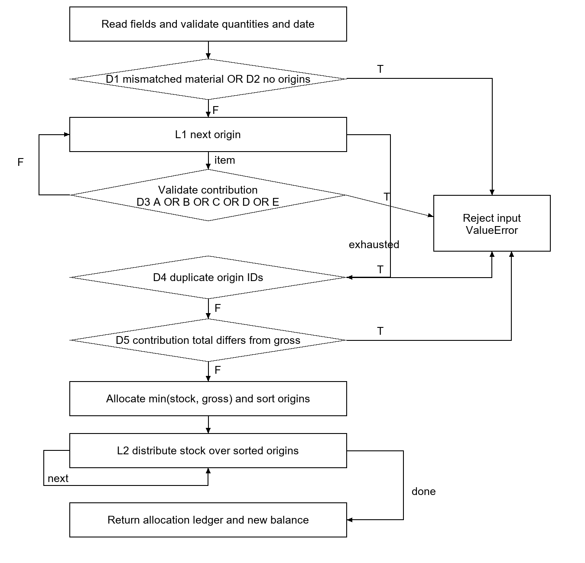
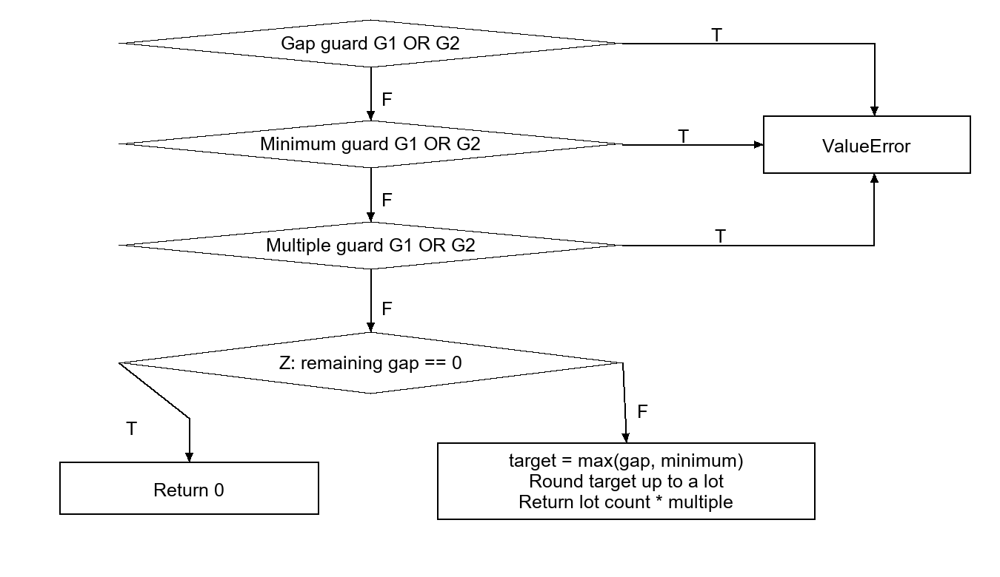

Experiment 4 | English technical report | 22 October 2026

This report tests inventory allocation M33 and purchase quantity rounding M43 in the implemented procedural material planning system. The 62 new test cases passed on the recorded source revision. Coverage claims below apply only to the stated units and input domain. M33 contains loops, so its complete path space is not exhausted by a finite suite.

Table 1.1 Experiment identity
| Item | Value |
| --- | --- |
| Group size | 2 members, confirmed by the user |
| Group and members | [Group number]  [Member A name and student ID]  [Member B name and student ID] |
| Design basis | E3 detailed design, M33 and M43; original E4 experiment guide |
| Execution | Automated local tests; no formal database writes |
| Status | Technical testing draft completed; actual group review and contributions pending |

## 1 Scope and acceptance criteria

The E4 guide requires at least as many selected modules as group members, meaningful complexity, all five white-box techniques for each module, and an English report. Two selected modules meet the numeric requirement. M33 supplies a five-condition predicate, a nested generator predicate, explicit loops, and business invariants. M43 supplies exact arithmetic and three calls to a shared compound input guard.

The source files are procedural Python functions. This experiment adds a test harness and report only. It does not replace the separate E5 system testing report or establish performance, database, browser, or deployment coverage.

## 2 Measurement method and boundaries

Every case is executed first against the original core.py and then against an in-memory instrumented copy of the same parsed syntax tree. The copy records executable statement sites, explicit if outcomes, explicit for entry and exhaustion, and actually evaluated Boolean atoms. Its result or exception and input immutability must match the original execution. The application file is never rewritten.

Table 2.1 Counting rules
| Criterion | Denominator and interpretation |
| --- | --- |
| Statement | Executable AST statement sites, including if and for sites; function headers and docstrings excluded. A multiline assignment is one site. |
| Branch | True and false outcomes of explicit if decisions plus entry and normal exhaustion of explicit for loops. Implicit library, comprehension and exception-dispatch branches are not included. |
| Condition | True and false outcomes of each executed atomic predicate, including the two atoms inside the any generator. Skipped atoms count as unobserved. |
| Condition combination | Feasible logical vectors per compound predicate, plus runtime short-circuit traces. Shadow evaluations use only safe built-in values; they are explicitly distinguished from executed atoms. |
| Path | M43 includes the integer guard and has eight finite control paths in scope. M33 reports 20 observed traces; no exhaustive percentage is assigned to its unbounded loop paths. |

M33 covers core.py lines 30 to 85, including its generator expression. The _integer and _date callees, standard library internals, comprehensions and lambdas are opaque at this boundary. M43 covers lines 90 to 97 and the _integer body at lines 8 to 9. Its 10 statement sites therefore include the two guard sites. M33 guard failures are supplementary tests, not a claim of callee coverage.

Tests assume record keys exist and use ordinary built-in values. Missing keys, adversarial Python objects, resource exhaustion and all malformed object shapes are outside the denominator. Tuple paths are deliberately invalid direct-unit inputs for testing the list-type guard; they are not asserted to be JSON input values.

For statement, branch and condition coverage, an exact set-cover search finds a smallest subset within the executed candidate suite. These minima do not prove a globally smallest suite across every possible input. Combination minima are stated per predicate; the full suite also retains boundary and business-oracle cases.

## 3 Inventory allocation design

M33 receives a demand and an available balance. It checks input invariants, allocates at most the available stock, distributes that allocation in BOM-path and origin-ID order, and returns new records. Neither caller-owned input may change. This control-flow refinement follows the M33 contract in E3.



D1 and D2 are two separate sequential checks in the source; the diagram groups their rejection edges for space. Helper exceptions also leave the function immediately. The measured decision IDs and exact source expressions are retained in whitebox-e4.json.

## 4 Inventory allocation cases and coverage

Default demand D1 belongs to task T1 and material X, is needed on 2026-10-30, and has gross quantity 10. Its origin O1 contributes 10 along [P, X]. Default available stock is 5. Every successful case checks [allocated, net, balance after, ordered origin allocations] against an independent expected value, as well as input immutability.

Table 4.1 M33 business and rejection cases
| Case | Change to default input | Expected result |
| --- | --- | --- |
| A00 to A03 | Available stock 0, 5, 10, 11 | Allocated/net/after: 0/10/0; 5/5/0; 10/0/0; 10/0/1 |
| A04 | O2 contributes 6 on P/Z/X; O1 contributes 4 on P/B/X; reverse input order | O1 gets 4, residual 0; O2 gets 1, residual 5 |
| A05 | Three origins O3=5, O1=2, O2=3 supplied out of order | O1 gets 2; O2 gets 3; O3 gets 0 and has residual 5 |
| A06 | Balance material Y | Reject mismatched material IDs |
| A07 | No origins | Reject missing origins |
| A08 | Two origins both named O2 | Reject duplicate origins |
| A09 | Gross becomes 11; contribution stays 10 | Reject quantity mismatch |
| A10 and A11 | Gross 0 or Boolean true | Reject integer or lower-bound violation |
| A12 | Needed date 2026-02-30 | Reject invalid calendar date |
| A13 | Available stock -1 | Reject negative stock |
| A14 | Origin contribution 0 | Reject nonpositive contribution |
| A15 | Path [P, 0] | Generator accepts prefix then rejects invalid element |
| A16 | First origin valid; second has empty ID | Validation loop rejects the second origin |

Table 4.2 M33 minimum candidate subsets
| Criterion | Measured | Smallest subset in this suite |
| --- | --- | --- |
| Statement | 28/28 | A06, A07, C01, A08, A09, A00 |
| Branch | 14/14 | A06, A07, A08, A00, A09, C01 |
| Condition | 22/22 | A06, A07, C12, C03, C02, C01, A08, A00, A09, C06, I2 |

All five explicit if decisions take both outcomes. Both for loops enter and exhaust. The 22 condition outcomes include the nested generator atoms. The six-case statement and branch subsets exercise the five distinct local rejection sites and a successful allocation. More cases are retained because coverage alone cannot establish arithmetic correctness or stable source attribution.

## 5 Inventory compound conditions

```python
A = not isinstance(origin_id, str)
B = not origin_id
C = not isinstance(bom_path, list)
D = not bom_path
E = any(not isinstance(part, str) or not part for part in bom_path)
D3 = A or B or C or D or E
U = not isinstance(part, str)
V = not part
```

For safe shadow evaluation, origin IDs are O1, an empty string, 1 or 0. Paths are a nonempty valid list, a nonempty invalid list, an empty list, and the corresponding tuples. A and B realize all four truth pairs. C, D and E realize six triples; the two triples with D=true and E=true are impossible because an empty built-in container has no invalid member. Consequently 24 of the 32 outer logical vectors are feasible in this defined domain.

Table 5.1 All feasible outer logical vectors
| Case | A B C D E | Origin ID | Path | Expected and actual |
| --- | --- | --- | --- | --- |
| C00 | F F F F F | 'O1' | ['X'] | Return 5/5/0 |
| C01 | F F F F T | 'O1' | [''] | ValueError |
| C02 | F F F T F | 'O1' | [] | ValueError |
| C03 | F F T F F | 'O1' | ('X',) | ValueError |
| C04 | F F T F T | 'O1' | ('',) | ValueError |
| C05 | F F T T F | 'O1' | () | ValueError |
| C06 | F T F F F | '' | ['X'] | ValueError |
| C07 | F T F F T | '' | [''] | ValueError |
| C08 | F T F T F | '' | [] | ValueError |
| C09 | F T T F F | '' | ('X',) | ValueError |
| C10 | F T T F T | '' | ('',) | ValueError |
| C11 | F T T T F | '' | () | ValueError |
| C12 | T F F F F | 1 | ['X'] | ValueError |
| C13 | T F F F T | 1 | [''] | ValueError |
| C14 | T F F T F | 1 | [] | ValueError |
| C15 | T F T F F | 1 | ('X',) | ValueError |
| C16 | T F T F T | 1 | ('',) | ValueError |
| C17 | T F T T F | 1 | () | ValueError |
| C18 | T T F F F | 0 | ['X'] | ValueError |
| C19 | T T F F T | 0 | [''] | ValueError |
| C20 | T T F T F | 0 | [] | ValueError |
| C21 | T T T F F | 0 | ('X',) | ValueError |
| C22 | T T T F T | 0 | ('',) | ValueError |
| C23 | T T T T F | 0 | () | ValueError |

All 24 cases matched their expected results and their independently evaluated logical vectors. Each single-origin test supplies one vector, so 24 is the per-predicate minimum when each vector is represented by a separate invocation. This is not a global lower bound if a single invocation is allowed to contain several valid origins.

## 5 Continued short circuit interpretation

Table 5.2 Executed outer predicate traces
| Witness | Observed A B C D E | Reason |
| --- | --- | --- |
| C12 | T - - - - | First atom rejects the ID type |
| C06 | F T - - - | Empty string ID |
| C03 | F F T - - | Tuple path rejected as non-list |
| C02 | F F F T - | Empty list |
| C01 | F F F F T | Invalid member in nonempty list |
| C00 | F F F F F | Valid origin |

A dash means the application did not evaluate that atom. In particular C12 through C23 do not execute the path checks. Their remaining truth values are explanatory shadow values, never additional runtime condition hits. The six traces above are the six feasible short-circuit outcomes of the outer OR expression.

Table 5.3 Inner generator combinations
| Case | Path member | Logical U V | Runtime U V | Result |
| --- | --- | --- | --- | --- |
| I0 | 'X' | F F | F F | Accept |
| I1 | '' | F T | F T | Reject |
| I2 | 1 | T F | T - | Reject |
| I3 | 0 | T T | T - | Reject |

Four cases are the per-predicate minimum for the four logical U/V pairs. Runtime evaluation has only three short-circuit traces because V is skipped when U is true. A15 also checks generator continuation after a valid member. Empty paths reject before the generator is entered; this structural dependency is not counted as missing coverage.

Table 5.4 Single condition combinations for other M33 decisions
| Decision | False witness | True witness |
| --- | --- | --- |
| D1 material IDs differ | A00 | A06 |
| D2 no origins | A00 | A07 |
| D4 duplicate IDs | A00 | A08 |
| D5 contribution total differs | A00 | A09 |

For condition-combination coverage of all M33 predicates, use C00 to C23, I0 to I3, A06 to A09. I0 and I1 repeat combinations already reached by C00 and C01 and may be omitted. This yields a 30-case sufficient suite. The per-predicate minima and feasible-vector argument above are the optimization claim; no global minimum for this combined suite is asserted.

## 6 Inventory paths and loop limits

Twenty distinct measured traces were observed when statements, decisions, conditions and explicit loop events are retained and helper internals are collapsed. This is a coverage inventory of the executed suite, not an exhaustive list of feasible control paths. The trace sequences are saved in the machine-readable evidence file.

Table 6.1 One witness for each observed M33 trace
| Trace | Witness | Distinguishing outcome or input |
| --- | --- | --- |
| A-path-01 | A00 | One origin; stock boundary |
| A-path-02 | A04 | Two origins, reversed lexical order, partial second allocation |
| A-path-03 | A05 | Three origins; depletion before final origin |
| A-path-04 | A06 | ValueError: material IDs must match |
| A-path-05 | A07 | ValueError: a demand requires origins |
| A-path-06 | A08 | ValueError: origin IDs must be unique within a demand |
| A-path-07 | A09 | ValueError: origin quantities must sum to gross demand |
| A-path-08 | A10 | ValueError: gross_qty must be an integer >= 1 |
| A-path-09 | A12 | ValueError: invalid calendar date |
| A-path-10 | A13 | ValueError: available_qty must be an integer >= 0 |
| A-path-11 | A14 | ValueError: contribution_qty must be an integer >= 1 |
| A-path-12 | C00 | Outer origin predicate feasible logical vector; skipped atoms are not observed |
| A-path-13 | C01 | Outer origin predicate feasible logical vector; skipped atoms are not observed |
| A-path-14 | C02 | Outer origin predicate feasible logical vector; skipped atoms are not observed |
| A-path-15 | C03 | Outer origin predicate feasible logical vector; skipped atoms are not observed |
| A-path-16 | C06 | Outer origin predicate feasible logical vector; skipped atoms are not observed |
| A-path-17 | C12 | Outer origin predicate feasible logical vector; skipped atoms are not observed |
| A-path-18 | I2 | Inner path-part predicate logical vector |
| A-path-19 | A15 | Generator valid prefix then invalid part |
| A-path-20 | A16 | Outer validation loop accepts first origin then rejects second |

The loop-focused suite uses A07 for zero origins and early rejection, A00 for one origin, A04 for two, A05 for three, and A16 for rejection after the first valid origin. C02 rejects an empty path, C00 accepts a one-member path, A00 visits two valid path members, and A15 visits a valid member followed by an invalid one. Zero origins never reaches the allocation loops because the contract rejects it first.

An arbitrary number of origins or path members generates arbitrarily long traces. Therefore neither 20 observed traces nor the loop cases justify 100 percent path coverage. Full bounded-path coverage is also not claimed: the suite samples loop lengths and rejection positions rather than enumerating every combination. Finite source-level statement, explicit branch, and atomic-condition obligations are met; exhaustive M33 path coverage remains inapplicable without an agreed finite bound and expanded enumeration.

## 7 Purchase rounding design

M43 returns zero for zero shortage. Otherwise it rounds the greater of the shortage and minimum order quantity upward to a multiple of the purchase lot. Exact integer arithmetic is required, including above the JavaScript safe-integer threshold when the function is called directly in Python. The web input limits remain separate.

```python
def round_purchase_qty(remaining_gap, minimum_qty, purchase_multiple):
    _integer(remaining_gap, "remaining_gap")
    _integer(minimum_qty, "minimum_qty")
    _integer(purchase_multiple, "purchase_multiple", 1)
    if remaining_gap == 0:
        return 0
    target = max(remaining_gap, minimum_qty)
    lot_count = (target + purchase_multiple - 1) // purchase_multiple
    return lot_count * purchase_multiple

def _integer(value, name, minimum=0):
    if type(value) is not int or value < minimum:
        raise ValueError(...)
```

The ellipsis abbreviates the error message only; executed source and exact messages are recorded in the evidence file. G1 means type(value) is not int; G2 means value < minimum. The guard decision is G1 OR G2. Built-in max is a call, not an invented source if branch.



## 8 Purchase cases and all five coverage criteria

Table 8.1 M43 expected and actual results
| Case | Gap minimum multiple | Expected and actual |
| --- | --- | --- |
| P00 | [0, 100, 10] | 0 |
| P01 | [620, 100, 100] | 700 |
| P02 | [1, 25, 10] | 30 |
| P03 | [20, 0, 10] | 20 |
| P04 | [1, 0, 1] | 1 |
| P05 | [9007199254740993, 0, 10] | 9007199254741000 |
| P10 | [True, 0, 1] | ValueError: remaining_gap must be an integer >= 0 |
| P11 | [-1, 0, 1] | ValueError: remaining_gap must be an integer >= 0 |
| P12 | [5, False, 1] | ValueError: minimum_qty must be an integer >= 0 |
| P13 | [5, -1, 1] | ValueError: minimum_qty must be an integer >= 0 |
| P14 | [5, 0, 1.5] | ValueError: purchase_multiple must be an integer >= 1 |
| P15 | [5, 0, 0] | ValueError: purchase_multiple must be an integer >= 1 |
| P16 | [-1.5, 0, 1] | ValueError: remaining_gap must be an integer >= 0 |

Table 8.2 M43 minimum candidate subsets
| Criterion | Measured | Smallest subset in this suite |
| --- | --- | --- |
| Statement | 10/10 | P00, P01, P10 |
| Branch | 4/4 | P01, P00, P10 |
| Condition | 6/6 | P01, P00, P11, P10 |

Three cases are necessary for all statement sites and explicit decision outcomes: one zero return, one positive return, and one guard exception. Four are necessary for actual atomic-condition coverage because a wrong-type failure skips the lower-bound test, while a below-minimum integer evaluates that test true. The recorded subset achieves these bounds.

Table 8.3 Guard logical combinations
| Witness | Value and minimum | G1 G2 | Executed G1 G2 |
| --- | --- | --- | --- |
| P00 | 0 and 0 | F F | F F |
| P11 | -1 and 0 | F T | F T |
| P14 | 1.5 and 1 | T F | T - |
| P16 | -1.5 and 0 | T T | T - |

The numeric-domain combination suite is P00, P01, P11, P14 and P16. It covers all four logical guard combinations and both outcomes of Z. Five cases are minimal for these obligations in this suite: two normal outcomes and three distinct rejecting guard vectors. G0 to G3 additionally test the shared guard directly. For nonnumeric values, G2 may not be defined; short-circuit rejection is the applicable obligation, not an invented truth value.

## 9 Purchase path coverage

Table 9.1 All eight finite M43 paths
| Path | Witness | Control sequence |
| --- | --- | --- |
| P-path-1 | P00 | Three guards accept; Z true; return zero |
| P-path-2 | P01 | Three guards accept; Z false; calculate and return |
| P-path-3 | P10 | First guard G1 true; reject |
| P-path-4 | P11 | First guard G1 false and G2 true; reject |
| P-path-5 | P12 | First guard accepts; second guard G1 true; reject |
| P-path-6 | P13 | First guard accepts; second guard G1 false and G2 true; reject |
| P-path-7 | P14 | First two guards accept; third guard G1 true; reject |
| P-path-8 | P15 | First two guards accept; third guard G1 false and G2 true; reject |

Each guard has two rejecting short-circuit paths and one accepting path. Any rejection terminates the call. After three successful guards, Z has two normal exits. This gives six rejecting paths plus two normal paths, all witnessed above. Eight invocations are necessary and sufficient to cover the eight complete paths. P16 repeats the first wrong-type path while adding a different logical guard vector.

The path claim abstracts the internals of type, integer comparison, max and Python arithmetic, and excludes hostile user-defined objects and resource exhaustion. It is a complete result for the declared source control-flow boundary, not all interpreter paths.

## 10 Validation strength and regressions

All 62 E4 cases passed, including original-versus-instrumented equivalence and unchanged inputs. Twelve evidence checks passed. Two existing regression suites were rerun on the same application source: 38 of 38 core checks and 114 of 114 planner checks. These counts are separate suites with overlapping scenarios, not 214 unique requirements.

Table 10.1 Targeted mutation checks
| Temporary defect | First detecting case |
| --- | --- |
| Zero gap incorrectly buys minimum | P00 |
| Floor rounding loses a purchase lot | P01 |
| Minimum order ignored | P02 |
| Origin quantity mismatch accepted | A09 |
| Duplicate origins accepted | A08 |
| Allocation overdraws balance | A00 |

All six deliberate defects were detected. Mutations were compiled only in temporary memory; no application file was changed. These checks show that the independent expected outputs can reject representative wrong implementations. They do not constitute an exhaustive mutation score.

## 11 Evidence and reproducibility

Execution time: 2026-10-22T12:12:14.729815+08:00. Python: 3.12.14 (main, Aug 25 2026, 14:01:42) [MSC v.1944 64 bit (AMD64)]. Platform: Windows-11-10.0.26200-SP0.

Table 11.1 Evidence files relative to the project root
| File | Purpose |
| --- | --- |
| material-planning/core.py | Unmodified implementation under test |
| material-planning/verify_whitebox.py | Case definitions, AST observers, exact subset search and mutation checks |
| material-planning/results/whitebox-e4.json | Inputs, expected and actual results, complete traces, site manifest, coverage and checks |
| material-planning/results/verification.json | Fresh 38-check core regression result |
| material-planning/results/planner-verification.json | Fresh 114-check planner regression result |
| specs/material-requirements-planning/e4/verification-report.json | Document and source consistency checks; page QA recorded separately |

Source SHA256: 01f67b289617224e6b10e39b189482f32806580538c7c6208c1496f0cd658ca8

Harness SHA256: 4e352a2bdd944ad8139e36e87a67215e9a64f2ce58b7e5f36c0d2dbbb14511cd

To reproduce, run verify_whitebox.py, verify_core.py and verify_planner.py using the recorded Python runtime from any working directory. Each script resolves its own application directory. Only result files are written; the production SQLite database is not part of this experiment. Rebuild this report after regenerating evidence so timestamps and hashes stay aligned.

The source report E4 brief from September 2026 is retained as historical work. This report supersedes its one-module technical coverage and its outdated statements about unimplemented system features. The original experiment guide and E3 design document remain unchanged.

## 12 Findings and remaining limits

The tested units preserve stock bounds and demand quantities, distribute stock deterministically, reject inconsistent origins, and compute exact purchase lots under the tested inputs. Full measured statement, explicit branch and atomic-condition obligations were achieved in the specified source boundary. Logical combination tables explain feasible and infeasible vectors without crediting skipped atoms as execution.

M33 cannot receive an exhaustive unbounded-path completion claim. A stricter bounded-path requirement would require an agreed maximum number of origins and path members and additional enumeration. E5 equivalence classes, boundary-value system scenarios and saved-plan user journeys are the next technical deliverable. Database and browser behavior were not rerun in this E4 round.

## 13 Group records to complete

The following fields are deliberately pending. Automated execution establishes technical evidence; it does not establish who performed academic work or whether an all-member review meeting occurred. Each member should record only actual work and understanding.

Table 13.1 Actual member tasks
| Member | Identity | Actual task and evidence |
| --- | --- | --- |
| A | [Name and student ID] | [Fill after confirmation: work actually performed, artifact or case IDs, dates] |
| B | [Name and student ID] | [Fill after confirmation: work actually performed, artifact or case IDs, dates] |

### 13.1 Review meeting record

Date and location: [To be recorded after the meeting]. Participants: [Both actual members]. Chair and recorder: [To be confirmed].

Agenda: verify the two-module scope; check independent expected values; review the difference between logical vectors and executed short-circuit atoms; confirm the M33 path limitation; check English terminology and consistency with E3; record agreed corrections and owners.

Discussion record: [Actual questions, replies and decisions]. Corrections and evidence: [Actual changes and recheck results]. Review outcome: [Accepted, accepted with corrections, or requires further work]. No review outcome is asserted in this draft.

### 13.2 Individual contribution statements

Member A: [Describe actual module analysis, case design, test execution, interpretation and lessons learned. Cite specific case IDs or report sections.]

Member B: [Describe actual module analysis, case design, test execution, interpretation and lessons learned. Cite specific case IDs or report sections.]

### 13.3 Submission checklist

Technical report: prepared with recorded scope limitations. English language: used throughout the report. Actual member tasks: pending. Literal all-member review record: pending. Personal contributions: pending. Final course submission: not performed.

## 14 Source materials

[1] Course handout. Experiment 4 Using White Box Testing in Unit Testing [Z]. Supplied original DOC, read on 21 October 2026.

[2] Project working document. E3 Detailed Design of the Material Planning System [R]. English technical draft, 15 October 2026.

[3] Project implementation and evidence. core.py and whitebox-e4.json [CP]. Source hash and execution timestamp recorded in Section 11.
